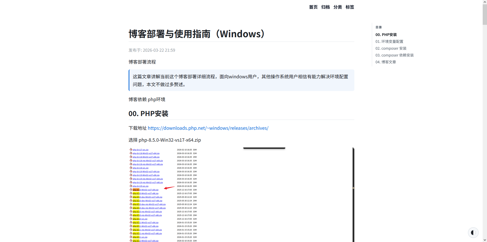
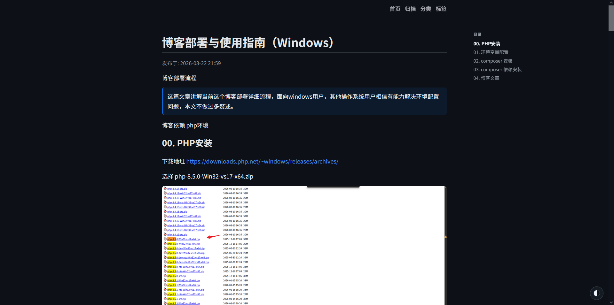

# the0n3 blog

<div align="center">

一个用 PHP 编写的静态博客生成器。Markdown 写作，构建为纯静态站点，推送后由 GitHub Actions 自动发布。





</div>

## 这是什么

读取带 YAML Front Matter 的 Markdown 文件，生成首页、文章页、分类页、标签页、归档页与独立页面，输出到 `dist/` 目录，可部署到任意静态服务器。

没有数据库，没有后台，也不依赖 Node 工具链 —— 整个构建过程就是一个 PHP 脚本。

## 与常见方案的区别

- 零前端工具链：不需要 Node、npm 或 webpack，`composer install` 之后就能构建
- 构建只依赖 PHP：装了 PHP 8.1+ 的机器即可生成整站，不需要额外运行时
- 输出可控：模板是普通 PHP 文件，调整版式不需要理解框架约定

## 特性

### 写作
- Markdown 加 YAML Front Matter，文章可用子目录组织
- 内置 Callout 提示块（`[!NOTE]`、`[!TIP]` 等）
- 独立页面：关于、友链等静态页与文章分开管理

### 输出
- 自动生成首页分页、归档页，分类与标签各有独立落地页
- 构建期生成全文搜索索引，前端按需加载
- 图片自动补 `decoding`、`loading` 与真实宽高，支持点击放大

### 部署
- GitHub Actions 自动构建并发布到 `gh-pages` 分支
- sitemap 的 `lastmod` 取自 git 提交历史，只收录内容页
- 可选 IndexNow，部署后主动推送新增 URL

### 阅读
- 明暗主题切换，评论区主题跟随站点
- 目录联动高亮、阅读进度条、导航栏自动显隐
- Prism 代码高亮，可选 Giscus 评论

## 快速开始

```bash
git clone https://gh-proxy.org/https://github.com/Apursuit/the0n3-blog-template.git
cd the0n3-blog-template
composer install
php main.php build
php -S localhost:8000 -t dist/
```

访问 http://localhost:8000 预览。

环境准备、写作流程、GitHub Pages 部署与 Giscus 配置的完整说明见[部署教程](https://the0n3.top/posts/blog-deployment/)。

## 文档

- [部署教程](https://the0n3.top/posts/blog-deployment/)：从环境准备到线上发布
- [项目结构与实现细节](https://the0n3.top/posts/347b34/)：构建流程、数据结构、模板清单
- [Markdown 语法](https://the0n3.top/posts/d716e5/)：常用写法与 Callout 语法

## 技术栈

PHP 8.1+、erusev/parsedown、symfony/yaml，前端使用 Prism。无框架、无数据库、无 Node。

## 许可证

MIT。欢迎提交 Issue 和 Pull Request。
