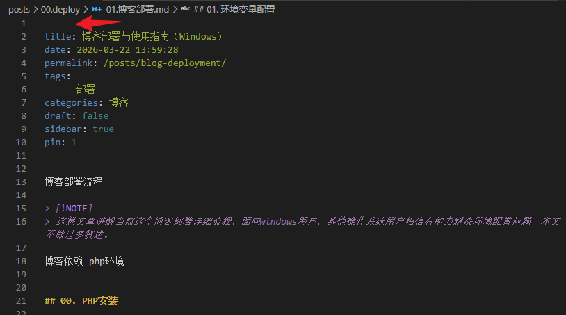
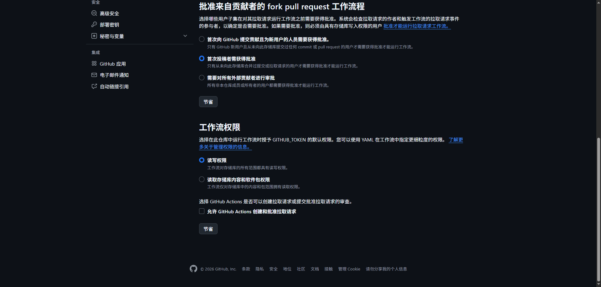
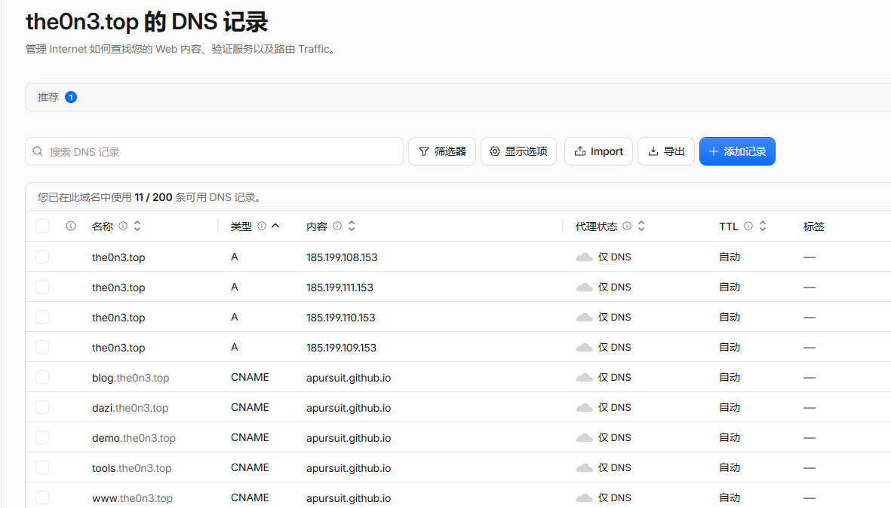
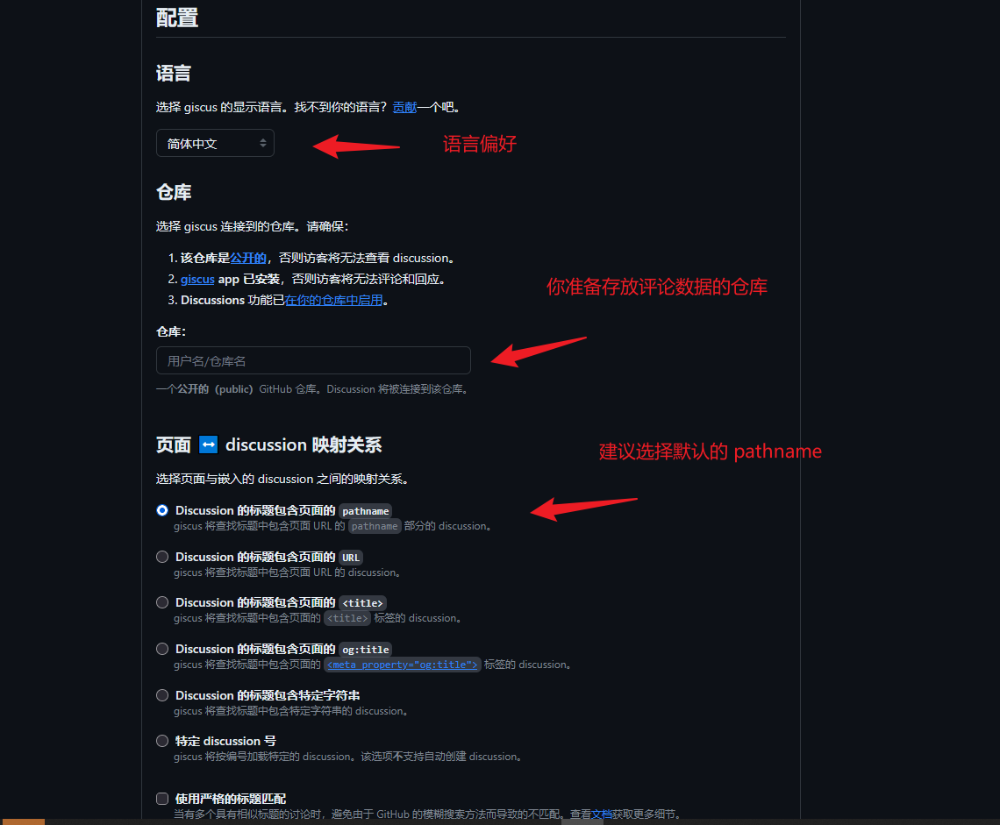
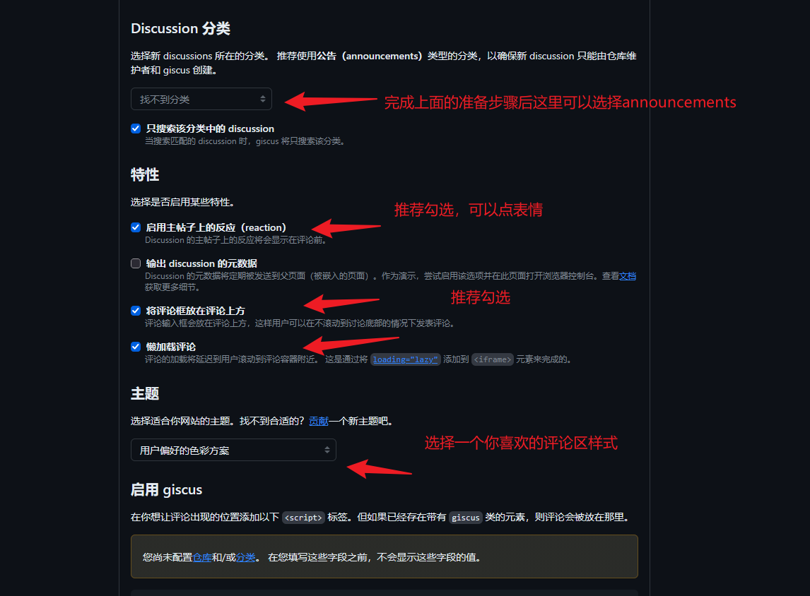

## 1. 环境准备

确保您的本地环境已安装以下组件：
* PHP ≥ 8.1
* Composer
* Git

安装 PHP、Composer、git：

windows

```bash
# windows powershell，管理员权限运行
# 过程中会提示是否修改执行策略，输入 Y 确认。
Set-ExecutionPolicy RemoteSigned -Scope CurrentUser
irm get.scoop.sh | iex
scoop install php composer git
```

MacOS

```bash
# macOS
brew install php composer git
```

Ubuntu/Debian

```bash
# Ubuntu/Debian  
sudo apt-get install php composer git
```

## 2. 获取项目与安装依赖

```bash
git clone https://gh-proxy.org/https://github.com/Apursuit/the0n3-blog-template.git
cd the0n3-blog-template
```

composer 依赖安装：

```bash
composer install
```

如果希望提交历史从零开始，可以手动删除项目根目录下的 `.git` 文件夹，再重新初始化仓库：

```bash
git init
```

这一步是可选的。删除 `.git` 只是清掉模板自带的提交记录，不删也不影响博客的正常使用与部署。

## 3. 开始写作

博客结构如下，你可以在 posts/ 目录下创建 Markdown 文件，也可以创建子目录来组织文章，例如 posts/2026/03/22/test.md。

```plaintext
.
├── assets/      # 前端资源（CSS / JS / Prism 代码高亮）
├── config/      # 站点配置目录
├── logs/        # 构建日志目录（默认追加写入，超过14天自动清空重写）
├── posts/       # Markdown 文章源文件（支持子目录嵌套）
├── public/      # 静态资源（构建时会原样拷贝至 dist/ 根目录）
├── images/      # 图片资源（构建时会原样拷贝至 dist/images/）
├── src/         # 核心 PHP 业务逻辑代码
├── templates/   # HTML 页面模板
├── dist/        # 构建后的最终静态站点输出目录（执行 build 后生成）
└── main.php     # CLI 工具统一入口文件
```

Markdown 文章需要包含 YAML Front Matter，格式如下：

```yaml
---
title: Hello World
date: 2026-03-20
permalink: /posts/hello-world/
tags:
    - 标签1
categories:
    - 分类1
draft: false
sidebar: true
---
```

首尾两行的 `---` 不能省略，且必须顶格写在文件最开头。

运行以下命令快速生成新文章模板：

```bash
php main.php new "文章标题"
```

这会打印出一个包含 Front Matter 的 Markdown 模板。在 `posts/` 下新建一个 `.md` 文件，把模板内容复制进去即可。

> 注意：`---` 分隔符必须顶格，且必须出现在文件开头，否则 front matter 无法被解析。



如果文章包含图片资源，可以放在 images 目录下，例如 images/testdir/1.png，然后在 Markdown 中使用`/images/xxxx/xx.png`路径引用。

```markdown

```

文章书写完成后，运行构建命令：

```bash
php main.php build
```

博客构建的产物在 dist目录，开启本地 web 服务，访问 http://localhost:8000 预览效果：

```bash
php -S localhost:8000 -t dist/
```

访问 http://localhost:8000 即可看到博客首页，至此，你已经成功搭建了自己的博客！后续在 posts/ 目录下添加 Markdown 文章，重复构建流程即可更新博客内容。

## 4. 部署指南

要让其他人访问你的博客，需要把源码推送到 GitHub 仓库。推送走 SSH 认证，公钥的生成与添加步骤参考 GitHub 官方文档：[生成新的 SSH 密钥并添加到 ssh-agent](https://docs.github.com/zh/authentication/connecting-to-github-with-ssh/generating-a-new-ssh-key-and-adding-it-to-the-ssh-agent#adding-your-ssh-key-to-the-ssh-agent)。这块涉及不同平台的具体操作，本文不展开，遇到不理解的地方可以让 AI 协助解释，配置完成后回到本文继续。

本模板已配置好完整的自动化部署流程。当您将本地更新推送到 GitHub 仓库时，GitHub Action 会自动触发构建，并把生成的静态文件推送到 gh-pages 分支，不需要在本地手动 build 再上传。

先在 GitHub 新建一个仓库，仓库名设为 `username.github.io`（其中 username 替换为你的 GitHub 用户名，大小写完全一致），这样 GitHub Pages 才能正确识别并部署。

然后把本地仓库的远程地址指向这个新仓库，注意用的是 SSH 地址：

```bash
git remote set-url origin git@github.com:<你的用户名>/<你的仓库名>.git
git remote -v   # 确认 origin 已指向自己的仓库
```

推送前还要给 Actions 开启写入权限，否则它无法把构建产物推送到 gh-pages 分支。在 GitHub 仓库页面进入 Settings ➔ Actions ➔ General，向下滚动至 Workflow permissions 部分，选择 Read and write permissions 并保存。



完成后提交并推送，首次推送用 `-u` 建立本地与远程的跟踪关系：

```bash
git add .
git commit -m "init"
git push -u origin main
```

推送后打开仓库的 Actions 页面，可以看到构建流程正在运行；构建成功后，站点会自动发布到 gh-pages 分支。

## 自定义域名（可选）

GitHub Pages 默认提供的访问地址是 `username.github.io`。使用自己的域名分两步：先在 DNS 里配解析记录，再在仓库里声明这个域名。

顶级域名（如 example.com）在域名服务商后台添加四条 A 记录，主机记录填 @（或留空），记录值为 185.199.108.153、185.199.109.153、185.199.110.153、185.199.111.153。

如果有多个 GitHub Pages 项目，用子域名（如 blog.example.com）区分：添加一条 CNAME 记录，记录值为 `username.github.io`。两种方式按域名类型二选一，不要混用。



DNS 配好后还要在仓库里声明域名，GitHub 收到请求时靠它判断该返回哪个仓库。本模板的 CNAME 在 public/ 目录下，把内容改成你的域名即可，只写域名本身，例如 example.com。

还需要同步两处配置，否则 sitemap 里的地址不对，搜索引擎也难以发现它。在 `config/site.php` 中把 `url` 改成你的自定义域名：

```php
'url' => 'https://你的自定义域名',
```

在 `public/robots.txt` 末尾补一行，指向 sitemap 的绝对地址：

```txt
Sitemap: https://你的自定义域名/sitemap.xml
```

`url` 留空时构建会跳过 sitemap 生成并输出一条警告，博客本身仍可正常访问。

## Giscus 评论系统（可选）

默认关闭。如需启用，评论数据会存放在你 GitHub 仓库的 Discussions 中，读者需登录 GitHub 账号才能评论。

**启用前需要完成三件准备：**

1. **仓库必须公开**：使用你的博客仓库或新建仓库专门用来存放评论数据。Giscus 无法访问私有仓库的 Discussions。
2. **开启 Discussions**：在准备作为存放评论数据的仓库 Settings → General → Features 中勾选 开启 Discussions。
3. **安装 Giscus App**：访问 [github.com/apps/giscus](https://github.com/apps/giscus) 安装，授权它访问你的仓库。

获取配置参数：

打开 [giscus.app/zh-CN](https://giscus.app/zh-CN)，填入你的仓库名（格式 `用户名/仓库名`），选择 Discussion 分类（推荐 Announcements，该分类下只有仓库维护者和 Giscus 能创建讨论，可防垃圾评论）。





页面下方会生成一段代码，从中复制四个值：`repo`、`repo-id`、`category`、`category-id`，将上述四个值填入 `config/site.php` 的 giscus 配置中，并把 `enabled` 参考修改为 `true`，保存后重新构建即可生效。

博客更多细节请阅读

- [项目结构与实现细节](/posts/347b34/)
- [markdown语法](/posts/d716e5/)