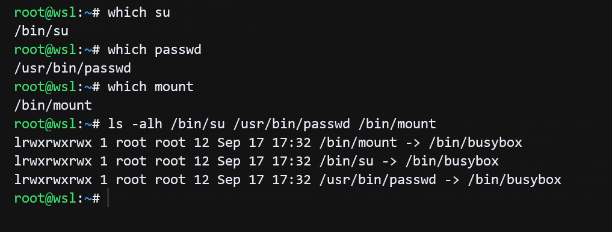
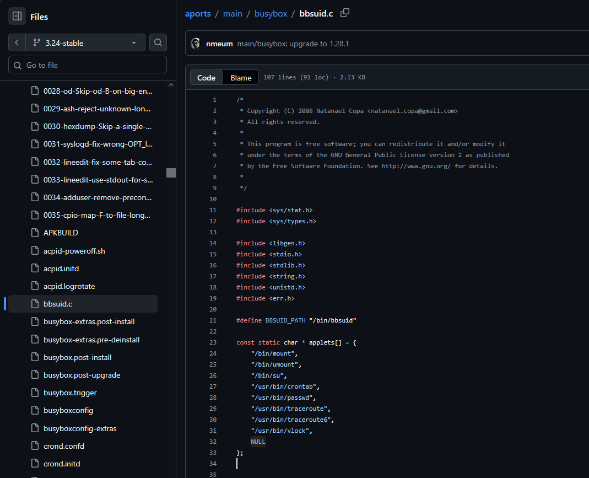
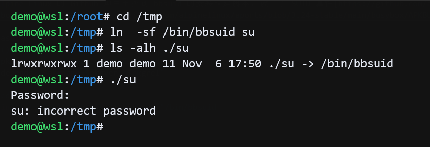

这次来聊聊 bbsuid 是什么，当你在终端运行 AI Agent 自动化打靶机遇到 Alpine Linux 的操作系统，发现一个陌生的 suid 程序 bbsuid ，Agent 几乎不可避免地把注意力集中在分析这个程序上，**已知暂时不能用来提权或恶意利用**。

在 Alpine Linux及一些固件会使用 busybox 作为系统的核心工具集，busybox 是一个单一的可执行文件，包含了许多常用的 Unix 工具和命令，体积小巧，适合嵌入式系统和资源受限的环境。在 Linux 系统中会涉及到权限提升和安全性问题，尤其是当某些程序被设置为 SUID（Set User ID）时，它们可以以文件所有者的权限运行，而不仅仅是执行它们的用户的权限。

Busybox 中实现了 su、passwd、mount这些涉及到权限提升和校验的 applet，在常见发行版上，su、passwd等程序通常是 SUID root 的，这意味着它们可以以 root 用户的权限运行，从而允许普通用户执行需要更高权限的操作。但放在 Alpine Linux 里，这些程序集成在 busybox 里，如果给 busybox 设置了 SUID root 权限，那么所有的 applet 都会以 root 权限运行，这就带来了潜在的安全风险。因此，Alpine Linux 的开发者们在 busybox 中引入了 bbsuid 这个程序，作为 busybox 中涉及权限操作如su、passwd、mount等 applet 的入口，设计上避免了让整个 BusyBox 二进制文件拥有 SUID 权限，只对必要的命令进行包装，减少了攻击面。




在 Alpine Linux 的 Github 项目里找到 bbsuid 的安装构建脚本，设置了 SUID 属性[https://github.com/alpinelinux/aports/blob/3.24-stable/main/busybox/APKBUILD#L300](https://github.com/alpinelinux/aports/blob/3.24-stable/main/busybox/APKBUILD#L300)

```bash
suid() {
	pkgdesc="suid binaries of Busybox"
	depends="$pkgname=$pkgver-r$pkgrel"

	cd "$_dyndir"
	install -Dm4111 bbsuid "$subpkgdir"/bin/bbsuid
}
```

程序源码[https://github.com/alpinelinux/aports/blob/3.24-stable/main/busybox/bbsuid.c](https://github.com/alpinelinux/aports/blob/3.24-stable/main/busybox/bbsuid.c)，源码总共106行。

在源码里维护了一份白名单 applet 路径。



这份白名单路径在 root 执行 bbsuid --install 时，被用作软链接的创建位置，/bin/su、/usr/bin/passwd 等路径都会被替换成指向 /bin/bbsuid 的软链接。

```c
static int install_links(void)
{
	int i, r = 0;
	/* we don't want others than root to install the symlinks */
	if (getuid() != 0)
		errx(1, "Only root can install symlinks");

	for (i = 0; applets[i] != NULL; i++) {
		const char *a = applets[i];
		struct stat st;
		if (lstat(a, &st) == 0 && S_ISLNK(st.st_mode))
			unlink(a);
		if (symlink(BBSUID_PATH, a) < 0)
			r++;
	}

	return r;
}
```

在程序主函数中，调用 is_valid_applet() 来校验传入的 applet 是否在白名单中，如果是，则调用 exec_busybox() 来执行对应的 applet。

```c
if (is_valid_applet(app))
		return exec_busybox(app, argc, argv);
```


在校验是否属于白名单 applet 时去掉了路径，仅比对文件名。这意味着校验不关心调用者从哪个目录执行、也不关心 argv[0] 的完整路径，只认文件名。理论上，如果在某个可写目录创建一个名为 su 的软链接指向 /bin/bbsuid，执行它同样能通过白名单校验。真正的约束在于：bbsuid 最终调起的是 BusyBox 的 su，而 su 自身会要求密码认证；


```c
static int is_valid_applet(const char *str)
{
	int i;
	for (i = 0; applets[i] != NULL; i++) {
		const char *a = applet_from_path(applets[i]);
		if (strcmp(applet_from_path(str), a) == 0)
			return 1;
	}
	return 0;
}
```

测试：



在白名单校验通过时，调用 execv 执行对应的 applet。

```c
int exec_busybox(const char *app, int argc, char **argv)
{
	char **newargv = malloc((argc + 2) * sizeof(char *));
	int i;
	newargv[0] = "/bin/busybox";
	newargv[1] = (char *)app;
	for (i = 1; i < argc; i++)
		newargv[i+1] = argv[i];
	newargv[argc+1] = NULL;
	execv(newargv[0], newargv);
	perror(newargv[0]);
	free(newargv);
	return 1;
}
```

那么，在 Alpine Linux 下如果调用了su、passwd、mount等 applet，实际上是通过 bbsuid 这个 suid 属性的程序作为入口，检查传入的 applet 是否在白名单中，如果是，则进入 busybox 并完成对应的操作。bbsuid中没有涉及到权限操作，busybox继承入口的suid属性带来的euid=0，在applet具体执行时，是否涉及降权操作，需要到busybox中查看。