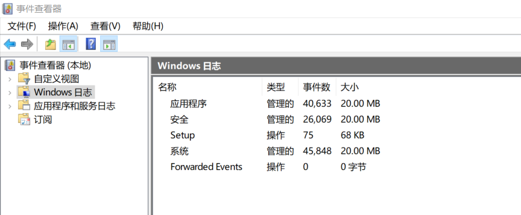
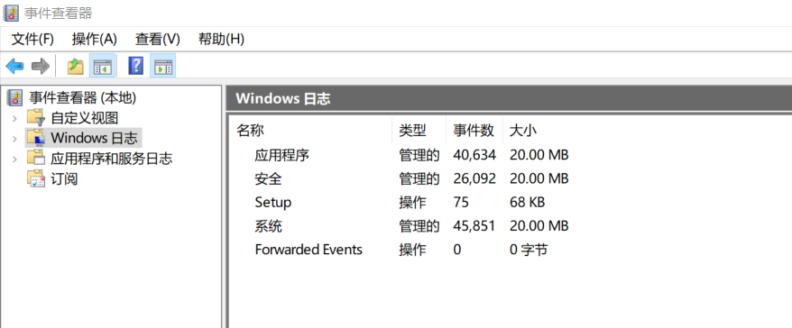
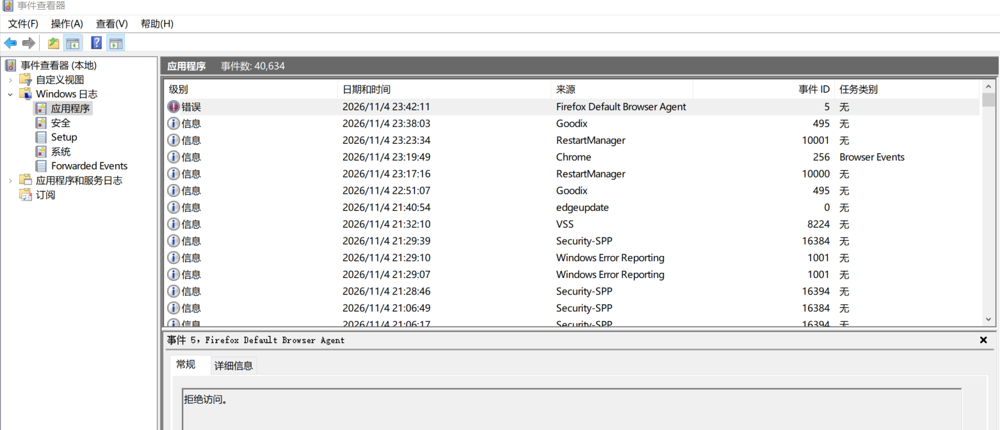

## 介绍

事件查看器是 Windows 内置的日志查看工具，系统各组件产生的运行记录都汇聚于此。排查时主要用它确认以下几类问题：

- 账户与登录：谁在什么时间登录，失败了几次
- 服务与驱动：某个服务为何起不来，驱动是否加载失败
- 应用程序：软件崩溃时出错的是哪个模块
- 审计与策略：审核策略是否被改动，日志是否被清除

Windows 日志记录系统全局层面的事件，无论哪个软件或组件，只要涉及系统级运行状态，都会汇聚到这几个通道里；应用程序和服务日志则按具体组件细分，排障特定功能时更有针对性。

可以通过以下几种方式打开事件查看器：

- 使用快捷键 `Win + R` 打开运行窗口，输入 `eventvwr.msc` 并按下回车键。
- 通过开始菜单搜索“事件查看器”并点击打开。
- 右键点击“此电脑”或“我的电脑”，选择“管理”，然后在左侧导航栏中选择“事件查看器”。
- 右键“开始”按钮，选择“事件查看器”。

左侧导航栏有四个分类，其中前两类是日志本体，后两类是使用日志的机制：

- 自定义视图：保存的筛选条件，并非日志本身。条件可跨通道汇总，系统预置「管理事件」一项，集中显示各通道的警告与错误。
- Windows日志：按系统、应用程序、安全等大类划分的日志本体。
- 应用程序和服务日志：按具体组件细分的日志本体。
- 订阅：从多台计算机集中收集事件的配置入口，本身不产生记录。收集结果统一写入「转发事件」，配置依赖 WinRM。

## Windows日志

Windows日志下又包含了系统、应用程序、安全、设置和转发事件等日志类型。

应用程序：软件崩溃、数据库报错等。  
安全：登录成功/失败、账户变更等审计事件（普通权限可能无法查看完整内容）。  
系统：驱动、服务、硬件相关的错误和警告。  
安装：补丁和软件安装记录。  
转发事件：从其他电脑集中收集来的日志。  

### 高频事件 ID

**系统排障相关**

`41` Kernel-Power。记录系统在未正常关机的情况下重新启动。与 6008 同时出现时，可作为异常断电或蓝屏重启的判定依据。

`1000` 应用程序错误。记录某个应用程序发生崩溃。事件详情中包含出错进程的映像名称，可用于定位具体崩溃的软件。

`6008` 非正常关机。记录上一次关机过程未正常完成。该事件不包含关机原因，需结合 41 判断是否由断电、蓝屏或强制关机导致。

`7000` 服务启动失败。服务控制管理器记录某服务启动失败，事件详情包含服务名称和错误代码。

`7031` 服务意外终止。服务控制管理器记录某服务意外终止，事件详情包含服务名称和终止原因代码。排查服务类故障时，可在系统日志中按来源 Service Control Manager 筛选 7000 与 7031。

**安全审计相关**

`1102` 审核日志清除。记录安全日志被清空。该事件本身即为审计记录被清除的直接证据，单独出现时应视为异常。

`4104` PowerShell 脚本块。记录 PowerShell 执行的脚本内容。需启用脚本块日志后才会产生，事件详情中的脚本块文本可直接还原执行逻辑。

`4624` 登录成功。记录账户成功登录。登录类型字段区分本地交互、网络访问、远程桌面与服务登录等方式，是判断登录来源的主要依据。

`4625` 登录失败。记录账户登录失败。失败原因由状态码给出，可区分密码错误、账户不存在、账户禁用等情况，是排查登录异常的首个入口。

`4648` 显式凭据登录。记录使用显式提供的凭据进行登录。事件详情包含目标服务器名称，可用于识别远程连接行为。

`4672` 特殊权限分配。记录登录账户被分配特殊权限，通常在管理员登录时产生。该事件在正常运维中数量较大，需结合账户与时间点判断。

`4688` 进程创建。记录新进程的创建。默认只记录进程名称，需启用命令行审计后才能看到完整命令行。

`4697` 服务安装。记录于安全日志。事件详情包含服务名称与可执行文件路径，需启用相应审核策略后才会产生。

`4698` / `4702` 计划任务创建与修改。前者记录新建计划任务，后者记录已有任务被修改。事件详情包含任务名称与任务内容，可从中提取实际执行的命令。

`4719` 审核策略更改。记录系统审核策略被修改。与 1102 同时出现时，通常指向审计功能被主动关闭或调整。

`4740` 账户锁定。记录用户账户因多次登录失败被锁定。短时间内批量出现时，应检查是否存在口令爆破。

`7045` 服务安装。记录于系统日志，默认即可见。内容与 4697 对应，无需额外审核策略。

几种常见攻击手法留下的痕迹：

PsExec，远程执行时在目标机器上安装临时服务并启动，执行完毕后删除，痕迹集中在服务的生命周期内。涉及 `7045`、`4697`、`4624` Type 3、`4688`；特征是临时服务 PSEXESVC 的安装与删除。

WMI 远程执行，通过 WMI 在目标机器上直接启动进程，不安装服务。涉及 `4688` 与 WMI-Activity 通道中的活动记录；特征是父进程为 WmiPrvSE.exe，且没有伴随的服务安装事件。

计划任务，通过创建计划任务在目标机器上执行命令。涉及 `4698`、`4702` 与 TaskScheduler 通道中的注册、启动记录；特征是任务按注册的时间触发，创建时间与执行时间存在间隔。

远程桌面，通过 RDP 登录目标机器并交互操作。涉及 `4624` Type 10，配合 `4778` 会话重连与 `4779` 会话断开；特征是登录类型为 10，且会话事件成套出现。

哈希传递，使用窃取的密码哈希直接完成认证，不经过凭据输入。涉及 `4624` Type 3 与 NTLM 认证，管理员权限下另有 `4672`；特征是有登录记录而无 `4648`，即不存在显式凭据的使用痕迹。

### 默认不记录的事件

审计类事件多数需要先启用对应策略才会产生记录。排查时若找不到目标事件，应先确认策略状态，而非判断日志缺失。

- 4688 默认只记录进程名称，不记录命令行。需在本地安全策略或组策略中启用「审核进程创建」，并勾选「包含命令行」。
- 4104 默认不产生。需在组策略中启用「打开 PowerShell 脚本块日志记录」。

## 应用程序和服务日志

应用程序和服务日志是按具体组件细分的日志（如 PowerShell、任务计划程序、Defender 等），排障特定功能时直接去对应文件夹找。